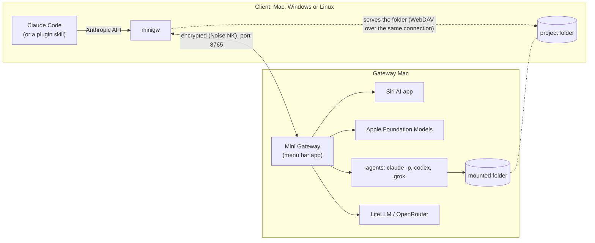
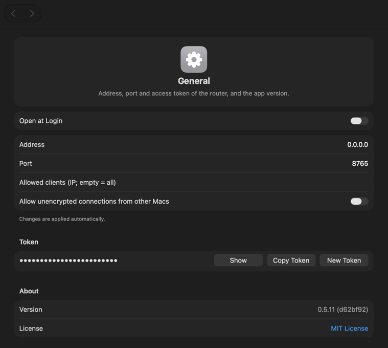
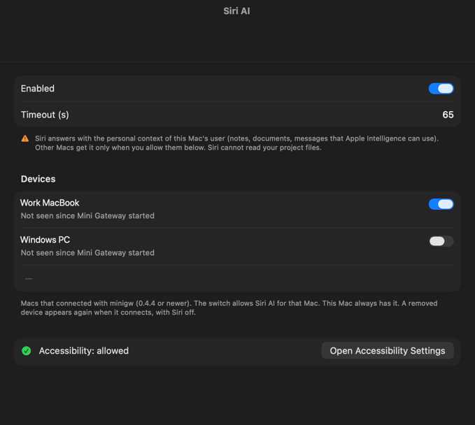
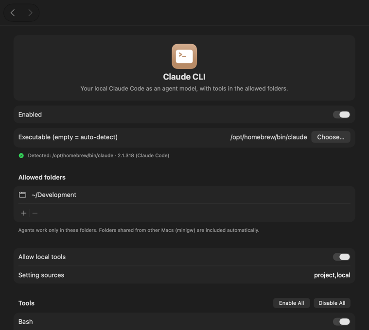
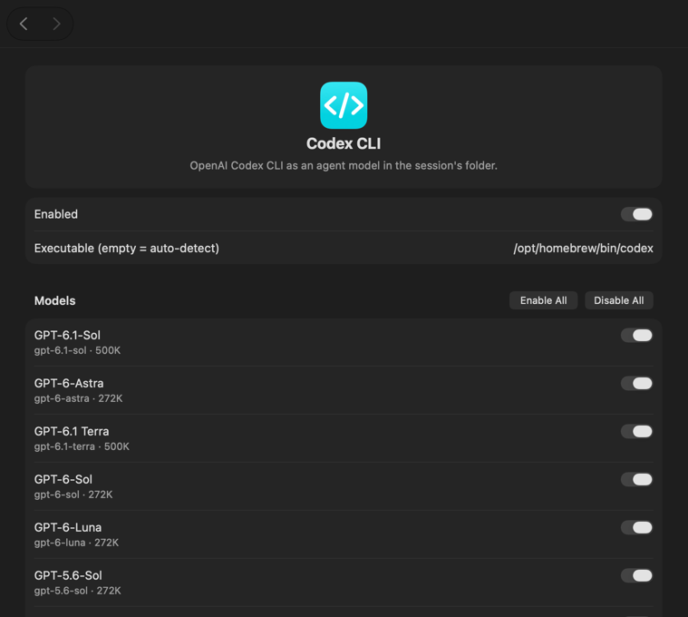

# Mini Gateway 

A macOS menu bar LLM gateway compatible with the [Claude Code](https://claude.com/claude-code) CLI. One endpoint for several models:
the **Siri AI** app, **Apple Foundation Models** (on-device), the **Claude Code CLI**, **Codex** and **Grok** as agents,
and any Anthropic-compatible upstream such as **LiteLLM** or **OpenRouter**. The gateway runs on a Mac (or, without Siri and Apple
models, on Windows or Linux); the `minigw` client runs on macOS, Windows and Linux. Pick a model with `/model`, or give each Claude Code subagent its own.

**Why.** Sometimes you want a second opinion: a review by Codex, a quick check by Grok, an answer from a local model
or from Siri, without leaving Claude Code. And sometimes Claude has to share the work: Mini Gateway was inspired by
a Claude Ultra plan that used up 100% of its weekly quota on day 2. Routine tasks can go to other or local models,
so Claude stays free for the work that needs it.

## Contents

- [1. What it does](#1-what-it-does)
- [2. Requirements](#2-requirements)
- [3. Install](#3-install)
  - [3.1 With the Claude Code plugin](#31-with-the-claude-code-plugin)
  - [3.2 Other ways to install](#32-other-ways-to-install)
    - [3.2.1 Gateway Mac: DMG or Homebrew](#321-gateway-mac-dmg-or-homebrew)
    - [3.2.2 Client on another Mac](#322-client-on-another-mac)
    - [3.2.3 Client on Windows and Linux](#323-client-on-windows-and-linux)
    - [3.2.4 Gateway on Windows or Linux without the plugin (minigw serve)](#324-gateway-on-windows-or-linux-without-the-plugin-minigw-serve)
- [4. Use](#4-use)
- [5. Gateway settings](#5-gateway-settings)
- [6. Security notes](#6-security-notes)
- [7. Build from source](#7-build-from-source)
- [8. Disclaimer](#8-disclaimer)
- [9. Credits](#9-credits)
- [10. License](#10-license)

## 1. What it does



Claude Code talks to `minigw`, which forwards every request to the gateway over one encrypted connection. The gateway
picks the provider by model name. For agent models `minigw` also shares the current folder: the gateway mounts it
and the agent works on your files, while they stay on the client.

| Model in `/model` | Provider | Notes |
|---|---|---|
| `claude-siri-ai` | Siri AI app (macOS 27) | Driven through Accessibility, in the background. Conversation only, no tools. Keeps a real Siri thread per Claude Code conversation. **Privacy:** Siri answers with the personal context of the gateway Mac's user (notes, documents), so other Macs get it only when you allow the device (Settings → Siri AI → Devices; minigw 0.4.4 or newer proves its device key over the encrypted connection). This Mac always has it. It cannot read folders itself: files you mention (`@CLAUDE.md`, or names like “CLAUDE.md”, “kb” that exist in the session folder) are found by the gateway and added to the question as text (up to 16 KB; names extracted on-device with Apple Foundation Models). Images and PDFs (up to 4) are attached in the Siri app itself, so Siri reads them. |
| `claude-apple-fm` | Apple Foundation Models | On-device, streaming, ~8K context (history trimmed automatically). No tools. |
| `claude-foundry-<model>` | [Foundry Local](https://github.com/microsoft/Foundry-Local) (Windows, Linux, Mac) | On-device models of Microsoft Foundry Local, off by default (Settings → Foundry Local). Conversation only, streaming; images for models that take them. The gateway finds the local server (`foundry server status`), starts it when needed and loads the model. |
| `opus`, `sonnet`, `haiku`, `fable` | `claude -p` | Runs your local Claude Code as an agent in the session's folder; sessions resume with `--resume`. Listed in `/model` as `claude-cli-*`; `claude-chat-*` = no tools. Tools: read-only by default; **Allow local tools** (Settings → Claude CLI) gives every Claude Code tool on the gateway Mac (commands, builds), with a table to exclude single tools. Files stay in the session folder and the allowed folders: file tools are refused outside them, and commands run in Claude Code's sandbox (no reads of the home folder, writes only in these folders, network allowed). |
| `claude-codex`, `claude-codex-<model>` | `codex exec` (OpenAI Codex CLI) | Off by default (Settings → Codex CLI). One entry per enabled Codex model of your account (model table, allowed folders and sandbox switches in Settings → Codex CLI). Runs Codex as an agent in the session's folder, like `claude -p`. Its sandbox writes only to that folder and the allowed folders. Within a conversation Codex continues its own thread (`codex exec resume`), also after `minigw -c` or `--resume`. |
| `claude-grok`, `claude-grok-<model>` | `grok -p` (xAI Grok Build CLI) | Off by default (Settings → Grok CLI). Agent in the session's folder; Grok's kernel sandbox (`workspace`) limits writes to that folder, or `read-only`. Within a conversation Grok continues its own session (`-r`). |
| `claude-copilot`, `claude-copilot-<model>` | `copilot -p` (GitHub Copilot CLI) | Off by default (Settings → Copilot CLI). `claude-copilot` uses Copilot's default (`auto`); list other models by name (Copilot has no model list). Copilot always runs in a sandbox (on the Mac a `sandbox-exec` profile, on Linux bwrap) with a fresh Copilot home for each request, deleted afterwards. It only reads the session's folder unless **Allow writing** is on (then it edits files there). No commands unless **Allow commands** together with **Allow writing** (confirmed) and a dedicated GitHub token: a fine-grained personal access token with only the Copilot Requests permission (`minigw gw copilot token`, or Settings); `gh` and `security` stay denied. No GitHub MCP server, no temporary folder of this computer, no `--add-dir`. It signs in with that token, which the Mac app needs for every request (never the GitHub CLI's sign-in, which other agents could read); `minigw serve` on Linux may also use the GitHub CLI's (`gh auth login`), and on Windows this user's own `copilot login` and `~/.copilot`. Commands can use the token to make Copilot requests on your account. Within a conversation Copilot continues its own session (`--session-id`). |
| discovered models | LiteLLM, OpenRouter or any Anthropic-compatible provider | Pure passthrough (tools, streaming). Add as many providers as you like, each with its own key. Models and context windows are discovered from the upstream; enable the ones you want. |

The gateway speaks the Anthropic Messages API (`/v1/messages`, `/v1/models`, `count_tokens`), so Claude Code
sees it as a regular LLM gateway. Only models that were verified to work are listed.

## 2. Requirements

- Gateway: macOS 27 on Apple Silicon, or Windows or Linux with `minigw serve` (no Siri or Apple models)
- Client (`minigw`): macOS, Windows or Linux, with Claude Code (`claude`) in your `PATH`
- Optional on the gateway Mac, for their providers: Claude Code, the **Siri AI** app, [Codex CLI](https://github.com/openai/codex),
  Grok CLI, GitHub Copilot CLI, a LiteLLM or OpenRouter account

## 3. Install

Mini Gateway has two parts: the **gateway** (on one computer) and the **client** `minigw` (on every computer that
uses it, the gateway computer included). The gateway is the menu bar app on a Mac, or `minigw serve` on Windows or
Linux (without Siri and Apple models). The default way to install both is the Claude Code plugin.

### 3.1 With the Claude Code plugin

1. Install Claude Code if you don't have it yet (`brew install --cask claude-code`, or
   `curl -fsSL https://claude.ai/install.sh | bash`) and sign in once by running `claude`.
2. In Claude Code (2.1.275 or later), add this repository as a plugin marketplace and install the plugin:

   ```
   /plugin marketplace add gh-commiter/mini-llm-gateway
   /plugin install minigw@mini-gateway
   ```

3. On the gateway computer:

   ```
   /minigw:gw install
   ```

   - **Mac:** installs the Mini Gateway app with Homebrew (it asks first) and turns on Open at Login.
   - **Windows:** installs `minigw serve` with the tray icon and starts it at sign-in. Or use the Windows installer
     (MSI) instead ([3.2.4](#324-gateway-on-windows-or-linux-without-the-plugin-minigw-serve)).
   - **Linux:** installs `minigw serve` as a systemd user unit. It starts at boot when linger can be turned on,
     otherwise at sign-in. The skill then shows the one `sudo` line that turns linger on.

   It also connects the gateway computer's own `minigw` to the gateway. `/minigw:gw status` shows the same
   summary on every system: running, version, autostart, devices, providers.
4. On every other computer:

   ```
   /minigw:connect <gateway> <token>
   ```

   `/minigw:gw token` on the gateway prints the token (on the Mac also **Settings… → General → Copy Token**).
   A Windows or Linux gateway refuses a new device until you allow it there: `/minigw:gw devices` shows it, and
   the skill asks you to compare the ID before it allows the device.

The plugin brings its own `minigw` on macOS, Windows (Git Bash) and Linux. At session start it uses an installed
one or downloads it from the latest release into its data folder, and checks the SHA-256 (on macOS also the
Developer ID signature). When the installed gateway is older than the release, the session start shows one line
with `/minigw:gw update`. Nothing is updated without you: an update stops the agent requests that run on the
gateway. The session itself does not have to run through the gateway, so it works with your normal Claude login,
Remote Control and so on.

| Skill | Model | Use |
|---|---|---|
| `/minigw:ask [--ro] <model> <question>` | any gateway model | Ask a specific model (`/minigw:models` lists them) |
| `/minigw:review [--rw] [what]` | `claude-codex-gpt-6-astra` | Independent review of the current changes, a plan or a bug analysis (folder read-only unless `--rw`) |
| `/minigw:codex [--ro] <task>` | `claude-codex-gpt-6.1-sol` | Hand a self-contained task to Codex in the current folder (`--ro`: read-only) |
| `/minigw:siri <question>` | `claude-siri-ai` | Questions about the gateway Mac's personal context (Siri must be allowed for the device) |
| `/minigw:on-device <text>` | `claude-apple-fm` | Short private answers on-device |
| `/minigw:gw install\|update\|uninstall\|status` | – | The gateway on this computer; also `devices`, `provider`, `claude`, `token`, `settings` |
| `/minigw:status` | – | Connection and available models |
| `/minigw:models` | – | Gateway models, grouped by provider |
| `/minigw:version` | – | Versions of minigw, Claude Code and the plugin |
| `/minigw:connect [--name <profile>] <gateway> <token>` | – | One-time connection to a gateway; `--name` adds another one as a profile |
| `/minigw:share [folder]` | – | Share a folder that minigw does not share by itself, such as a system folder |

Claude can also pick these skills by itself when they fit the request.

### 3.2 Other ways to install

Optional. Each of these does part of what the plugin does.

#### 3.2.1 Gateway Mac: DMG or Homebrew

1. Download `Mini-Gateway-<version>.dmg` from [Releases](../../releases) (signed with Developer ID and notarized;
   a `.zip` is there too, checksums in `SHA256SUMS`).
2. Open the DMG, drag **Mini Gateway** to **Applications** and open it. It lives in the menu bar.
3. **Settings… → Claude CLI → Install** puts the `minigw` command in your `PATH` and connects it.

With Homebrew instead of the DMG (add the tap once):

```sh
brew tap gh-commiter/mini-gateway https://github.com/gh-commiter/mini-llm-gateway
brew trust --tap gh-commiter/mini-gateway
brew install --cask gh-commiter/mini-gateway/mini-gateway
```

Then **Settings… → Claude CLI → Install** for `minigw`. The cask also installs Claude Code (`claude-code`) if it is
not installed yet.

#### 3.2.2 Client on another Mac

One command installs Claude Code (with Homebrew if present, otherwise the native installer) and the signed `minigw`
command into your `PATH`:

```sh
curl -fsSL https://github.com/gh-commiter/mini-llm-gateway/releases/latest/download/install.sh | sh
```

To connect in the same step, add the gateway's name or address. The script then asks for the token:

```sh
curl -fsSL https://github.com/gh-commiter/mini-llm-gateway/releases/latest/download/install.sh | sh -s -- mini.local
```

The script checks the download against `SHA256SUMS` and the Developer ID signature before installing.

With Homebrew (tap as above; also installs Claude Code if missing):

```sh
brew install --cask gh-commiter/mini-gateway/minigw
```

#### 3.2.3 Client on Windows and Linux

For Windows and Linux `minigw` is a single executable without dependencies (`client/`, Go standard library only),
in [Releases](../../releases):

| System | File |
|---|---|
| Windows x64 / ARM64 | `minigw-windows-amd64.exe` / `minigw-windows-arm64.exe` |
| Linux x64 / ARM64 | `minigw-linux-amd64` / `minigw-linux-arm64` (static, any distribution) |

Check that `SHA256SUMS` is signed by Mini Gateway and the file matches it, rename it to `minigw` (`minigw.exe` on
Windows) and put it in your `PATH`. Linux:

```sh
R=https://github.com/gh-commiter/mini-llm-gateway/releases/latest/download
curl -fsSLO $R/minigw-linux-amd64 -O $R/SHA256SUMS -O $R/SHA256SUMS.sig
echo 'minigw-release namespaces="minigw-release" ssh-ed25519 AAAAC3NzaC1lZDI1NTE5AAAAINt++OHn+HHmR9mmA2UI+B0osuilO2GP0ddEzNp0GTrH' > signers
ssh-keygen -Y verify -f signers -I minigw-release -n minigw-release -s SHA256SUMS.sig < SHA256SUMS
grep ' minigw-linux-amd64$' SHA256SUMS | sha256sum -c -
mv minigw-linux-amd64 minigw && chmod +x minigw && sudo mv minigw /usr/local/bin/
```

The plugin, `install.sh` and `minigw serve install` check this signature themselves: `SHA256SUMS` is signed with a
key that is not on GitHub, so a changed release is refused.

Windows (PowerShell; `ssh-keygen` comes with Windows 10 and later; the same steps check the MSI,
`minigw-windows-amd64.msi`). `cmd /c` passes `SHA256SUMS` unchanged, which a PowerShell pipe would not:

```powershell
cd $HOME
$R = "https://github.com/gh-commiter/mini-llm-gateway/releases/latest/download"
foreach ($f in "minigw-windows-amd64.exe", "SHA256SUMS", "SHA256SUMS.sig") { Invoke-WebRequest "$R/$f" -OutFile $f }
Set-Content signers 'minigw-release namespaces="minigw-release" ssh-ed25519 AAAAC3NzaC1lZDI1NTE5AAAAINt++OHn+HHmR9mmA2UI+B0osuilO2GP0ddEzNp0GTrH' -Encoding ascii
cmd /c "ssh-keygen -Y verify -f signers -I minigw-release -n minigw-release -s SHA256SUMS.sig < SHA256SUMS"
(Get-FileHash minigw-windows-amd64.exe -Algorithm SHA256).Hash.ToLower()   # must match its line in SHA256SUMS
Rename-Item minigw-windows-amd64.exe minigw.exe
```

Then connect once with the gateway's token (quote it, it contains `#`):

```sh
minigw connect mini.local --token '<token>'
minigw connect hpx360.local --name win --token '<token>'   # a second gateway as profile "win" (both stay)
```

The connection is stored in Windows Credential Manager, on Linux in `~/.config/minigw/connection.json` (mode 0600),
other profiles under `minigw:router:<profile>` and `connections/<profile>.json`
([Several gateways at once](#4-use)).
All clients encrypt with AES-256-GCM; the Mac gateway also accepts ChaCha20-Poly1305 from older macOS clients.

#### 3.2.4 Gateway on Windows or Linux without the plugin (minigw serve)

`minigw serve` turns a Windows or Linux computer into a small gateway: `claude -p` on that computer as
`claude-cli-opus`, `claude-cli-sonnet` and `claude-cli-haiku`, Codex and Grok (off by default), plus providers; no
Siri or Apple models. Agents work in a synced copy of the client's folder or, for a git repository, in a clone on a
branch (worktree mode), so clients run with `MINIGW_WORK=sync`, `worktree` or `auto` (folder mounts, native mode and
`minigw run` need the Mac gateway). Install Claude Code there (on Windows the native `claude.exe`; `minigw serve`
does not run `claude.cmd`).

`/minigw:gw install` runs these two commands. `minigw serve install` copies minigw to a fixed place, adds it to
PATH and starts the gateway now and at sign-in, all without admin rights. On Windows it installs to
`%LocalAppData%\Programs\Mini Gateway` (with the tray icon; downloaded and checked against the release's
`SHA256SUMS` if `minigw-tray*.exe` is not next to `minigw.exe`). On Linux it installs to `~/.local/bin` with a
systemd user unit, and turns on linger (`loginctl enable-linger`, or `sudo -n` without a password) so the gateway
starts at boot; if neither works it prints the `sudo` line. Run it again to update; `minigw serve uninstall` removes
it and keeps the config and keys.

```sh
minigw serve init            # creates the config with a new token and gateway key, prints the minigw connect line
minigw serve install         # install, start now and at boot or sign-in
minigw serve                 # or run it in this terminal: port 8765; --port, --folder, --config
```

On each client run the printed `minigw connect` line. The first connect from a new device is refused and the gateway
log shows `minigw serve allow <id> "<name>"`. Anyone with the token can try to connect, so compare the ID with the
device you just connected before you allow it. `minigw gw devices` lists the allowed devices and the ones
waiting, `minigw gw devices deny <id or name>` removes one.

**Windows tray.** `minigw-tray-windows-amd64.exe` (or `-arm64.exe`) is the same gateway with an icon in the
notification area instead of a console window. On first start it creates the config. Its menu shows the status,
devices waiting for approval (Allow / Deny, with a notification when one appears), **Settings…**, **Copy connect
line**, **Start at sign-in**, the log (`minigw-serve.log` in the config folder) and Quit. `minigw serve install` sets
it up.

**Windows installer (MSI).** Instead of the two commands, download `minigw-windows-amd64.msi` (or `-arm64.msi`) from
the [latest release](https://github.com/gh-commiter/mini-llm-gateway/releases/latest) and open it. It installs for
this user only, without admin rights, the same as `minigw serve install`: `minigw.exe` and `minigw-tray.exe` in
`%LocalAppData%\Programs\Mini Gateway`, minigw on your PATH, a Start menu entry, and the tray at sign-in. It then
starts the tray, which creates the config on first start; copy the connect line from its menu. Running a newer MSI
updates it. Remove it in Settings → Apps (not with `minigw serve uninstall`); the config and keys stay. The MSI is
not code-signed yet, so SmartScreen warns: **More info → Run anyway**. Check it first against the signed
`SHA256SUMS`, as in [3.2.3](#323-client-on-windows-and-linux). The ARM64 package needs Windows 11.

**Settings page.** **Settings…** opens `http://127.0.0.1:<port>/minigw/settings` in the browser with a one-time
link (60 s). It has the panes of the Mac's Settings window ([5. Gateway settings](#5-gateway-settings)), light or dark
as the system. Changes apply at once. On Linux, `minigw gw settings` prints such a link; open it on the gateway computer or
through `ssh -L <port>:127.0.0.1:<port>` with the same port on both ends (the page checks the port). With the Windows
tray, **Choose…** next to Allowed folders and **Browse…** next to a program's path open the Windows file dialog on the
gateway computer; elsewhere you type the path.

**Changing the gateway.** `minigw gw status|devices|provider|claude|token` (also as `minigw serve allow`, `deny`,
`devices`, `provider`) changes the running gateway at once, through its admin API; when it does not run, it changes
`serve.json`. Port and address need a restart. `minigw gw token rotate` makes a new token and prints the new
connect line for the clients. The admin API ([docs/admin-api.md](docs/admin-api.md)) answers only on this computer,
with the secret in `admin.secret` in the config folder.

The config (`%AppData%\minigw\serve.json`, `~/.config/minigw/serve.json`, mode 0600) holds the token, the gateway key,
the allowed devices and the agent's `tools` (default `Read,Grep,Glob,Edit,Write,MultiEdit`, limited to the copy).
`Bash` runs in Claude Code's sandbox on Linux (needs `bubblewrap` and `socat`); on Windows there is no sandbox, so it
also needs `"allowUnsandboxedBash": true`; agents can then run any command as you and read the provider API keys in
Credential Manager and the admin secret. Connections from the gateway computer itself (loopback) skip the device
check and encryption: do not forward the port to loopback (`ssh -L`, `netsh interface portproxy`, a reverse proxy).

**Providers.** Any Anthropic-compatible upstream (OpenRouter, LiteLLM) works as on the Mac, with the same model names.

```sh
minigw gw provider add openrouter https://openrouter.ai/api  # asks for the API key (or reads it from stdin)
minigw gw provider models openrouter --enable anthropic/claude-sonnet-4.5,openai/gpt-5
minigw gw provider models openrouter haiku                   # enabled models; a text or --all also shows the others
minigw gw provider list                                      # also: provider remove <name>
```

The gateway lists the enabled models with the claude-cli ones and passes requests through unchanged, streaming
included. A provider with more than 20 models starts with none enabled. The URL must be `https`; `http` works only
to localhost or a private IP, with `--insecure`. The API key is never in `serve.json`: it is in Credential Manager
on Windows, in the Secret Service (`secret-tool`) on Linux, or in `gateway-keys.json` (mode 0600) next to
`serve.json` if there is no Secret Service.

## 4. Use

```sh
minigw                                  # Claude Code through the gateway; choose models with /model
minigw --model claude-apple-fm -p "Hi"  # any claude option works
minigw status                           # gateway, providers, number of models
minigw models                           # list available models (<model>@<profile> for other gateways)
minigw connect 192.168.1.20 --token …   # use a gateway on another Mac (--name P adds it as profile P)
```

Subagents can use gateway models too, e.g. `model: claude-siri-ai` in `.claude/agents/<name>.md`.

**Several gateways at once (profiles).** One client can use, for example, the Mac mini and a Windows gateway in the
same session:

```sh
minigw connect mini.local --name mini --token -     # each gateway is a profile
minigw connect hpx360.local --name win --token -
minigw profiles                                     # list; * marks the default
minigw profiles default mini                        # its models also appear without a suffix
minigw --model claude-cli-opus@win -p "…"           # <model>@<profile> runs on that gateway
minigw --minigw-profile win …                       # this command uses only that gateway
minigw disconnect --name win
```

- The connection you had before is the profile `default`; nothing changes while it is the only one.
- With several profiles, `minigw` puts a local proxy on `127.0.0.1` (with its own token) in front of Claude Code. It
  sends `<model>@<profile>` to that gateway without the suffix. `/model` and `minigw models` list every reachable
  gateway's models; one that cannot be reached is left out, and `minigw status` shows it.
- The folder is shared with another gateway only when that gateway gets its first request for an agent model
  (`claude-cli-*`, `claude-codex*`, `claude-grok*`, `claude-copilot*`), in the same work mode
  (`--minigw-work`). A Windows or Linux gateway needs `--minigw-work=sync` (or `auto`).
- Each profile keeps its own address, token and gateway key: Keychain on the Mac, Credential Manager on Windows
  (`minigw:router:<profile>`), on Linux `~/.config/minigw/connections/<profile>.json` (mode 0600). The device key is
  one per client, so every gateway recognises the same device.

**Another Mac and Claude CLI models with tools.** `opus`, `sonnet`, `haiku` and `fable` run `claude -p` as an agent on
the gateway Mac. When `minigw` talks to a gateway on another Mac, it shares the current folder with it for the length
of the session: the gateway mounts it (built-in WebDAV, through the connection `minigw` opens, so the gateway Mac does
not need to reach the client) and the agent works on your files. Nothing to install on either side. Any project
folder is shared, also outside your home folder (for example `D:\Projects\app` on Windows or `/Volumes/Disk/app`),
but never a drive or volume root, the home folder itself, system folders (`C:\Windows`, `Program Files`, `/usr`,
`/System` …), other users' home folders, `~/Library`, `AppData` or hidden folders such as `~/.ssh`. To share one of
those anyway, run `minigw share add` in it (`minigw share list`, `minigw share remove`); a root is always refused.
The list is per computer: with several profiles every gateway gets the folder on its first agent request.
**Read-only:** `minigw --minigw-ro …` (or `MINIGW_SHARE=ro`, for example in the `env` of Claude Code's settings for the
plugin) shares the folder read-only: minigw refuses every write, the gateway mounts it read-only and runs Codex and
Grok in their read-only sandbox. Agents read files up to 32 MB in one piece (larger ones only in ranges).
The gateway caches folder listings (PROPFIND) for 10 seconds, like davfs2's `dir_refresh`; writes through the mount clear
the cache at once, changes made on the client outside the mount show up within 10 seconds.
The folder's own Claude Code settings and hooks are not loaded on the gateway Mac. Set `MINIGW_SHARE=0` to turn it off.

**Sync instead of a mount (for builds).** `minigw --minigw-work=sync …` (or `MINIGW_WORK=sync`) copies the folder to the
gateway's Scratch folder before each agent request and copies the files the agent changed back after it. Agents and
builds then work on the gateway's local disk.
- **Sent to the gateway:** only changed files, compared by size, time and SHA-256.
- **Never sent, never copied back:**
  - files matched by `.gitignore` or the built-in list (`.git`, `target/`, `.build/`, `node_modules/`, `build/`,
    `dist/`, `DerivedData/` …);
  - files the agent puts into `.git`, `.claude/settings*.json`, `.vscode/tasks.json` or `.envrc`, also through a link
    in your folder (for example `hooks → .git/hooks`): the check uses the real path.
- **The list above is defence in depth, not a sandbox for your folder:** an agent that may write can still add code
  that runs on your computer later, for example in `.husky/`, `.githooks/`, `package.json` scripts, a `Makefile` or
  `.mcp.json`. Review an agent's changes before you run builds or hooks, or share the folder read-only.
- **Conflicts:** if you changed a file the agent also changed, yours stays and the agent's version is saved next to it
  as `<name>.minigw-conflict`.
- **Read-only:** with `--minigw-ro` nothing comes back.
- **The gateway copy is kept between requests,** so the next sync and the next build are incremental.
  A copy that no session used for 14 days is deleted. A folder with more than 100 000 files or 8 GB is refused
  (add build output and large data to `.gitignore`). Copies of all devices are in the gateway's Scratch folder: agents
  that can read every file of the gateway's user (Codex and Grok on the Mac, any agent on Windows) can read them
  too. Keep Scratch on APFS (or NTFS, ext4): exFAT ignores the folder's private permissions.
- **Names:** files whose names differ only in upper and lower case (`A.txt` and `a.txt`) are not synced, with a note.
  Accented names travel in NFC, as Windows and Linux write them; the Mac finds a file under either form. A Linux
  folder that holds the decomposed (NFD) form of a name may get a second, NFC copy of that file back.
- **Agents in the same folder run one after another.**

**Worktree: a git repository, results as branches.** `minigw --minigw-work=worktree …` (or `MINIGW_WORK=worktree`) sends
the repository to a mirror in the gateway's Scratch folder (git bundles over the encrypted connection, only missing objects)
and gives each agent its own clone on a branch `minigw/<agent>-<session>-<n>`; parallel agents get separate branches.
- **Your exact state:** the agent starts from `HEAD` plus your uncommitted changes and your untracked files that are not
  ignored: **those files are sent to the gateway** too, saved as a commit "minigw: your uncommitted changes" with a
  temporary index. Your index, branches and files are not changed.
- **Results come back as branches only:** after each request the gateway commits what the agent left uncommitted and minigw
  fetches the branch into your repository (`git log minigw/…`). It is never checked out; the fetch takes only a git bundle,
  checks objects (fsck), runs no hooks, submodules or filters, and does not change `.git/config`. If you committed on that
  branch yourself, your commits stay and the agent's version is not fetched. The gateway never runs git with the agent's own
  `.git` (config, hooks) and reads the clone only from a sandbox.
- **Review the branch before you check it out or build it:** it is the agent's work. Look at `.gitattributes` (filter
  and diff drivers you have configured would run on checkout) and `.gitmodules` (submodule URLs) first.
- **Sandboxed agents:** Claude CLI agents get Bash, always in Claude Code's sandbox; Codex uses its own sandbox with the
  clone as the writable folder (not when Codex may not write: then worktree mode is refused). Grok is not supported in
  worktree mode yet (use sync). They write only to the clone, their own Maven repository (`MAVEN_OPTS`), DerivedData and
  temporary folders, never to your `~/.m2` settings, plugins or SwiftPM configuration; Claude cannot read your home
  folder (from `~/.m2` only `settings.xml` and `toolchains.xml`). Agents have their own temporary folder and module
  cache in the clone, never the shared ones of this Mac. Maven builds work; `swift build` and `xcodebuild` by an agent
  may fail there (the Swift build service needs this Mac's temporary folder): build Swift and Xcode projects with
  `minigw run` or in sync mode. Network for builds: on for Claude (its sandbox hides your files), off for Codex (it can read all your files);
  Settings → General → Worktree mode. The Scratch folder must not be a temporary or build cache folder; mirrors unused for
  30 days are removed.
- **`--minigw-work=auto`:** read-only (`--minigw-ro`) → direct; a folder on the gateway's SMB share → native; a git
  repository → worktree, then sync (never direct read-write: `.git` is not protected there); otherwise sync, then direct.
  A saved per-folder mode (`minigw share add --work=…`) and the flag still win.
- **On `minigw serve` (Windows, Linux)** worktree works the same way: the gateway's own `git` from PATH (no system or global
  config, hooks, fsmonitor or submodules), one clone per session and agent (requests of a session run one after another,
  so there is one branch `minigw/<agent>-<session>-0`). On Linux Codex and Copilot run under bwrap with the clone writable
  and its `.git/config`, `hooks` and `info` read-only; Claude CLI in Claude Code's sandbox; on Windows the usual rule
  ("Allow commands without a sandbox"). The settings for build network (Settings → General → Worktree mode) exist only on
  the Mac. Native mode and `minigw run` stay Mac-only.

**Native: the folder is the gateway's own SMB share.** When the client works in an SMB mount of a gateway share (for
example `/Volumes/Java/projects` mounted from the gateway's `/Volumes/Java`), `minigw --minigw-work=native …`
(or `MINIGW_WORK=native`) lets agents work directly in the gateway's folder: no mount back, no copy.
`minigw run -- mvn -q verify` runs a build there and streams its output and exit code back.
- **Mode per folder:** `minigw share add --work=native` (or `sync`, `direct`, with `--ro` for read-only) in a folder
  saves its default mode for it and its subfolders in minigw's share list (never in the project); `minigw share list`
  shows it. `--minigw-work=` or `MINIGW_WORK` still wins for one run. `minigw run` uses the default profile, or
  `--minigw-profile P`.
- **Proof, not a path:** minigw sends the share name and the path under it; the gateway writes a check file with random
  content into its folder, and minigw must read it back through its mount. A folder with the same path elsewhere fails.
  The check is for correctness (the same folder), not a permission: permission comes from the token, the device, the
  share and the allowed folders.
- **Only allowed folders:** the folder must be in a writable SMB share of the gateway (System Settings → Sharing) and
  inside its **Allowed folders**; the gateway checks it again on every request. Agents keep the same sandbox and folder
  rules.
- **Like `direct`:** the agent can change every file in the folder, also `.git`, `.claude/settings*.json` and
  `.vscode/tasks.json`. Use `sync` for a folder where those must stay protected. Native cannot be read-only:
  `--minigw-ro` (or a saved `--ro`) uses the read-only mount instead.
- **`minigw run` is off by default:** turn it on per device in **Settings → General → minigw run**, or with the admin
  API (`PATCH /run`). Only the listed commands run (default `mvn, swift, xcodebuild`), without a shell, at most two at
  a time per device. It is outside the agent sandbox: the build runs the project's code with your rights on the gateway.
  The run sandbox below reduces what a build can do, but it is defence in depth, not a security boundary: enable
  `minigw run` only for devices you would trust with your user account on the gateway. A sandbox (`sandbox-exec`) lets it write only to the folder (not its `.git`), `~/.m2`
  (not `settings*.xml`, `extensions.xml`), `~/Library/Developer` (not `~/Library/Caches`), SwiftPM's folders (not their
  configuration, repository `config` and `hooks`) and temporary folders, and hides `~/.ssh`, `~/.aws`, `~/.gnupg`,
  `~/.netrc`, `~/.git-credentials`, `~/.npmrc`, `~/.pypirc`, `~/.gradle/gradle.properties`, shell histories, `~/.config`,
  `~/.docker`, `~/.kube`, the keychains, cookies, `~/Library/Application Support`, `Containers`, `Group Containers`,
  `Mail`, `Messages`, Mini Gateway's Scratch folder and preferences (rules cover the resolved paths of links too). The
  gateway refuses the run when the folder or one of the writable folders is a link. Unix sockets are blocked (only DNS
  and syslog are allowed), so a build cannot reach Docker (`docker run -v $HOME …`) or an SSH agent, and the gateway's own
  port is always blocked. Network is on per device (switch it off in Settings or with `"denyNetwork"`); off is best
  effort: it blocks direct connections and `nsurlsessiond`, but another system service could still reach the network
  for the build. The sandbox also blocks writing preferences, reading
  Mini Gateway's, creating launchd jobs, opening apps and sending Apple events. A sandbox inside it is not possible, so the gateway runs `swift build|test|run|package` with
  `--disable-sandbox` and `xcodebuild` without its package and script sandboxes. Stopping minigw stops the whole
  process group. In a terminal minigw shows only colours from the output, no other escape sequences.
- If the folder is not a gateway share, minigw falls back to the usual mount. On Linux (cifs) and Windows (UNC path or
  mapped drive) detection is automatic; elsewhere set `MINIGW_NATIVE_MOUNT=<share>=<mount folder>`. The Go gateway
  (`minigw serve`) does not support native yet.

## 5. Gateway settings

Settings of the menu bar app on the gateway Mac (**Settings…**, laid out like System Settings). On Windows and Linux
the settings page of `minigw serve` has the same panes, without Siri AI and Apple Foundation Models. Open it with **Settings…** in the tray or `/minigw:gw settings`. [docs/windows-parity.md](docs/windows-parity.md)
lists every control on both. Client options (`minigw share`, `--minigw-work`, `--minigw-ro`) are in [4. Use](#4-use).

- **General** – listen address and port (default `127.0.0.1:8765`; `0.0.0.0` for other computers), access token,
  scratch folder (agents' temporary files; another folder moves them, for example to a fast SSD), and About.
  Mac only: **Worktree mode** (network for builds, network for Codex builds) and **minigw run** (which Macs may run
  builds in a folder of this Mac's SMB share, each with or without network).
- **Providers** (LiteLLM, OpenRouter or any other Anthropic-compatible one) – name, base URL, API key, and a switch
  per discovered model. **+ / −** under the sidebar adds or removes providers.
- **Siri AI** (Mac) – off by default; turning it on asks for Accessibility permission. Privacy note and the devices
  that may use Siri (this Mac always may).
- **Apple Foundation Models** (Mac) – on-device model and its instructions.
- **Foundry Local** – off by default; Microsoft's on-device models, their switches and instructions.
- **Claude CLI** – path to `claude`, allowed folders, **Allow local tools** with a table to exclude tools; install or
  download `minigw`. On Windows also **Allow commands without a sandbox**. With the Windows tray, **Browse…** and
  **Choose…** open the file dialog.
- **Codex CLI** / **Copilot CLI** / **Grok CLI** – off by default; models, and switches for writing and network
  (Copilot: also commands, with its own GitHub token).
- **Devices** – the computers that use this gateway; on the Mac also allowed client IPs and unencrypted connections
  (on the settings page they are under General). On the Mac every
  device with the token is added on its own (**Copy ID**, last seen); on Windows and Linux a new device waits until
  you allow it.

<table>
<tr><td></td>
<td></td></tr>
<tr><td></td>
<td></td></tr>
</table>

Changes apply immediately. Keys and the access token are stored in the Keychain, settings in
`~/Library/Preferences/dev.trojar.minigateway.plist`.

**From the command line.** `minigw gw status|devices|provider|claude|copilot token|autostart|token` changes the same settings on this
Mac, with the same commands as on Windows and Linux (`minigw gw help`), for example
`minigw gw provider add Lab https://gw.example` (the key comes from stdin or a hidden prompt) or
`minigw gw provider models OpenRouter --enable anthropic/claude-sonnet-4.5`. The app must be running; the
Settings window shows the change at once. The first time, macOS asks whether `minigw` may use the app's Keychain
item (the admin secret); `minigw` talks to the app only after the app proves its gateway key. The API is in
[docs/admin-api.md](docs/admin-api.md).

## 6. Security notes

- Every request needs the gateway's token; the server listens only on `127.0.0.1` unless you change it.
- The Claude CLI provider runs `claude -p` with tools in the client's folder: it only runs inside the allowed
  folders and uses the tools and permission mode you configure (default: read-only, `dontAsk`).
- Between `minigw` and a gateway on another Mac everything is encrypted (WireGuard-style: Noise NK with Curve25519
  and ChaCha20-Poly1305). **Copy Token** includes the gateway's public key, so `minigw` only talks to that gateway.
  Unencrypted connections are accepted only from the gateway Mac itself, unless you turn on
  **Allow unencrypted connections from other Macs** (for other clients, on a trusted network).
- With a remote gateway, `minigw` gives the gateway Mac read and write access to the current folder while it runs
  (nothing outside it). Use it only with a gateway Mac you trust.
- The gateway Mac mounts a shared folder with macOS's own WebDAV client. The mount URL contains a secret that local
  processes can see (`mount`, `ps`), so the gateway serves a mount only to the system `webdavfs_agent` process that
  its own mount started: an agent or another local user with the URL is refused.
- The Siri provider uses Accessibility UI automation of the Siri AI app. It only touches that app, but
  Accessibility is a powerful permission.

## 7. Build from source

```sh
./build.sh            # build, sign (Developer ID if available, else Apple Development)
./build.sh --test     # run tests first
./build.sh --release  # Developer ID + notarization + staple → build/release/Mini-Gateway-<version>.{dmg,zip}
```

`--release` needs a *Developer ID Application* certificate and a notarytool profile:

```sh
xcrun notarytool store-credentials minigateway-notary --key AuthKey_XXXX.p8 --key-id XXXX --issuer <issuer-id>
```

Set `SIGN_IDENTITY` or `NOTARY_PROFILE` to override the defaults. The app icon is drawn by
`swift scripts/make-icon.swift`.

## 8. Disclaimer

Mini Gateway is provided **"AS IS", without warranty of any kind**, express or implied. Use it at your own risk.
The authors are not liable for any damage, data loss, costs (for example API usage billed by a provider) or other
claims arising from its use. Mini Gateway is an independent project and is not affiliated with or endorsed by
Apple, Anthropic, OpenAI, xAI, BerriAI or OpenRouter. The Siri provider automates the Siri AI user interface, which
has no public API and may change with any macOS update. Siri and Apple are trademarks of Apple Inc.; Claude is a
trademark of Anthropic, PBC; Codex and OpenAI are trademarks of OpenAI; Grok is a trademark of xAI.

## 9. Credits

Mini Gateway only connects tools that others built:

- [Anthropic](https://www.anthropic.com): [Claude Code](https://claude.com/claude-code) and the Claude models. Claude Code
  is the client the whole project is made for, and Claude wrote all of the code.
- [OpenAI](https://openai.com): [Codex CLI](https://github.com/openai/codex).
- [xAI](https://x.ai): Grok CLI.
- [GitHub](https://github.com): [Copilot CLI](https://github.com/github/copilot-cli).
- [Apple](https://www.apple.com): the Siri AI app and the [Foundation Models](https://developer.apple.com/documentation/foundationmodels) framework.
- [LiteLLM](https://github.com/BerriAI/litellm) by BerriAI and [OpenRouter](https://openrouter.ai): upstream model providers.
- [The Noise Protocol Framework](https://noiseprotocol.org) by Trevor Perrin: the encrypted connection between `minigw` and the gateway.

Thank you to everyone behind these projects for making them available. Mini Gateway would not exist without them.

## 10. License

[MIT](LICENSE)
