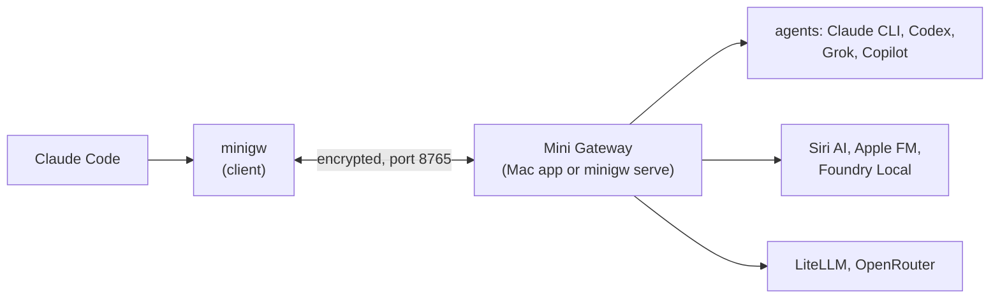
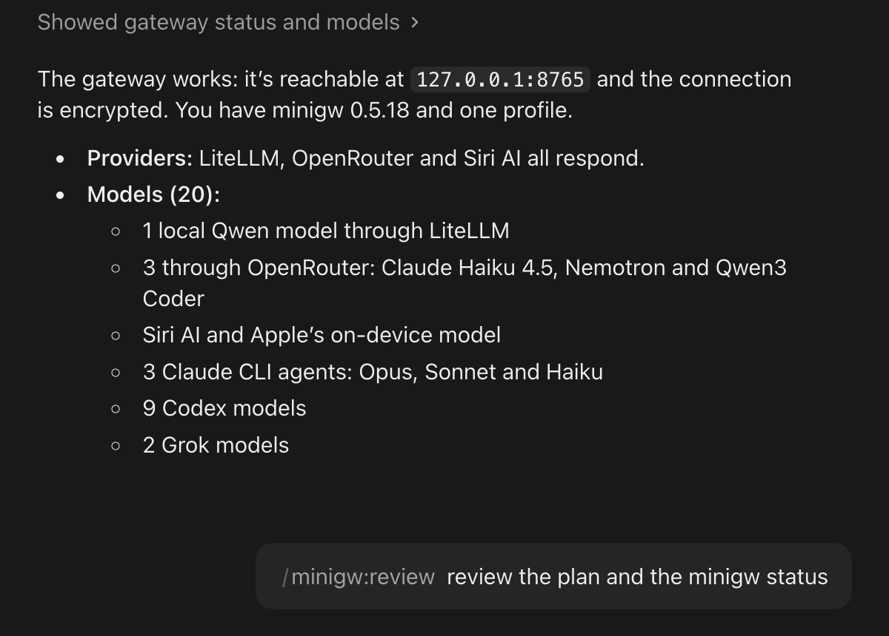

# Mini Gateway 

An LLM gateway compatible with the [Claude Code](https://claude.com/claude-code) CLI. One endpoint for several
models: the **Claude Code CLI**, **Codex**, **Grok** and **Copilot** as agents, the **Siri AI** app and **Apple
Foundation Models** on a Mac, **Foundry Local** on-device models, and any Anthropic-compatible upstream such as
**LiteLLM** or **OpenRouter**.

The gateway runs as a menu bar app on a Mac, or as `minigw serve` on Windows and Linux (without Siri and Apple
models). The `minigw` client runs on macOS, Windows and Linux. Pick a model with `/model`, give a subagent its own,
or call one from a plugin skill.

**Why.** Sometimes you want a second opinion: a review by Codex, a quick check by Grok, an answer from a local model
or from Siri, without leaving Claude Code. And sometimes Claude has to share the work: Mini Gateway was inspired by
a Claude Ultra plan that used up 100% of its weekly quota on day 2. Routine tasks can go to other or local models,
so Claude stays free for the work that needs it.

## How it fits together



Claude Code talks to `minigw`, which forwards every request to the gateway over one encrypted connection. The
gateway picks the provider by the model name. For agent models `minigw` also brings the current folder to the
gateway, so the agent works on your project while your files stay on your computer. In a git repository the agent's
work comes back as a branch for you to review. Details: [docs/how-it-works.md](docs/how-it-works.md).

| Model | Provider |
|---|---|
| `claude-cli-opus`, `-sonnet`, `-haiku`, `-fable` | Claude Code on the gateway, as an agent with tools |
| `claude-codex`, `claude-codex-<model>` | OpenAI Codex CLI, as an agent |
| `claude-grok`, `claude-grok-<model>` | xAI Grok Build CLI, as an agent |
| `claude-copilot`, `claude-copilot-<model>` | GitHub Copilot CLI, as an agent |
| `claude-siri-ai` | Siri AI app on the gateway Mac (personal context, no tools) |
| `claude-apple-fm` | Apple Foundation Models, on-device |
| `claude-foundry-<model>` | Microsoft Foundry Local, on-device |
| `claude-<id>` | LiteLLM, OpenRouter or any Anthropic-compatible provider |

Codex, Grok, Copilot (Copilot: not on a Windows gateway in this version) and Foundry Local are off until the gateway owner turns them on. More: [docs/usage.md → Models](docs/usage.md#models).

## Requirements

- **Gateway:** macOS 27 on Apple Silicon (the app), or Windows or Linux (`minigw serve`).
- **Client:** macOS 27 on Apple Silicon, Windows or Linux, with Claude Code (`claude`) in your `PATH`.
- **On the gateway, for their providers:** Claude Code, the Siri AI app, [Codex CLI](https://github.com/openai/codex),
  Grok CLI, [GitHub Copilot CLI](https://github.com/github/copilot-cli), Foundry Local, a LiteLLM or OpenRouter account.

## Install

Mini Gateway has two parts: the **gateway** on one computer, and the **client** `minigw` on every computer that uses
it, the gateway computer included. The Claude Code plugin installs both.

1. Install Claude Code if you don't have it yet (`brew install --cask claude-code`, or
   `curl -fsSL https://claude.ai/install.sh | bash`) and sign in once by running `claude`.
2. In Claude Code (2.1.275 or later), add this repository as a plugin marketplace and install the plugin:

   ```
   /plugin marketplace add gh-commiter/mini-llm-gateway#release
   /plugin install minigw@mini-gateway
   ```

   `#release` is the branch that only releases move. Then turn on **Enable auto-update** for `mini-gateway` under
   `/plugin` → **Marketplaces**, so new plugin versions arrive by themselves. `minigw plugin install` and the
   installers set both for you; to turn auto-update off there, set `"autoUpdate": false` under `extraKnownMarketplaces` → `mini-gateway` in `~/.claude/settings.json`.
   To update by hand: `claude plugin marketplace update mini-gateway`, then `claude plugin update minigw@mini-gateway`.

3. On the gateway computer:

   ```
   /minigw:gw install
   ```

   - **Mac:** installs the Mini Gateway app with Homebrew (it asks first) and turns on Open at Login.
   - **Windows:** installs `minigw serve` with the tray icon and starts it at sign-in.
   - **Linux:** installs `minigw serve` as a systemd user unit that starts at boot (or at sign-in; the skill then
     shows the one `sudo` line that changes it).

   It also connects the gateway computer's own `minigw`. `/minigw:gw status` shows the result.
   A Mac gateway listens only on this Mac at first: for other computers set the address to `0.0.0.0` in
   **Settings… → General** ([docs/gateway.md → Network](docs/gateway.md#network-and-firewall)).

4. On every other computer, with the token from `/minigw:gw token` on the gateway (on the Mac also
   **Settings… → General → Copy Token**):

   ```
   /minigw:connect <gateway> <token>
   ```

5. Allow the new device on the gateway: on the Mac in **Settings… → Devices** or the menu bar, on Windows in the
   tray, or with `/minigw:gw devices allow <id>`. Compare the ID with the one `minigw status` shows on the client
   first. Then run `/minigw:connect` again.

Without the plugin: DMG, Homebrew, `install.sh`, single executables, the Windows MSI, and how to check a download are
in [docs/install.md](docs/install.md).

## First use

In Claude Code with the plugin:

```
/minigw:status
/minigw:review
/minigw:codex Add a --dry-run flag to scripts/deploy.sh and test it
/minigw:ask claude-cli-opus Why does the cache test fail on Windows?
```



*The plugin in the Claude desktop app (Code); it works the same in the Claude Code CLI in a terminal.*

In a terminal:

```sh
minigw                                  # Claude Code through the gateway; choose models with /model
minigw -p --model claude-codex "Fix the failing test in pkg/store"
minigw models                           # list the models
```

In the root of a git repository the agent works in a clone and its work comes back as a branch
`minigw/<agent>-…`; minigw prints the range to review. Elsewhere the folder is synced and the changes land in your
files. See [docs/usage.md → Work modes](docs/usage.md#work-modes-what-happens-to-your-files).

## Documentation

| Page | What is in it |
|---|---|
| [docs/usage.md](docs/usage.md) | Scenarios: ask a model, hand a task to an agent, review, work modes and branches, read-only, sharing, profiles, native mode, models |
| [docs/commands.md](docs/commands.md) | Every `minigw` command, option and plugin skill, with examples |
| [docs/how-it-works.md](docs/how-it-works.md) | Request flow, encryption, devices, folder transport, protected paths, limits, security notes |
| [docs/gateway.md](docs/gateway.md) | Mac app and `minigw serve`: network, devices, settings, providers, storage |
| [docs/install.md](docs/install.md) | All install options, checking downloads, building from source |
| [docs/admin-api.md](docs/admin-api.md) | The gateway's admin API |
| [docs/windows-parity.md](docs/windows-parity.md) | Every Mac setting and its Windows/Linux counterpart |
| [docs/release-notes.md](docs/release-notes.md) | What changed in each release |

## Disclaimer

Mini Gateway is provided **"AS IS", without warranty of any kind**, express or implied. Use it at your own risk.
The authors are not liable for any damage, data loss, costs (for example API usage billed by a provider) or other
claims arising from its use. Mini Gateway is an independent project and is not affiliated with or endorsed by
Apple, Anthropic, OpenAI, xAI, GitHub, Microsoft, BerriAI or OpenRouter. The Siri provider automates the Siri AI user
interface, which has no public API and may change with any macOS update. Siri and Apple are trademarks of Apple Inc.;
Claude is a trademark of Anthropic, PBC; Codex and OpenAI are trademarks of OpenAI; Grok is a trademark of xAI.

## Credits

Mini Gateway only connects tools that others built:

- [Anthropic](https://www.anthropic.com): [Claude Code](https://claude.com/claude-code) and the Claude models. Claude Code
  is the client the whole project is made for, and Claude wrote all of the code.
- [OpenAI](https://openai.com): [Codex CLI](https://github.com/openai/codex).
- [xAI](https://x.ai): Grok CLI.
- [GitHub](https://github.com): [Copilot CLI](https://github.com/github/copilot-cli).
- [Microsoft](https://github.com/microsoft/Foundry-Local): Foundry Local.
- [Apple](https://www.apple.com): the Siri AI app and the [Foundation Models](https://developer.apple.com/documentation/foundationmodels) framework.
- [LiteLLM](https://github.com/BerriAI/litellm) by BerriAI and [OpenRouter](https://openrouter.ai): upstream model providers.
- [The Noise Protocol Framework](https://noiseprotocol.org) by Trevor Perrin: the encrypted connection between `minigw` and the gateway.

Thank you to everyone behind these projects for making them available. Mini Gateway would not exist without them.

## License

[MIT](LICENSE)
