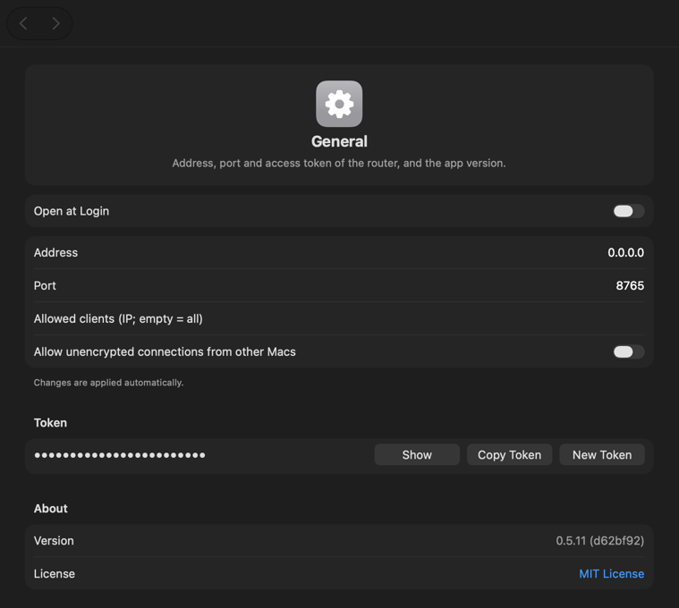
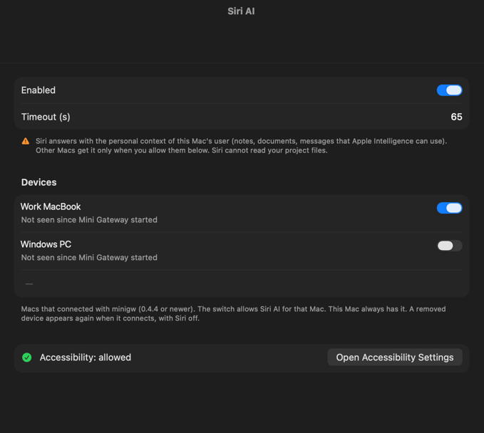
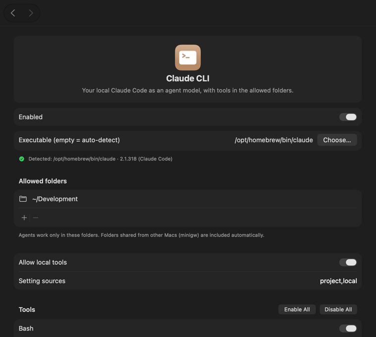
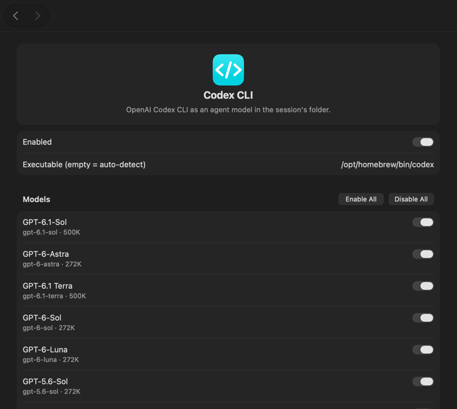

# Running the gateway

The gateway runs on one computer and serves every client. Install it with `/minigw:gw install` or as in
[install.md](install.md); this page covers running and configuring it.

- [Mac app or minigw serve](#mac-app-or-minigw-serve)
- [Network and firewall](#network-and-firewall)
- [Devices](#devices)
- [Settings](#settings)
- [Providers](#providers)
- [Change settings from the command line](#change-settings-from-the-command-line)
- [minigw serve on Windows and Linux](#minigw-serve-on-windows-and-linux)
- [Git in direct mode](#git-in-direct-mode-060)
- [Where things are stored](#where-things-are-stored)

## Mac app or minigw serve

| | Mac app (Mini Gateway) | `minigw serve` |
|---|---|---|
| Systems | macOS 27 on Apple Silicon | Windows, Linux |
| Runs as | Menu bar app | Tray icon (Windows), systemd user unit (Linux), or a terminal |
| Settings | Settings window | Settings page in the browser ([below](#settings-page)) |
| Autostart | Open at Login | At sign-in (Windows), at boot with linger or at sign-in (Linux) |
| Claude CLI, Codex, Copilot (Copilot: not on a Windows gateway in this version), Foundry Local, providers | yes | yes |
| Grok | no: not supported on the Mac gateway | yes |
| Siri AI, Apple Foundation Models | yes | – |
| Work modes | auto, worktree, sync, direct, native, native-direct | auto, worktree, sync |
| `minigw run` | yes | – |
| Projects, notes, usage events, quota (0.6.0) | yes, through the helper `minigw-core` ([below](#the-mac-app-the-project-helper)) | yes, in the gateway ([below](#the-core-database-060)) |
| Owner commands `minigw gw user\|bind\|project\|member\|grant\|core\|usage-events\|quota` | yes | yes |
| Pages for users and projects | only a status row in Settings → General | – (command line only) |
| Listens on | `127.0.0.1:8765` until you change it | all addresses, port 8765 |

Both speak the same protocol and the same [admin API](admin-api.md), so every client works with both.
[windows-parity.md](windows-parity.md) lists every setting on both, control by control.

Model-filled usage labels are a beta exception: the Go gateway has a background worker on Windows/Linux, with Foundry Local
available only on Windows in this step; the Mac worker comes later. The feature is off by default. The owner must enable
Foundry Local and select `foundry:<model>` through `PUT /usage/labels/settings` before turning labels on. It sends only the
bounded first user message and task label to that local model, without storing the text. See [usage labels](usage.md)
for sampling, limits and the meaning of agreement, and [the admin API](admin-api.md) for settings.

## Network and firewall

- **Mac app:** it listens only on `127.0.0.1` at first, so only the Mac itself can use it. For other computers set
  the address to `0.0.0.0` in **Settings → General** (a change of address or port needs a restart).
- **`minigw serve`:** it listens on all addresses by default. The address may be empty (all), `0.0.0.0`, `::` or
  `127.0.0.1`: the admin API must stay reachable on `127.0.0.1`.
- **Firewall:** `minigw serve install` adds no firewall rule. If a firewall runs on the gateway computer, allow
  inbound TCP on the gateway port (8765) for the clients' network. To limit who may connect, use **Allowed client
  IPs** (Devices) or the firewall.
- **Mac and providers on the local network:** when the gateway cannot reach a provider on the same subnet, allow
  Mini Gateway in System Settings → Privacy & Security → Local Network.
- **Never forward the port to loopback** (`ssh -L`, `netsh interface portproxy`, a reverse proxy): loopback
  connections skip the device check ([how-it-works.md](how-it-works.md#the-connection)).

## Devices

A new client connects with the token, then waits for approval. Approve it in one of these places:

- **Mac:** **Settings… → Devices**, or the menu bar (Waiting for approval, with a notification).
- **Windows:** the tray menu (Waiting for approval, with a notification) or the settings page.
- **Anywhere:** `minigw gw devices allow <id>` on the gateway, or `/minigw:gw devices allow <id>`.

Compare the ID with the one `minigw status` shows on the client first. Anyone with the token can try to connect, and
a name proves nothing. Then run `minigw connect` on the client again.

```sh
minigw gw devices                        # allowed and waiting devices
minigw gw devices allow <id> --name Laptop
minigw gw devices deny <id>              # remove or reject (not a block list)
minigw gw token rotate                   # lock everyone out; clients need the new connect line
```

## Settings

The Mac app's **Settings…** window and the `minigw serve` settings page have the same panes. Changes apply at once.

- **General:** listen address and port (`0.0.0.0` for other computers), access token (Show, **Copy Token**,
  **New Token**), **Allow this user's apps without a token** (off by default; see
  [how-it-works.md → Security notes](how-it-works.md#security-notes)), Scratch folder (agents' copies and clones;
  pick a fast disk, not a temporary or build cache folder), Open at Login / Start at sign-in, About. Mac only: **Worktree mode** (network for builds,
  network for Codex builds) and **minigw run** (which devices may run builds, each with or without network).
- **Devices:** **Allow any device with the token** (only while no device is allowed), allowed client IPs,
  unencrypted connections from other computers, devices waiting for approval (editable name, ID, address, time, OS,
  minigw version; **Allow** / **Reject**), allowed devices (rename, ID, last seen, **History**, **Copy ID**,
  **Remove**).
- **Users and devices** (Mac): a pane the app builds from a panel description (`GET /panels`, see
  [admin-api.md → Panels](admin-api.md#panels)), shown after Devices in the language of the app (English or Slovenian).
  **Users:** the list of people with **Add User…**, **Rename…**, **Deactivate** (asks first) and **Activate**, and a switch
  that shows the inactive ones. **Devices of users:** which device is bound to which user, with **Bind Device…** (binding a
  device again changes its user) and **Unbind** (asks first). Devices are still approved in **Devices**. The pane shows only
  plain text; a name that looks like a link or markup is shown as typed. If the project database is not available the pane
  says so.
- **Teams and projects** (Mac, between Users and devices and Knowledge base): built from the panel `builtin.teams`.
  **Teams:** name, path label, number of people and projects, a switch for archived ones; **Add Team…**, **Rename…**,
  **Set Path Label…** (empty clears it), **Archive** (asks first) and **Unarchive**; **Open** shows the people of the team
  (add, remove), its projects (add, remove) and the roles it gives (give, change, remove). **Projects:** short name, name, team,
  number of people, archived switch; **Add Project…**, **Archive** (asks first: nobody can write, reading and agents go on) and
  **Unarchive**; **Open** shows the people with their role and where it comes from (directly, through which teams), with
  buttons to set the direct role (giving a role, raising to manage, lowering and removing all ask first) and to give a role, the git remotes (add, remove) and
  the dependencies on projects and on teams (add, remove; a search hint only). **Grants between projects:** which project reads which notes of
  another, with add and remove. Every confirmation says what happens: access that ends, that agent runs which are already
  going are not stopped but can no longer read notes (the next read fails), and what does not change. A team's hidden notes
  segment is never listed as a project.
- **Upstream gateways** (Mac and the `minigw serve` settings page, after Knowledge base): built from the panel `builtin.upstreams`; see
  [usage.md → Sending a project's knowledge to another gateway](usage.md#sending-a-projects-knowledge-to-another-gateway).
  **Upstream gateways:** name, address and the **device ID to approve there**; **Add Upstream…** takes a name, an address, the upstream's
  Copy Token in a password field (never shown again, cleared as soon as it is sent, never repeated in an error) and an optional device
  name, then shows the device ID and what the upstream says; **Remove** (asks first: its stored credentials are deleted and its links
  removed; nothing changes there). **Open** checks the connection when it opens (waiting for approval, allowed but not bound, connected,
  not reachable, token refused). **Links:** project or team, upstream, name there, classes, how many notes would go, last push and last
  refusal; **Link Project…**, **Link Team…**, **Dry Run** (writes nothing), **Push Now** (asks first, and says exactly what leaves: title,
  class, kind and text of each note, one line with an opaque reference and the author's display name, the device name and ID in the
  connection; no note ids, revisions, paths or usage data), **Unlink** (asks first). The report of a dry run or a push is shown under the
  list. Nothing is sent automatically unless a link is set to automatic. **Reading from upstream gateways** (below the links): per link reading on or off, classes, extra sources, the pull interval, the mirror's notes, the last complete pull and the next one, and under **Open** the age of the mirror, the failures in a row, whether the automatic pull is off and the last error; **Dry Run**, **Turn Reading On…** (asks first and records the acceptance of the reach), **Change What Is Read…**, **Turn Reading Off**, **Set Pull Interval…** and **Pull Now**; see [usage.md → Automatic pull](usage.md#reading-the-upstreams-notes-the-mirror-the-manual-pull-and-what-members-see). On the Mac the credentials are Keychain items of the app.
- **Knowledge base** (Mac, last of the panels): built from the panel `builtin.kb`. **Waiting for review:**
  pending submissions of projects and teams (title, project or team, class, kind, author, received); **Accept**, **Reject…**
  (asks first; an optional reason the author sees) and **Open** to read the text, and for a replacement the current text of the note it
  replaces and the new text, one above the other (no line difference); Accept is offered only when the replaced note is
  unchanged and both texts are shown in full. Below: **Notes** and **Questions and answers** of a project or of a team, chosen
  with a picker, searchable by title, paged. You read every class here, `private` notes included, as the owner; nothing on
  the page edits a note except accepting a submission. A long text is wrapped in the page (no inner scroll) and cut at
  20000 characters with a note. Needs the new helper: with an older one the pane says to update the app.
- **Sessions:** **Projects (7 days)**: requests, agent minutes and tokens per folder and device (kept 31 days, also
  after their sessions are gone); the last 200 client sessions with device, folder, work mode and models; open one for
  requests, errors, refusals, time and tokens per model, and "read-only (cap worktree)" when the agent's cap made it
  read-only. **Clear History** clears both. No prompt text is stored.
- **Providers** (LiteLLM, OpenRouter or any other Anthropic-compatible one): name, base URL, API key, **Allow http**,
  a switch per discovered model. **+ / −** under the sidebar adds or removes providers.
- **Siri AI** (Mac): off by default; turning it on asks for Accessibility permission. Lists the devices that may use
  Siri (this Mac always may).
- **Apple Foundation Models** (Mac): on-device model and its instructions.
- **Foundry Local:** off by default; Microsoft's on-device models, a switch per model, instructions.
- **Claude CLI:** path to `claude`, allowed folders, **Allow local tools** with a table to exclude tools, the
  `minigw` command-line tool (Mac: Install). On Windows also **Allow commands without a sandbox**.
- **Codex CLI / Copilot CLI:** off by default; a switch per model, **Allow writing**, network (Codex,
  Copilot). Copilot has no commands (greyed out with the reason) and signs in with `copilot login`.
  **Grok is not supported on the Mac gateway** (there is no Grok pane in the Settings): every Grok request answers 400
  "Grok is not supported on the Mac gateway. Use another agent, or Grok through minigw serve on Windows or Linux." with
  `x-should-retry: false`, the Grok models are not listed, and the admin API and `minigw gw grok` answer the same text.
  Grok through `minigw serve` on Windows and Linux works (a Mac client can use its models). There, a Grok run that may not
  write (read-only, `--minigw-ro`, worktree) cannot run commands: a headless Grok cannot ask for approval, and approving
  automatically would let a command use the network and read the whole disk. The run is told to use its file tools
  (`list_dir`, `read_file`, `grep`); if it still needs a command it ends with 400 "grok needed approval to run a
  command …" (not a 502, which Claude Code would retry). Use a run that may write, or ask for file reading only.
- **Changes in the client's folder** (each agent pane): **In the folder or a copy (any mode)** (default), **Only in a
  copy or on a branch (sync, worktree)** or **Only on a branch (worktree)**. In a mode above it the agent only reads
  the folder, and minigw says so ("Mini Gateway lets Codex change files only in worktree mode, so it only read the
  folder (run minigw --minigw-work=worktree)"). The client can only choose a lower mode, never a higher one.
- **May ask other models** (each agent pane, off by default): the agent may ask another model of this gateway with
  `minigw -p --model <id> "…"`, in the same folder and with your device's rights, one level deep, never its own kind.
  Claude CLI needs **Allow local tools**, Codex its network switch. On Windows Codex can ask only with its unelevated
  sandbox (`[windows]` `sandbox = "unelevated"` in `~/.codex/config.toml`).

<table>
<tr><td></td>
<td></td></tr>
<tr><td></td>
<td></td></tr>
</table>

### Settings in the terminal

`minigw gw settings` shows the settings in the terminal, on any gateway (the Mac app and `minigw serve`), also over
SSH and inside tmux. Keyboard first (←/→ or 1-7 page, 1-8 on the Mac, ↑/↓ move, Enter change, Esc back, q quit); a click on a page
name or a row works too. No colors, English only, at least 80 columns. It is the helper `minigw-tui` next to `minigw`
(on the Mac in the app's `Contents/Helpers`; `minigw` checks its signature first). It reads and changes everything
through `minigw gw api` of the same `minigw`, so the same rules apply: only on the gateway computer, as the user who
runs the gateway. API keys and the Claude token you type go to `minigw` on stdin and are never shown; the connect
line with the token appears only after **Show the connect line**.

| Page | Both gateways | Mac app only | `minigw serve` only |
|---|---|---|---|
| General | Status, version, address, port, token (show, new), this user's apps, scratch folder | Open at Login | Windows: Start at sign-in; Linux: how it starts |
| Devices | Allow any device, allowed client addresses, unencrypted clients, waiting devices (allow with a name, reject), allowed devices (rename, history, remove) | | |
| Providers | Enabled, name, base URL, Allow http, aliases, API key, models (search, a switch each, all, none), add, remove | | |
| Agents | Claude CLI (enabled, path, local tools, tools, permission mode, setting sources, changes in the client's folder, ask others), Codex CLI (enabled, path, write, changes in the client's folder, network, ask others, models), Grok CLI (`minigw serve` only: enabled, path, write, changes in the client's folder, ask others, models), Copilot CLI (models, write, changes in the client's folder, web, login; commands shown as not available), Foundry Local | | Allow commands without a sandbox (Windows, Linux without `bwrap`) |
| Folders | Allowed folders: add, remove; folders left out at startup | | |
| Sessions | Projects (7 days) per folder and device, recent sessions with details, Clear history | | |
| Activity | Requests running now (model, time, the agent's latest step) at the top, then the last 200 requests to models (time, status, duration, model, device; Enter or a click shows the path, size and device ID). Read-only, reloads every 3 s. Metadata and the agent's current step (a tool or command), never prompt or answer text; an unknown model shows as `unknown`. A gateway older than 0.5.21 shows "Needs gateway 0.5.21 or newer" | | Empty after the gateway restarts |
| Mac | – | Siri AI (on, timeout, per device), Apple Foundation Models (on, instructions), `minigw run` (commands, per device, network) | |

**Remote administration over SSH (Mac):** there is no remote admin API; `ssh` to the gateway Mac as the user who runs
Mini Gateway and run `minigw gw …` (or `minigw gw settings`) there. The login keychain is often locked in an SSH
session, so `minigw` cannot read the gateway's admin key. When macOS reports the login keychain as locked, `minigw` in
a terminal then asks once: "The login keychain is locked in this SSH session. Mac password for <user> (to unlock
it): ". The password is read without echo, never from the command line, never logged, and goes only to macOS: it is
first checked against the Mac account (Open Directory), then unlocks the keychain (`SecKeychainUnlock`); `minigw`
never runs the `security` command. The check is needed because macOS alone does not check the password in an SSH
session while the Mac's own session has the keychain unlocked. A wrong password ends with "wrong password: the
keychain stays locked" and the keychain is not touched; if Open Directory cannot check the password, `minigw` says
"cannot check the Mac password (Open Directory: …)". If the Mac password is right but the keychain has another
password (out of sync, for example after a password reset), it says "the Mac password does not unlock the login
keychain": unlock it in the Mac's own session or with Keychain Access, then retry. After a right password the
keychain stays unlocked for that SSH session as macOS keeps it (its lock-after-inactivity setting still applies).
Without a terminal (scripts, Claude Code skills) `minigw` does not ask: it says the keychain is locked. Prefer running
`minigw gw` once in an interactive SSH terminal; the fallback `security unlock-keychain
~/Library/Keychains/login.keychain-db` in the SSH session works too, but macOS does not check that password while the
Mac's own session has the keychain unlocked. When macOS reports the keychain as unlocked, `minigw` never asks (macOS
would accept any password then); if it still cannot read the admin item it says "macOS reports the login keychain as
unlocked but does not let minigw read Mini Gateway's admin item in this SSH session: quit and open the Mini Gateway
app once on the Mac, then retry".

Not in the terminal: Claude CLI's per-tool switches (the tools
are a comma-separated field) and copying the token to the clipboard.

### Settings page

The `minigw serve` settings page opens from **Settings…** in the Windows tray, or with a link that
`minigw gw settings link` prints. The link is one-time and valid for 60 seconds. Open it on the gateway computer, or
through `ssh -L <port>:127.0.0.1:<port>` with the same port on both ends (the page checks the port). With the
Windows tray, **Choose…** and **Browse…** open the Windows file dialog; elsewhere you type the path.

The page also draws the four admin panels (Users and devices, Teams and projects, Knowledge base, Upstream gateways; see Settings above), after
Usage in the list, in the order the gateway gives. It fetches their descriptions (`GET /panels`) and texts
(`GET /panels/strings?lang=` with the browser's language, `sl` or `en`, falling back to the base table) through its session and
applies the same rules as the Mac app: only registered routes are called, a value that is not one plain path segment is never
put in a path, destructive and access-changing actions ask first (in the browser's own dialog), a long text is cut at 20000
characters with a note, a panel it cannot show (newer format, unknown element) says so. Every text from a description, a table
or an answer is put on the page as plain text, never as HTML. On the Mac app the page is not used: the Settings window draws
the panels natively. Tried so far only in a headless Chromium browser on one Windows gateway (not Edge, not Firefox, not on Linux): see Known problems in the release notes.

### Remote settings listener

`minigw serve` can opt in to a separate HTTPS settings listener. It is disabled by default and is not a web page in
the Mac app. The loopback settings link and CLI proof keep their existing authentication. The remote page has a password
form, its own session storage and a Sign out button; this version manages providers, models and devices, and lists users, bindings, teams and projects read-only, with the members of a team, its assignments and the members of a project with their origins (`GET` only, one numeric id of 1-18 digits;
no changes). The page also reviews pending knowledge-base submissions of all projects and teams as the owner does (`GET kb/submissions`, `GET kb/submissions/{id}`, `POST kb/submissions/{id}/accept` and `/reject`, no query string, the first 100 only): it accepts exactly the version the owner read (the request carries its review hash), a text with hidden characters, a text too long to review here, and a submission that replaces a note whose current text is hidden or long, or that changed or no longer exists since the submission was written, are refused by the gateway for accept, so they are reviewed on the server (reject works here); a replacement of an unchanged note is shown with its current text and the new text and can be accepted (the page then says where the previous text is saved), the request body has exactly these keys (`reviewHash` as 64 lowercase hex characters plus, for a replacement, `currentRevision`, a whole number; or `reason`: one line of up to 1024 bytes, no control characters); a refused body or accept is audited as `denied` and does not use up a decision, at most 30 decisions are taken in 10 minutes (the 429 carries a `Retry-After` header; decisions that reach the core and are refused there, such as a text that changed since the read or an unknown id, count toward the 30, while malformed or not-acceptable ones are refused by the gateway first and have their own higher limit of 300 per 10 minutes, with at most one `limited` audit row per window; when two reviewers accept the same version within about ten seconds, the second also sees "Accepted and published" and nothing is published twice), and `remote-settings.audit.jsonl` records each decision (`started`, then `ok` or `denied`, or `limited`) with the operation, the source address, the request id and the submission id in `Subject`; the core's own audit shows the reviewer `owner`. A rejected author sees the reason only with `minigw kb submissions --json` today. Notes, the FAQ, search rebuild and paging beyond 100 stay with the CLI.
Host service installation, file dialogs, agents, core panels, project/member routes other than those lists and views, sync and inference are unavailable
on this listener. Gateway tokens, local settings sessions, device credentials and agent headers cannot authenticate here.

Set a password locally with `minigw gw settings password` (hidden terminal input, or stdin); it also works while the
gateway is stopped. Use the same `--config` selection as the gateway. No argument or environment variable supplies the
password. Resetting it invalidates remote sessions on their next use. There is no initial remote registration. Five failed
attempts lock a source out for 15 minutes; bounded global backoff also limits distributed attempts. Lockout deadlines
survive restart. Wait for expiry for recovery; resetting the password does not bypass lockouts. Sessions expire after
30 minutes idle or eight hours total, and end on logout, password reset, gateway-token rotation, disabling the listener
or restart. A password/session authenticates its holder; it does not prove that the caller is a person.
A request accepted a moment before a session is revoked still finishes. A source that signed in within the last 8 hours
(an IPv6 source counts by its /64) is not shut out by the global backoff, only by its own limit; the listener holds at
most 64 connections. Remote provider changes cannot carry `baseURL`, `insecure`, `tools` or `model` (they would send
the stored API key elsewhere or raise what agents may do): make them locally, or add the provider again with its key.

Example `serve.json` block (paths name existing PEM files; restart after configuration or certificate changes):

```json
"remoteSettings": {
  "enabled": true,
  "listen": "0.0.0.0:8766",
  "origin": "https://settings.example.net",
  "allowedSourceCIDRs": ["192.168.10.0/24"],
  "proxyIdentity": "settings-proxy.internal",
  "proxyCA": "/config/tls/proxy-ca.pem",
  "certificate": "/config/tls/gateway.pem",
  "privateKey": "/config/tls/gateway.key"
}
```

The listener requires TLS 1.3 and a proxy client certificate verified against `proxyCA` with the exact DNS SAN
`proxyIdentity` (a common name is insufficient). It never falls back to HTTP. The proxy must verify the gateway's
server certificate and overwrite `X-Minigw-Client-IP` with one browser TCP-peer IP. The gateway ignores other forwarding
headers and checks that address against `allowedSourceCIDRs` only after verifying the proxy certificate. It requires
the exact external Host and, for login, logout and mutations, the exact Origin, JSON and `X-Minigw-Remote-Request: 1`.
There is no CORS. The remote session header is `X-Minigw-Remote-Session`; neither passwords nor sessions go in URLs.

Keep port 8766 private to the proxy network. Upstream mutual TLS does not prove the browser used HTTPS: an HTTPS-only
proxy virtual host, HSTS and forwarding-header replacement are part of the required boundary. The supported Compose
deployment is the `admin` profile ([docker.md](docker.md#remote-settings-from-a-browser-admin-profile)); this listener alone is not.
Trust, origin and listener changes require restart. Setting `enabled` to false and restarting stops the listener and
discards its sessions. Startup rejects missing credentials/material, noncanonical origins, invalid CIDRs and incomplete
proxy trust; expired proxy certificates fail the handshake. Replace renewed files and restart; there is no HTTP fallback.

Password records, persisted lockouts and the rotating admin audit are stored beside `serve.json` as private files.
The audit records login outcomes, revocations and fixed mutation operations with verified source IPs and generated request
IDs. It never records credential values, request bodies or user-supplied route IDs. A failed audit intent prevents a
mutation. If saving its result fails after dispatch, the reply says the operation may have completed; inspect the current
settings before retrying. Audit rotation retains the current file (up to about 1 MiB) and one previous file.

## Providers

Any Anthropic-compatible upstream works: OpenRouter, LiteLLM, xAI, or another. Add as many as you like, each with its own
key. LiteLLM (`http://localhost:4000`) and OpenRouter (`https://openrouter.ai/api`) are always listed and stay off
until you set a key.

```sh
minigw gw provider add openrouter https://openrouter.ai/api   # asks for the API key (or reads it from stdin)
minigw gw provider models openrouter --enable anthropic/claude-sonnet-4.5,openai/gpt-5
minigw gw provider models openrouter haiku                    # enabled models matching "haiku"; --all also the others
minigw gw provider list
```

- The gateway passes requests through unchanged, streaming and tools included. Only for `https://api.x.ai` (xAI) it
  first rewrites two things xAI rejects: a `system` message inside `messages` becomes a `<system-reminder>` text block in
  the neighbouring user message, and a tool schema without `required` gets `"required": []`.
- **Tools of its models:** `minigw gw provider tools <name> [none|read|edit|default] [--model m]` (also Settings → Providers) sets the most a client's Claude Code may give the models of a provider: `read` (default: Read, Grep, Glob), `none`, or `edit` (also Edit and Write inside the client's folder, see [usage.md](usage.md#models)). The gateway lists the level per model (`minigw_tools` in `/v1/models`), the client refuses `--minigw-tools=edit` above it, and the gateway refuses a request whose `x-claude-mini-tools` header is above it. The tools run in the client's Claude Code, so the gateway can only refuse to serve: a modified client can send a lower level than it runs with, and the real protection of the folder is the client's own permission rules.
- **xAI**: base URL `https://api.x.ai`, billed per token by xAI. Turn the image and video models off in the model list.
- A provider with more than 20 models starts with none enabled.
- The URL must be `https`. `http` works only to localhost, a private IP or a `.local` name, with `--insecure`
  (**Allow http**).
- Clients see the models as `claude-<id>` ([usage.md → the `claude-` rule](usage.md#models)).

## Change settings from the command line

`minigw gw …` changes the gateway on this computer at once, on every system ([commands.md](commands.md#gateway-minigw-gw)):

```sh
minigw gw status
minigw gw provider add Lab https://gw.example     # the key comes from stdin or a hidden prompt
minigw gw autostart on
```

- **Mac:** the app must be running. The first time, macOS asks whether `minigw` may use the app's Keychain item (the
  admin secret). `minigw` talks to the app only after the app proves its gateway key.
- **Windows and Linux:** with the gateway stopped, `minigw gw` changes `serve.json`. Port and address need a restart.

The admin API behind it is in [admin-api.md](admin-api.md). It answers only on the gateway computer.

## minigw serve on Windows and Linux

`minigw serve` turns a Windows or Linux computer into a gateway: Claude Code there as `claude-cli-opus`,
`claude-cli-sonnet` and `claude-cli-haiku` (`claude-cli-fable` works by name but is not listed), Codex, Grok and
Copilot (off by default), Foundry Local, and providers. No Siri or Apple models.

```sh
minigw serve init            # creates the config with a new token and gateway key, prints the connect line
minigw serve install         # install, start now and at sign-in or boot
minigw serve                 # or run it in this terminal (--port, --config)
```

- **Claude Code** must be installed there. On Windows `minigw serve` runs the native `claude.exe`, never `claude.cmd`.
- **Work modes:** agents work in a synced copy or, for a git repository, in a clone on a branch. With no mode chosen
  the client picks worktree or sync; an explicit `--minigw-work=direct` is refused. With Claude CLI in worktree mode,
  Linux pins the clone's `.git` with nested `bwrap` so the agent cannot replace it; where nested user namespaces are
  restricted, Linux watches `.git` with inotify and stops the run at once when it is moved (if the watch cannot be set
  up, the run is refused: use sync). macOS and Windows `minigw serve` have no
  pin and check `.git` every second and on every Claude event.
- **Agents' tools:** Claude CLI's default tools are `Read,Grep,Glob,Edit,Write,MultiEdit`, limited to the session
  folder. `Bash` runs in Claude Code's sandbox on Linux (needs `bubblewrap` and `socat`). On Windows there is no
  sandbox, so it also needs **Allow commands without a sandbox** (`minigw gw claude --allow-unsandboxed-bash=true`):
  agents can then run any command as you and read the provider API keys and the admin secret. On Linux Codex, Grok
  and Copilot run under `bwrap`.
- **Allowed folders** may not contain the Scratch folder or sit inside it: such a folder is refused, and ignored at
  start. Each run uses the checked final path in sandbox rules and `--add-dir`, so retargeting a configured
  symlink or junction after validation does not grant its new target. The configured spelling stays in settings;
  agents see the real path (Windows keeps the configured name, so a mapped drive does not turn into a UNC path that Claude Code blocks). Unix launches open the real directory without following a final symlink and compare
  its device and inode with the validation snapshot just before starting. Linux bwrap binds use those open
  descriptors when bwrap supports `--bind-fd` (bubblewrap 0.10.0, backported to 0.6.3; also for Claude when an outer,
  nested bwrap is available). bwrap closes those descriptors before it starts the agent, so the agent holds none (the start check also proves it for the installed bwrap, else path mode is used; Go test `TestAllowedFolderDescriptorsNotInherited`). An older bwrap keeps its sandbox: allowed folders are then bound by the checked real path
  (never the configured name) and the identity is rechecked right before launch, as on macOS; the start log says
  which mode is used. macOS sandbox profiles and Windows
  MXC/tool rules accept names, not directory handles; Windows rechecks the volume/file identity of the configured name right before launch.
  Someone able to write a parent of the **real** path can still replace a component after the last check on
  macOS, Windows, Linux in path mode, or Linux without the outer bwrap. Keep those parents outside agents' writable folders.
  Residual risks, accepted: (1) between the launch check and the moment the sandbox resolves the name there is a short
  window on macOS, Windows and Linux in path mode; (2) some NAS servers report file index 0, so on such a drive the
  identity check cannot tell two folders apart (the real-path and owner checks still apply); (3) a local process of
  the same user could rename a pinned parent folder into a protected folder after the check (it could write there
  directly anyway).
- **The core data folder is closed to every agent** (0.6.0, #106): the database, its sidecars (`-wal`, `-shm`, `core.state`,
  `core.audit.log`), backups and the usage spool hold the notes of all projects, so an agent run of any user must not
  read or write them. The folder is denied by its **real path** (a link to it from an allowed folder does not reach it),
  and an allowed folder that contains it or is inside it is refused. Per platform and agent kind:
  - **Mac** (app data folder `~/Library/Application Support/Mini Gateway`, the core in `core`): Codex always runs under its
    permission profile (every mode: write, read-only, chat, resume, worktree) with the folder set to `none`; Claude CLI
    (tool rules and sandbox `denyRead`), `minigw run` and Copilot (Seatbelt profile) hide it with the Scratch list
    (`RouterConfig.hiddenScratch`). Grok does not run on the Mac gateway. On Windows and Linux Grok keeps a home of
    its own per device in which `config.toml` is linked to yours, so its defaults apply there.
  - **Linux** (`<config dir>/core`): `bwrap` masks the config folder with a tmpfs (Codex, Grok, Copilot); Claude Code's
    own sandbox has it in `denyRead`. Without `bwrap` agents run only with **Allow commands without a sandbox**, and then
    they read it: see the acceptance below.
  - **Windows**: the MXC box denies the config folder (by its final path, junctions included) for Claude CLI and Grok.
    Codex and Copilot run beside the box and only with **Allow commands without a sandbox**, so they read it.
  - **Gateway with an agent that can read the folder** (Linux without `bwrap`, Windows without the box, Codex and Copilot
    on Windows; always with **Allow commands without a sandbox**): the core **refuses to open** (project routes answer 503
    `core_unavailable`, models keep working) unless the owner has accepted it: `minigw gw claude
    --accept-agents-read-notes=true` (admin `PATCH /agents/claude` with `acceptAgentsCanReadNotes`, key
    `acceptAgentsCanReadNotes` in `serve.json`; restart the gateway). An accepted exposure is logged at start and shown in
    `minigw gw status` (`projects: on; Codex can read all notes (accepted: acceptAgentsCanReadNotes)`; refused:
    `projects: off (...)`). The check is repeated at **every launch**, next to the config folder's deny: a run of an
    agent that would read the folder is refused with 403 while the core is open and not accepted.
  - **Data on disk, core not open:** the check does not depend on an open handle. While the core folder holds data and the
    core is not open (refused, failed, an earlier period), an agent that can read it is refused at launch (403: "old project
    data in <folder>: move it away, or set acceptAgentsCanReadNotes"); one WARNING at start and
    `minigw gw status` (`projects: off (...); old project data in <folder>: agents that can read it are refused`) say so.
    Nothing is deleted. No usage recorder and no spool file exist while the core is not open; the spool
    (`usage.spool`) lives inside the core folder (Go: `<config>/core`, Mac helper: its store folder).
  - **Backups** are written only into `<core>/backups` (name only), so every deny of the core folder covers them.
  - **Hard links:** a hard link to a core file from an allowed folder is the same file under another name and bypasses
    every deny by path (a sandbox alone does not stop it; tested on Seatbelt). The core refuses to open when a file of the
    core folder or its backups has a name outside the folder (a name inside, like a restore's snapshot, is fine), and
    every agent launch checks it again (Go `core.CheckLinks`, Mac `RouterConfig.coreLinkProblem` in `syncRun`) and is
    refused until the other link is removed.
  - **Claude CLI in every mode:** the tool rules `Read` and `Edit` (Read covers Grep and Glob, Edit covers Write; checked
    with a real `claude -p`) for the core folder and the other providers' credential homes are in the settings of the
    default mode (no "Allow local tools"; on the Mac with a kernel profile under the rules) as well as the sandboxed modes. The Go gateway's default mode already
    scopes the file tools to the session and allowed folders and denies the config folder.
  - **Other providers' credentials:** `~/.grok` (or `$GROK_HOME`), `~/.codex` (or `$CODEX_HOME`), `~/.copilot` (or
    `$COPILOT_HOME`) and the gateway's `Scratch/grok-home` and `Scratch/copilot` are denied to every agent of another
    kind (Codex's profile, the Seatbelt hidden list, Claude's rules); an agent keeps its own home. Grok's folders stay on the list (a Grok login on this Mac stays hidden from the others).
  - **Claude CLI without "Allow local tools"** (the restricted mode): only file tools run there (Read,
    Grep, Glob, LS, Edit, Write, MultiEdit, NotebookEdit, WebSearch, WebFetch). A configuration that lists `Bash`, `Task`, an
    MCP tool or another tool is refused when it is saved, and a run with such an older stored configuration is refused (400),
    because such a tool could read the notes of all projects. `minigw serve` refuses the same tools except `Bash`, which its
    sandbox confines.
  - **Two layers under the restricted Claude CLI on the Mac** (0.6.0). The Claude Code rules (`--allowedTools` scoped to the
    session and allowed folders, `--disallowedTools`, `dontAsk`/`acceptEdits`) are the first layer, enforced by the Claude Code
    program, so they depend on the installed version (older versions ignored scoped rules in some modes). The second layer is
    the kernel: the whole `claude` process runs in a Seatbelt profile (`sandbox-exec`, `Native.claudeRestrictedProfile`) that
    denies every file read and write except an explicit list, so a file outside the session folder and the allowed folders
    is refused with EPERM even when the rules fail open. Readable: the system libraries, the `claude` program, the session
    folder, the allowed folders (writable only when edit tools are configured and the run is not read-only; `.git` and, with
    the setting sources `project` or `local`, `.claude` stay closed for writing there, as the rules do), claude's temp
    folder (`CLAUDE_CODE_TMPDIR`, a private folder `Scratch/tmp/run-<id>`, removed after the run or at the next start),
    a few device nodes, and for the login the login keychain files (`login.keychain-db*` read and write: a token refresh
    must be saved, else the rotated refresh token is lost; `metadata.keychain-db`, the folder). `~/.claude` is an allow list
    found with real `claude -p` runs (start, login, answer, Read, Grep, Glob, Write, Edit, resume): only `dev-mods` is read
    (without it Claude Code refuses the write tools), and the run's own conversation is read and written (`projects/<folder
    of the session>/<conversation id>.*` and `<id>/`; the folder is created if missing; the folder's name is not unique per
    session, so the id is the rule and other conversations of the same folder are neither readable nor listed). Nothing
    else in `~/.claude` is written (no `session-env`, `sessions`, `cache`; runs work without them) and everything else is
    closed to reading: shell snapshots, `.credentials.json`, history, other projects' transcripts, project memory, debug,
    todos, plans, plugins, settings, the owner's `CLAUDE.md`. `~/.claude.json` is read-only. With the setting source
    `user`, `settings.json` is readable too (never writable); the owner's plugin hooks stay unloaded because the plugin
    folders are closed, so `user` settings apply but plugin hooks do not. A per-run `CLAUDE_CONFIG_DIR` is not possible:
    the Keychain keeps the login under a name derived from that folder (measured: "Not logged in"). The environment of
    the confined `claude` is an allow list (HOME, USER, LOGNAME, PATH, SHELL, LANG, LC_*, TERM, TZ, proxies, the temp
    folders), not the gateway's whole environment, so the tokens and keys of the gateway process are not in it. Network
    out: only TCP 443 and DNS; every other port is closed on every address (loopback and the Mac's own LAN address,
    including the gateway's port), nothing can listen (bind and inbound are denied).
    A self-check decides whether the layer is used: at start (and at the first run after a new `claude`, macOS or a change
    of the profile) one tiny real `claude -p` runs under the profile in a temporary folder, reads a canary and must leave its
    conversation file, and plain `cat`/`touch` under the same profile must not read or write outside it (these cheap rows run at
    every start). The model run's pass is cached in `Scratch/cache/claude-seatbelt.json` (key: the program with its
    nanosecond modification time, its version, macOS and a profile schema number that is bumped with every change of the
    profile). If claude does
    not run under the profile after an update, the restricted mode falls back to the rules alone and says so, never silently:
    one WARNING in the log, `minigw gw status` ("Claude CLI without local tools runs without the system sandbox: <reason>";
    `claudeSandbox` in the admin `status`) and the Claude CLI pane of Settings. A failed check because the network or the login
    is down is not the profile's fault: it does not switch the layer off and is not repeated for ten minutes. A run whose
    profile cannot be built (its temporary folder, a folder that became a link, a root grant, a control character in a path) is refused with 503, not run on the rules alone. A check that times out under the profile while the unconfined run answers is inconclusive; an `off` verdict is re-checked after 30 minutes and at once for a new binary, macOS or profile, so a transient cause does not disable the layer until the next start. Letter case: Seatbelt compares paths without case on APFS and Claude Code 2.1.322 matches its path globs in any case (plain and `[gG]` classes, Read and Edit, allow and deny; measured), so `.GIT`, `.Git` and `.CLAUDE` are closed like `.git` and `.claude`. The sandboxed ("Allow local tools") and worktree
    modes are not wrapped: Claude Code's own sandbox does not nest inside `sandbox-exec`.
    What the kernel layer does not cover: WebFetch/WebSearch send what the agent could read to the network (any host on
    port 443; TCP 443 cannot be limited to one host in a Seatbelt profile, and DNS goes to any resolver); the login keychain files are readable and writable by the confined process (their content is encrypted, and
    the Claude Code rules keep the Read and Edit tools away from them, but the kernel does not); `~/.claude.json` (account
    name, project list) is readable; Residual risk, plainly: `~/.claude.json` stays readable and can hold the environment and headers (keys) of MCP servers you configured; a model that escapes the Claude Code rules could read them and send them out over TCP 443. Measured: with the file closed a restricted run still works but starts about five times slower (12 s instead of 2.4 s per run), and a per-run `CLAUDE_CONFIG_DIR` with its own copy fails with "Not logged in" because the Keychain item of the login is named after the config folder; a minimal copy of the file cannot be placed anywhere claude looks for it without that folder. Keep keys out of MCP entries of `~/.claude.json` if this matters to you. a file the agent can read can leave over TCP 443; the login keychain files can be overwritten by a process confined by this profile; `~/.claude.json` is not writable, so Claude Code cannot save its own state there (runs work without it).
  - **Codex write mode on the Mac** is a permission profile now: writable are the session folder, allowed folders and
    the request's private temporary folder (`/private/tmp/minigw-codex-<id>`, exported as `TMPDIR`); other places in
    `/tmp` are not writable any more (before: all of `/tmp`).
- **Allowed folders survive a restart** (M2): when a folder is added (settings, admin API, `minigw gw claude --folders`),
  the gateway saves its real path and identity with it (Go: `allowedRecords` in `serve.json`; Mac: in the settings,
  next to the allowed folders; identity = volume UUID and inode in the Mac app, `statfs` `f_fsid` and inode on Linux,
  volume serial and file ID on Windows; never the device number, which changes with the mount order; where a
  filesystem has no stable volume id the filesystem type, mount source and inode are compared). The identity is
  compared at start, on every agent run and right before launch. An older config
  without records is migrated once at the first start of this version by recording the current state (one log line
  per folder: `recorded <folder> -> <real>`); that single step trusts what is there. At every later start a saved
  folder whose real path or identity differs from its record is refused like a changed folder at run time (the same
  reason, logged once; the Go gateway also lists it in `agents/claude.refused`) until you remove it and add it again.
  Known limit: without a volume UUID, another server export mounted with the same filesystem type and mount
  source string at the same path passes this check if the folder also has the same inode number.
  A start never rewrites the saved name or the record. A folder that does not exist at start keeps the "was
  missing" handling; a folder that did not exist when it was added takes its identity at its first accepted use, and
  that is saved.
- **In a container** `minigw serve` may run as PID 1: it then starts the gateway as its child and only reaps orphaned
  processes (left by `bwrap --unshare-pid`) and forwards signals. `docker run --init` works too.

**Install on Windows.** `minigw serve install` installs to `%LocalAppData%\Programs\Mini Gateway` with the tray icon,
adds it to PATH and starts the tray at sign-in, without admin rights. The tray executable is downloaded and checked
against the release's signed `SHA256SUMS` if it is not next to `minigw.exe`. The MSI does the same
([install.md → Windows installer](install.md#windows-installer-msi)).

**Install on Linux.** `minigw serve install` installs to `~/.local/bin` with a systemd user unit
(`minigw-serve.service`) and turns on linger (`loginctl enable-linger`, or `sudo -n` without a password) so the
gateway starts at boot. If neither works it prints the `sudo loginctl enable-linger <user>` line; until then the
gateway starts at sign-in.

**Update and remove.** Run `minigw serve install` again to update (or `/minigw:gw update`). `minigw serve uninstall`
stops the gateway and removes autostart; the config and keys stay. An MSI install is removed in Settings → Apps.

**Windows tray.** `minigw-tray.exe` is the same gateway with an icon in the notification area. On first start it
creates the config. Its menu shows the status, devices waiting for approval (Allow / Reject), **Settings…**,
**Copy Token**, **Start at sign-in**, **Open log** and **Quit**.

## The core database (0.6.0)

The core holds the projects of 0.6.0. It is the same Go code on both gateways: `minigw serve` runs it inside the gateway, the
Mac app runs it in the helper `minigw-core` ([below](#the-mac-app-the-project-helper)). This part describes the database and
its commands, which are the same on both; the Mac differences are in the Mac sections after it.

Users, device bindings, projects, members, grants and notes are kept in a SQLite database in the `core` folder next
to `serve.json` (`core.db`, with its `-wal` and `-shm` files, `core.state`, `core.audit.log`, snapshots). The folder
is private to the gateway's user (mode 0600; on Windows an ACL for the user only). The gateway opens it at start and
holds a lock on it, so only one process uses it at a time.

- **`503 core_unavailable`:** if the database cannot be opened (newer schema than this minigw, locked by another
  process, damaged) the gateway still starts: the log has one `WARNING` with the reason, the project routes and the
  core admin routes answer 503, the model routes work as before.
- **Migrations:** forward only. Before the first pending migration the gateway writes a snapshot
  `core-<schema>-<time>.db` next to the database (the last 3 are kept); a failing migration leaves the earlier ones
  applied and the schema version at the last good one. A database written by a newer minigw is refused (503).
- **Team directory (schema 9):** adds `teams`, `team_members` and `team_projects` to schema 8 with the same
  snapshot-before-migration lifecycle. Existing projects remain unassigned; existing permissions stay unchanged.
  Users can join several teams; a project belongs to at most one team. Directory membership grants no project
  role or note access. Owner mutations write transactional audit events. Removing assignment origins can change the authorization epoch.
  Archiving preserves directory reads and attachments, blocks new attachments and does not archive projects.
  Removing a team user or project also removes its assignment origins. Backup and offline restore include teams; the restore allowlist is derived
  from migrations. Restoring can bring back earlier directory names and membership as well as permissions.
- **Backup:** `minigw gw core backup [name]` writes a consistent copy while the gateway runs into the core folder's
  `backups` folder (a name, no path: a copy in an allowed folder would be a copy of all notes that agents can read; the
  name must not exist; the file is readable by you only; without a name `core-<UTC time>.db`). Move it out by hand
  when you need it elsewhere. The approved device list (`serve.json`) is not part of it.
- **Restore:** `minigw gw core restore <file|name>` works only with the gateway stopped (a name is looked up in
  `backups`; an explicit path is accepted here, offline). It checks the file (same gateway,
  schema not newer, integrity, every table, index, trigger and virtual table equal to what this program's migrations make for that schema, no foreign-key violation, epoch and project mark in range), keeps the current database as a snapshot, and puts the backup in place with one
  rename. A backup of schema 12 or newer has its search index rebuilt from the notes before the swap, so a damaged or
  tampered index is not installed; if the rebuild fails, the restore fails and the current database stays. It brings back the users, bindings, memberships, team members, team projects, team assignments and grants of the backup, also ones revoked since, so it asks
  you to confirm (`--yes` skips that). The epoch is set above both values (all runs and conversations end) and the
  project-id counter never goes back. An interrupted restore is finished or rolled back at the next start.
- **Where backups go:** `minigw gw core backup [name]` writes only into `core/backups` (agents cannot read that folder); the
  gateway makes none by itself. A backup there is removed together with the core folder (see below): to keep one, copy the
  file yourself to a place that agents cannot read, not into a project or an allowed folder. The only automatic copies are the
  migration snapshots and the restore snapshot, both inside the core folder. The newest three snapshots are kept; while an
  upgrade has failed and not yet completed, the oldest snapshot from before it is kept as well, and a failed start repeated on an unchanged file writes no new one.
- **Uninstall:** the core folder is never removed by an uninstall or an upgrade, only by purge. Windows MSI: Uninstall and
  upgrade leave `%AppData%\minigw\core`; `PURGE=1` (or `minigw uninstall --purge`) deletes the whole settings folder,
  `core` with the projects, members, notes, usage events and audit trail, for good. Linux: `install.sh --uninstall` keeps
  `~/.config/minigw/core`, `--purge` deletes it. Mac app: dragging the app to the Trash or `brew uninstall` keeps
  `~/Library/Application Support/Mini Gateway/core`; `brew uninstall --zap` moves it to the Trash. Take a backup first if
  you may want the projects again. By hand: stop the gateway, then delete the `core` folder (the usage spool is inside it); the gateway creates an empty core at the next start.
- **Audit:** `minigw gw core audit` lists the audit trail. `core.audit.log` next to the database also records restores
  and migrations, so they survive a database swap.
- **Devices:** removing a device from the approved list (`minigw gw devices deny`, the settings page, the tray) raises
  the core's epoch before the call returns; the device keeps its binding.

Members, projects and grants are managed with `minigw gw user|bind|project|member|grant` (see `minigw gw help`).

### The Mac app: the project helper

The Mac app has no copy of this code in Swift. It starts **`minigw-core`** (`Mini Gateway.app/Contents/Helpers/`), a
small helper made from the same Go packages, and forwards the project routes and the core's admin routes to it. The
app still does the authentication (the Noise tunnel and the device proof, the approved list, the gateway token, the
admin proof, the agent check); the helper decides everything else, so both gateways answer the same.

- **Where the database is:** `~/Library/Application Support/Mini Gateway/core/` (mode 0700, the files 0600), next to
  `state.json`. It is not in Scratch and not in the settings. Back it up with `minigw gw core backup [name]` (written into `core/backups`).
- **How it runs:** the app starts the helper with a private connection (an inherited socket pair, no file and no
  network port) and a secret made for that start. The helper serves only the app that started it, and ends when the
  app quits or dies. If it stops, the app starts it again (waiting longer after each failure, up to 5 seconds).
- **`503 core_unavailable`:** the project routes answer it while the helper is not running (missing, being restarted,
  refused because it does not speak the app's protocol version) and while it is up but cannot open the database (newer
  schema, locked, damaged). The model routes work as before. For the second case the helper stays up and answers every
  request with the same 503; the admin routes carry the reason (`The project database is not available: …`) and the
  helper writes it to its error output. Quit and open the app to try again. A request that was cut off by a restart may or may not have
  been applied: repeat it with the same `Idempotency-Key`.
- **Removing a device** (Settings, `minigw gw devices deny`, the admin API) raises the core's epoch before the call
  answers. If the helper is down the removal still happens at once (the device is refused immediately) and a pending
  mark is saved in the settings with it; the app sends it when the helper is next ready, before any project route is
  served.
- **First start:** the owner user is created once, named after the Mac account (on `minigw serve` after the OS account).
- **One request at a time:** the helper serves the app's calls one after another. A slow call delays the next one. Project
  routes and usage events are small, so this is not noticeable in normal use, but it is a limit of 0.6.0.
- **Where you see it:** `minigw gw status` prints `projects: on` or `projects: off (reason)` (helper not running, database
  cannot be opened, a hard link to a core file) and Settings → General shows the same as a row. `minigw serve` prints the
  same line.
- **Restore:** `minigw gw core restore <file|name>` needs the app quit: the Mac `minigw` starts `minigw-core restore` itself and
  it refuses while the helper holds the store.

### The Mac app: agents with a project

Agent runs with a project work on the Mac app as on `minigw serve`. The app reads the project id that `minigw`
sends (`X-Minigw-Project`), asks the helper to admit it (a direct role; otherwise 403 `no_project_access`, or 503
`core_unavailable` while the helper is not running: it never runs without the project), and gives the run a read-only
notes capability on its run port (`GET /minigw/v1/notes[/{id}]`, nothing else; the run port also exists for a run
with a project when "May ask other models" is off). A removed device, a changed binding or role, or a new epoch ends
the reads of runs already going. Conversations are keyed by user, project and epoch, and Codex, Grok and Copilot
keep their transcripts in a home of their own per user, project and epoch under `Scratch/state` (hidden from every
agent). Usage events are sent to the helper, which stores them; while the helper is down they wait in the app (4096
at most, a longer outage becomes a gap). The Claude CLI agent reads notes with `minigw kb search` or `minigw note list|read` only with
**Allow local tools**, Codex only with its network switch on.

## An upstream gateway (0.7.21)

`minigw gw upstream` (usage.md, "Sending a project's knowledge to another gateway") makes this gateway a client of another one.
The non-secret part lives in the core database (schema 19): `upstreams` (name, address), `upstream_links` (project or team, the
name there, classes, the last push and the last refusal) and `upstream_sent` (per link and local note: the content hash, the
revision and the upstream's submission and note ids). The secret, the upstream's token line and this gateway's own device key for
it (one per upstream, made when the upstream is added), is kept as the provider keys are, under the name `upstream:<name>`: the
credential store (Windows Credential Manager, Secret Service), else a private file next to `serve.json` (mode 0600). It never
appears in the database, a backup, the log, an API answer or an argument. Each request opens its own encrypted connection in memory
(Noise, the upstream's key pinned), so there is no local listener to borrow; redirects are not followed and an answer is read up to 8
MiB (up to 1 MiB of it is parsed). The routes are the owner's (`/upstreams`, `/upstream-push`, `/upstream-auto`, `/upstream-resolve`, admin-api.md); the push uses only the
upstream's existing member routes (`GET /minigw/v1/projects/<slug>`, `GET /minigw/v1/teams`, `POST .../kb/submissions` with an
idempotency key, `GET` of a submission and of a note to learn what exists). The panel for it is a later step.

Publish mode on the Mac: the app admits `POST /notes` and `PUT /notes/{id}` on an upstream for the helper (it cannot see link modes), so it allows them for every upstream, also one with only submit-mode links. What is enforced today is the core's own rule (those two requests are sent only for a link in publish mode) and the role of the device on the upstream; a compromised helper could still write notes directly as far as that role allows. Bind the device of a submit-only gateway to a role that cannot write notes there.

On the Mac app the helper has no network and no Keychain, so the app does that work for it: the core asks through callouts
(core-adapter.md), the app keeps the secret as the Keychain item `upstream:<name>` of the provider keys' service (the helper never sees
it, except the token once at `add`, which it does not keep), and makes the connection with the client's own Noise code (`Noise.Initiator`,
the upstream's key pinned) over a connection it opens itself, in process: there is no local listener, so no other program can borrow the
gateway's device key. The request line is written by hand, never built from the helper's text: the app accepts only GET or POST of
`/minigw/v1/...` with a plain path, the idempotency key as the only header and a body of at most 1 MiB, to the address configured at `add`
(checked again with the core's rules, `client/testdata/upstream-addresses.json`); a redirect is just an answer and an answer is read to at
most 1 MiB. Answers must carry their length (`Content-Length`, or chunked): one "until the end of the connection" is refused, because
a connection cut at a frame boundary would pass as complete (both gateways always send a length; a 204 has no body). The answer is read by one small incremental reader (`UpstreamHTTP.swift`): one buffer, strict numbers (digits only, at most 8),
every cap checked before bytes are kept, `Transfer-Encoding` with `Content-Length` refused, any violation "no answer", no force unwrap or
literal subscript (a source test enforces it) and a seeded test of thousands of mutated answers. The Go gateway reads the answer with
`net/http` (redirects off, 60 s in total, at most 1 MiB and one byte kept). The app refuses an upstream that is this gateway by key and by address. The Keychain access rules are
those of the provider keys: only the app reads them. The idempotency keys and references that leave with a push are HMACs under a secret
of this gateway (a random key in the core database, made on first use; it is a key, not an upstream's credential, and it is in backups
like the notes), so an upstream cannot work out project or note ids from them. Children that the app spawns do not inherit the
helper's connections: every spawn site is Foundation `Process` or `posix_spawn` with `POSIX_SPAWN_CLOEXEC_DEFAULT` (tested in
`SpawnFdTests`, also for socketpairs).

## Usage events and quota (0.6.0, `minigw serve` and the Mac app)

**What is counted.** Every model invocation is one event: a request to `POST /v1/messages` that reaches a model (a
provider, Claude CLI, Codex, Grok, Copilot, Foundry Local) and every call an agent makes to another model through its
run port (it has the asking event as its parent). Requests that are refused before a model (400, 401, 403, 404, 413)
are not counted; a client's retry is a new event. An event stores the start and end time, the user (the user the
device is bound to), the device, the project of the run, the provider, the model, the outcome (`ok`, `error`,
`cancelled` when the client went away, `interrupted` when the gateway stopped or crashed meanwhile) and the tokens.
User, device and project are frozen when the request is admitted and never changed afterwards. A request without a
proven device is recorded with no user, and without a project with none.

**Tokens and their source.** `reported`: the counts of the provider's own stream or of Claude Code's result (Claude CLI
and provider models; Claude Code reports the output of its own turns and the input of its last result). `estimated`:
Codex, Grok and Copilot give no counts; the gateway estimates the output from its length (bytes / 4) and leaves the
input empty. `unknown`: no counts at all. Totals add every event once: an agent's own tokens do not include the models it
asked, because each of those calls is its own event (shown as "nested", and already in the totals).

**Never blocks.** A request only puts its event into a queue (4096 events); a writer stores the events. If the queue is
full the event is counted as lost.
- **`minigw serve`:** the writer is in the gateway. If the core cannot be used, events go to the file `usage.spool` in the
  core folder (the same protection as the core): at most 10 000 events or 10 MiB, the oldest are dropped and a gap record
  (how many, from when to when) is kept. The spool is replayed at the next start and every 30 seconds; replaying twice stores
  every event once. No spool exists while the core is not open.
- **Mac app:** the queue is in the app and the helper stores the events (the helper has the same spool for a failing
  write). While the helper is down the events wait in the app's memory; a longer outage drops the oldest and records a
  gap. When the app **quits** with events still queued, they are written as one gap (count and time span) to a file in
  the app's data folder, and the next start sends it to the helper as lost events. If the app **crashes** or is killed, the
  queued events are lost without a gap record.

`minigw gw usage-events` (the owner's usage route) shows the gaps ("N events lost between A and B"); a member's
`minigw usage` never does, also not for a project admin, because gaps are gateway-wide. Events that were only *begun* in the
core when the process died become `interrupted`.

**Retention.** Detail rows older than 400 days are folded into daily totals (at start and once a day).

**Quota (owner only, `minigw gw quota`; both gateways, 0.6.0).** Codex: the last `rate_limits` record in the session log of the Codex run the
gateway started (5-hour window and week; as fresh as the last run), read in the background after the answer has gone
out. OpenRouter credit (`/api/v1/credits`) and LiteLLM spend (`/key/info`) with the provider's key, never logged or
returned, cached for 10 minutes. **Claude is off by default.** `minigw gw quota --claude-probe=on` (Mac app: also Settings →
Claude CLI → Show the subscription quota) lets the gateway run
`claude -p /usage` (at most every 10 minutes, single-flight, 30 s timeout) in an empty private folder (`minigw serve`: under the config
folder; Mac app: `quota-tmp` in the app's data folder), with settings sources off, `--strict-mcp-config` and an empty MCP config, and an environment built from an
allowlist: `PATH`, `HOME`, `USERPROFILE`, `APPDATA`, `LOCALAPPDATA`, `SystemRoot`, `windir`, `SystemDrive` (the program
and its login folder), `XDG_CONFIG_HOME`, `XDG_DATA_HOME`, `XDG_STATE_HOME` (Linux login folder), `CLAUDE_CONFIG_DIR`
(a moved login folder), `CLAUDE_CODE_OAUTH_TOKEN` (login by token), `LANG`, `LC_ALL`, `TZ` (the reset times); nothing
else, in particular no `ANTHROPIC_*`. The Mac app passes only `PATH`, `HOME`, `XDG_CONFIG_HOME`, `CLAUDE_CONFIG_DIR`,
`CLAUDE_CODE_OAUTH_TOKEN`, `LANG`, `LC_ALL` and `TZ`. Checked with Claude Code 2.1.322: `/usage` runs no model turn (0 turns, no cost,
no tokens). The residual risk: a future Claude Code could treat `/usage` as a prompt. The gateway checks every answer; a
run that shows a turn, cost or tokens is refused and the probe is switched off until the gateway restarts, but that
one run has then already happened. The text format is Claude Code's own, so another version may show `unavailable`.
Every value shows its source, when it was observed and when its window resets; `stale` when the window has reset since
or the observation is older than a day, or a refresh failed; `unavailable` values say why (`reason`, for example
`probe off`).

**Revocation is durable.** Removing a device writes a pending mark (`pendingRevocations` in `serve.json`) in the same
update that removes the device; with a live core the epoch is raised and the mark cleared before the call answers.
Offline, with the core unavailable or when the write fails, the mark stays and the next start of the core raises the
epoch before any project route is enabled.

**Agent homes.** A Codex, Grok or Copilot run with a project keeps its transcripts in a home of its own per device, user,
project and epoch (`state/<device>/proj/<user>-<project>-e<epoch>/<cli>`; on Windows too, where runs without a project
still use the real `~/.codex`). Only the login files the gateway already links (`auth.json`, `config.toml`) are carried
over; sessions and logs never are. The homes of dead epochs of the same user and project are removed when the next one
is created, and at most 20 project homes are kept per device. Cost: no session resume across an epoch change (by
design), and one more folder per project in Scratch; on Windows the login file is copied in per run instead of used in
place.

## Git in direct mode (0.6.0)

A direct-mode agent (Mac app) can commit in the client's repository: the client's share guard and the gateway's
sandboxes (Claude CLI sandbox rules, the Codex permission profile) let it write git's own data (`index`, `HEAD`, `refs`,
`logs`, `objects`, `packed-refs`, the commit and merge files) and keep closed what git runs or follows (`config`, `hooks`,
`info`, `commondir`, `shallow`, `grafts`, `worktrees`, `objects/info/alternates`, `rebase-merge`, `rebase-apply`,
`sequencer`). The list and what an agent gains from it are in
[how-it-works.md → Protected paths](how-it-works.md#protected-paths). Per agent:

- **Claude CLI with "Allow local tools"**: Bash runs in Claude Code's sandbox, which allows the folder; its rules deny
  the closed names; the file tools (Edit, Write) never touch `.git`. Without "Allow local tools" there is no Bash, so no
  commit, and the file tools stay out of `.git` as before.
- **Codex**: the permission profile makes the folder's `.git` writable and the closed names read-only.
- **Grok** (Windows and Linux gateways): its sandbox has no `.git` rule. On a client's shared folder in direct mode the client's guard applies; in direct mode on a folder of the gateway computer itself (an allowed folder) Grok has no `.git` protection of its own (issue #115).
- **Copilot**: no commands and no repository of its own (`GIT_DIR=/dev/null`); it cannot commit, and its profile keeps
  `.git` closed.
- Worktree, sync and read-only (`--minigw-ro`) runs, and `minigw serve` (no direct mode), are unchanged.

## Where secrets are kept

`minigw gw status` prints one line, `secrets: ...`, and the admin API's `GET /status` carries it as `secrets`. It never contains a value. Provider API keys, the agents' tokens and API keys and the upstream gateway credentials go through one place that `minigw serve` chooses once at start and never changes while it runs:

1. The credential store of the signed-in user, when it is not container mode (`MINIGW_CONTAINER=1`) and the store answers: Windows Credential Manager (`secrets: Windows Credential Manager`), the Linux Secret Service through `secret-tool` when the user has a session bus (`secrets: the Secret Service`). On the Mac the app keeps them in the Keychain (`secrets: Keychain (service dev.trojar.minigateway)`).
2. Files the platform provides, read-only: `$CREDENTIALS_DIRECTORY` (systemd) or `$MINIGW_SECRETS_DIR` (for example Docker or Compose secrets at `/run/secrets`); the file name is the secret's name with `:` written as `_` (`agent:claude` is `agent_claude`). A name the platform does not provide is kept in the file of step 3 (`secrets: platform files <dir> (read-only; others in file <path>)`).
3. The last resort: `gateway-keys.json` next to `serve.json`, mode 0600 (Windows: the protection of the config folder) (`secrets: file <path> (no credential store for this session)`, or `(container mode)`, or `(forced by MINIGW_SECRETS=file)`).

The remote settings password record (`remote-settings.password.json`, only when a password was set) is not in that store: it stays a file in the config folder on every system, a known problem. `minigw gw status` says where with one more line, `remote settings password: file <path>`, when the file exists (the admin API's `GET /status` carries it as `remotePassword`); it never prints what is in it. The Mac has no remote settings, so no such line.

A store that fails after it was chosen is an error (a locked keyring is "the Secret Service cannot be read"), never a quiet move to a weaker place. Nothing moved in this step: the gateway token and the gateway key are still in `serve.json`; the next step moves them into the store, and `minigw status` on a client shows where its tokens and device key are (`Secrets:`).

## Where things are stored

| What | Mac app | Windows | Linux |
|---|---|---|---|
| Settings | `~/Library/Preferences/dev.trojar.minigateway.plist` | `%AppData%\minigw\serve.json` | `~/.config/minigw/serve.json` (mode 0600) |
| Token, gateway key | Keychain | `serve.json` | `serve.json` |
| Provider API keys | Keychain | Credential Manager | Secret Service (`secret-tool`), else `gateway-keys.json` (mode 0600) next to `serve.json` |
| Lock for changes of `serve.json` | – | `serve.json.lock` next to `serve.json` (a change waits up to 5 s for another process) | same |
| Usage spool (0.6.0) | `core/usage.spool` (written by the helper) | `core\usage.spool` | `core/usage.spool` |
| Core database (0.6.0) | `~/Library/Application Support/Mini Gateway/core/` (0700, hosted by the helper `minigw-core`) | `core\` next to `serve.json` | `core/` next to `serve.json` |
| Admin secret | Keychain | `admin.secret` in the config folder | `admin.secret` in the config folder |
| Log | – | `minigw-serve.log` in the config folder (tray) | the systemd journal |
| Agents' copies and clones | Scratch folder (Settings → General) | Scratch folder | Scratch folder |

### Provider spending-limit errors

An OpenRouter 403 with a recognized spending-limit code (`spending_limit_reached` or
`spending_limit_exceeded`) or a message containing "spending limit reached" or "spending limit exceeded"
returns `OpenRouter: spending limit reached` with `x-should-retry: false`. The client-facing status stays 502
for compatibility. A 401 retains the API-key hint. Other 403s return 502 with `access denied` and the sanitized
upstream message, including guardrail refusals. Raw upstream error bodies are not stored as accounting data.

### Team assignment authority (schema 10)

A team assignment creates the same project membership as a direct one; the strongest wins
(admin > developer > reader); removing a team assignment does not remove a direct one.
The core backfills schema 9 memberships as direct origins. `memberships` remains the sole permission
authority: origin changes rebuild and check it transactionally. Team/project or team/user removal and
team archive delete affected origins in that transaction. Effective narrowing bumps the global epoch,
invalidating old runs just like direct membership narrowing. Additions and unchanged effective roles do
not invalidate runs. Inactive users remain blocked regardless of origins. Grants and note classes are unchanged.

Migration 10 uses the existing snapshot-before-upgrade lifecycle, including upgrades from schema 8 via 9.
Backups include both origins and effective memberships; restore can restore previously revoked access.
No delegated administration, team model policy, agents or quotas are introduced.
# Reviewed KB submissions

Schema 11 adds revision provenance and a separate submission store. Upgrades use
the existing snapshot-first migration and backup/restore lifecycle. Legacy notes
stay published with known author/project/times and `UNKNOWN` device/source.
Authenticated device bindings determine writers; request payloads cannot choose
identity. Swift forwards routes to the Go core, which owns all policy.

Members propose notes with `minigw kb submit <project> <file|->`; owners review with
`minigw gw kb review [<project>]`, `gw kb accept <id>` and `gw kb reject <id>
[--reason text]`. Pending content is excluded from published notes and agent runs.
Acceptance rechecks writer access and replacement revision. Ordinary note push
continues publishing directly. See usage.md for input limits and the rule excluding
customer names, policy numbers, amounts and raw records from every KB class.
Imports, synthesis and automatic expiry remain deferred.

# Published KB search maintenance

Schema 12 backfills an FTS5 title/body index from published notes; pending
submissions stay outside it. Existing databases receive the usual pre-migration
snapshot, and older binaries refuse the newer schema. Snapshot failure blocks
migration. Backups and snapshots contain note content and the search index.

The owner can run `minigw gw kb rebuild-search` (admin
`POST /kb/search/rebuild`) to rebuild the index transactionally, with a metadata
audit event. This maintenance route does not search or bypass member/run policy.
Index maintenance stays in the Go core with `trusted_schema=0`. Runtime FTS5
creation and mutation tests are release gates; cross-compilation alone does not
prove runtime behavior on another OS.
