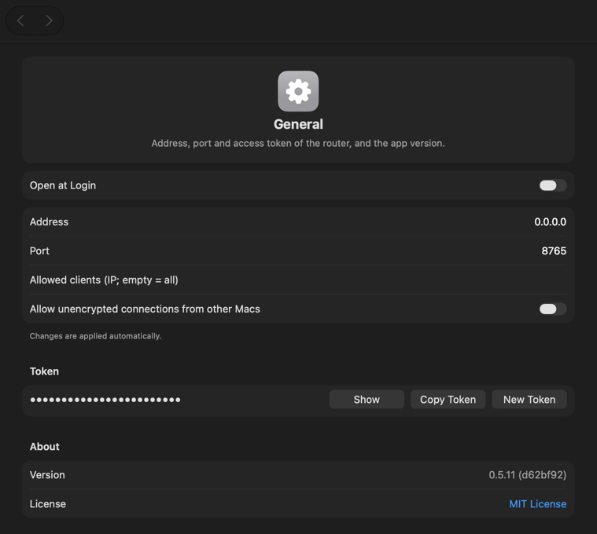
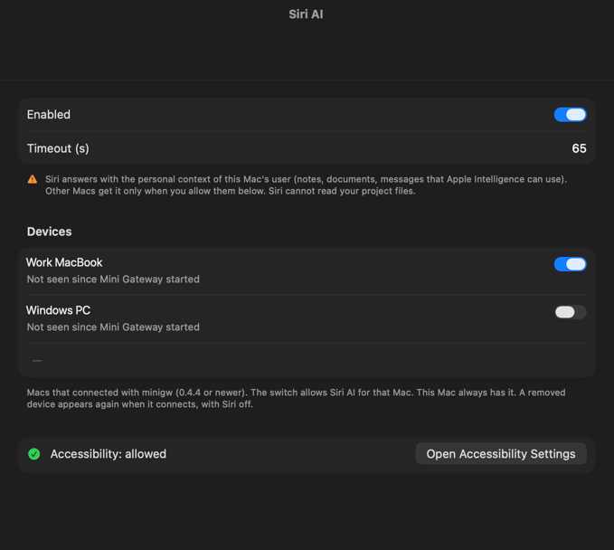
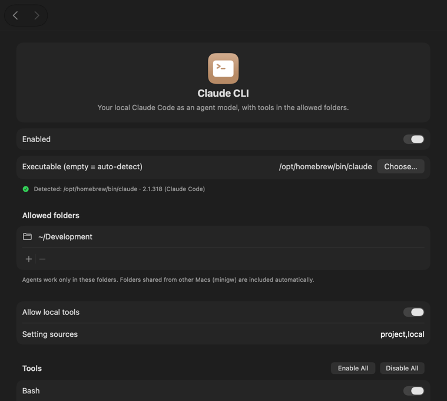
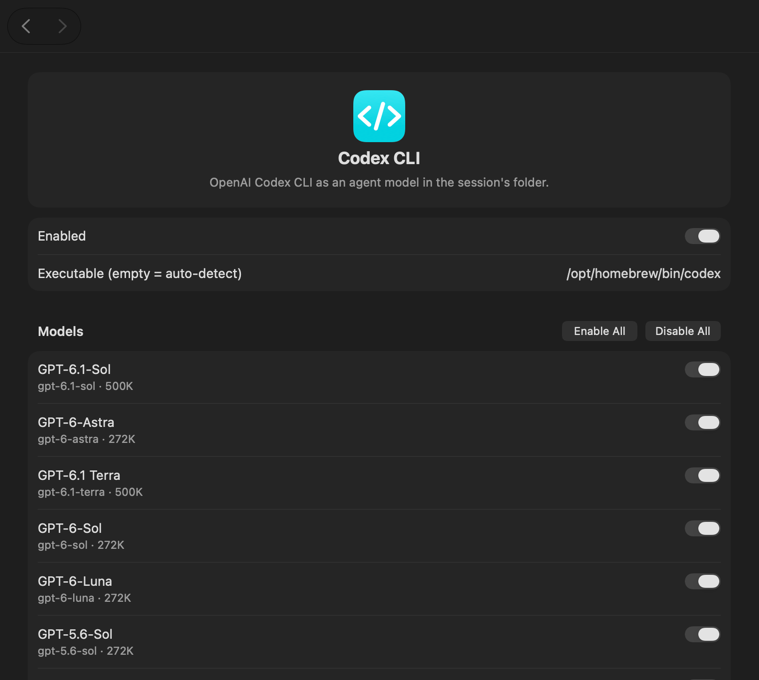

# Running the gateway

The gateway runs on one computer and serves every client. Install it with `/minigw:gw install` or as in
[install.md](install.md); this page covers running and configuring it.

- [Mac app or minigw serve](#mac-app-or-minigw-serve)
- [Network and firewall](#network-and-firewall)
- [Devices](#devices)
- [Settings](#settings)
- [Providers](#providers)
- [Change settings from the command line](#change-settings-from-the-command-line)
- [minigw serve on Windows and Linux](#minigw-serve-on-windows-and-linux)
- [Where things are stored](#where-things-are-stored)

## Mac app or minigw serve

| | Mac app (Mini Gateway) | `minigw serve` |
|---|---|---|
| Systems | macOS 27 on Apple Silicon | Windows, Linux |
| Runs as | Menu bar app | Tray icon (Windows), systemd user unit (Linux), or a terminal |
| Settings | Settings window | Settings page in the browser ([below](#settings-page)) |
| Autostart | Open at Login | At sign-in (Windows), at boot with linger or at sign-in (Linux) |
| Claude CLI, Codex, Grok, Copilot, Foundry Local, providers | yes | yes |
| Siri AI, Apple Foundation Models | yes | – |
| Work modes | auto, worktree, sync, direct, native, native-direct | auto, worktree, sync |
| `minigw run` | yes | – |
| Listens on | `127.0.0.1:8765` until you change it | all addresses, port 8765 |

Both speak the same protocol and the same [admin API](admin-api.md), so every client works with both.
[windows-parity.md](windows-parity.md) lists every setting on both, control by control.

## Network and firewall

- **Mac app:** it listens only on `127.0.0.1` at first, so only the Mac itself can use it. For other computers set
  the address to `0.0.0.0` in **Settings → General** (a change of address or port needs a restart).
- **`minigw serve`:** it listens on all addresses by default. The address may be empty (all), `0.0.0.0`, `::` or
  `127.0.0.1`: the admin API must stay reachable on `127.0.0.1`.
- **Firewall:** `minigw serve install` adds no firewall rule. If a firewall runs on the gateway computer, allow
  inbound TCP on the gateway port (8765) for the clients' network. To limit who may connect, use **Allowed client
  IPs** (Devices) or the firewall.
- **Mac and providers on the local network:** when the gateway cannot reach a provider on the same subnet, allow
  Mini Gateway in System Settings → Privacy & Security → Local Network.
- **Never forward the port to loopback** (`ssh -L`, `netsh interface portproxy`, a reverse proxy): loopback
  connections skip the device check ([how-it-works.md](how-it-works.md#the-connection)).

## Devices

A new client connects with the token, then waits for approval. Approve it in one of these places:

- **Mac:** **Settings… → Devices**, or the menu bar (Waiting for approval, with a notification).
- **Windows:** the tray menu (Waiting for approval, with a notification) or the settings page.
- **Anywhere:** `minigw gw devices allow <id>` on the gateway, or `/minigw:gw devices allow <id>`.

Compare the ID with the one `minigw status` shows on the client first. Anyone with the token can try to connect, and
a name proves nothing. Then run `minigw connect` on the client again.

```sh
minigw gw devices                        # allowed and waiting devices
minigw gw devices allow <id> --name Laptop
minigw gw devices deny <id>              # remove or reject (not a block list)
minigw gw token rotate                   # lock everyone out; clients need the new connect line
```

## Settings

The Mac app's **Settings…** window and the `minigw serve` settings page have the same panes. Changes apply at once.

- **General:** listen address and port (`0.0.0.0` for other computers), access token (Show, **Copy Token**,
  **New Token**), **Allow this user's apps without a token** (off by default; see
  [how-it-works.md → Security notes](how-it-works.md#security-notes)), Scratch folder (agents' copies and clones;
  pick a fast disk, not a temporary or build cache folder), Open at Login / Start at sign-in, About. Mac only: **Worktree mode** (network for builds,
  network for Codex builds) and **minigw run** (which devices may run builds, each with or without network).
- **Devices:** **Allow any device with the token** (only while no device is allowed), allowed client IPs,
  unencrypted connections from other computers, devices waiting for approval (editable name, ID, address, time, OS,
  minigw version; **Allow** / **Reject**), allowed devices (rename, ID, last seen, **History**, **Copy ID**,
  **Remove**).
- **Sessions:** the last 200 client sessions with device, folder, work mode and models; open one for requests,
  errors, refusals, time and tokens per model. **Clear History**. No prompt text is stored.
- **Providers** (LiteLLM, OpenRouter or any other Anthropic-compatible one): name, base URL, API key, **Allow http**,
  a switch per discovered model. **+ / −** under the sidebar adds or removes providers.
- **Siri AI** (Mac): off by default; turning it on asks for Accessibility permission. Lists the devices that may use
  Siri (this Mac always may).
- **Apple Foundation Models** (Mac): on-device model and its instructions.
- **Foundry Local:** off by default; Microsoft's on-device models, a switch per model, instructions.
- **Claude CLI:** path to `claude`, allowed folders, **Allow local tools** with a table to exclude tools, the
  `minigw` command-line tool (Mac: Install). On Windows also **Allow commands without a sandbox**.
- **Codex CLI / Grok CLI / Copilot CLI:** off by default; a switch per model, **Allow writing**, network (Codex,
  Copilot), and for Copilot **Allow commands** with its own GitHub token.
- **May ask other models** (each agent pane, off by default): the agent may ask another model of this gateway with
  `minigw -p --model <id> "…"`, in the same folder and with your device's rights, one level deep, never its own kind.
  Claude CLI needs **Allow local tools**, Codex its network switch. On Windows Codex can ask only with its unelevated
  sandbox (`[windows]` `sandbox = "unelevated"` in `~/.codex/config.toml`).

<table>
<tr><td></td>
<td></td></tr>
<tr><td></td>
<td></td></tr>
</table>

### Settings in the terminal

`minigw gw settings` shows the settings in the terminal, on any gateway (the Mac app and `minigw serve`), also over
SSH and inside tmux: the pages General, Devices, Providers, Agents and Folders, keyboard only (←/→ page, ↑/↓ move,
Enter change, q quit), no colors. It is the helper `minigw-tui` next to `minigw` (on the Mac in the app's
`Contents/Helpers`). It reads and changes everything through `minigw gw api` of the same `minigw`, so the same rules
apply: only on the gateway computer, as the user who runs the gateway. API keys and the Copilot token you type go to
`minigw` on stdin and are never shown; the connect line with the token appears only after **Show the connect line**.

### Settings page

The `minigw serve` settings page opens from **Settings…** in the Windows tray, or with a link that
`minigw gw settings link` prints. The link is one-time and valid for 60 seconds. Open it on the gateway computer, or
through `ssh -L <port>:127.0.0.1:<port>` with the same port on both ends (the page checks the port). With the
Windows tray, **Choose…** and **Browse…** open the Windows file dialog; elsewhere you type the path.

## Providers

Any Anthropic-compatible upstream works: OpenRouter, LiteLLM, or another. Add as many as you like, each with its own
key. LiteLLM (`http://localhost:4000`) and OpenRouter (`https://openrouter.ai/api`) are always listed and stay off
until you set a key.

```sh
minigw gw provider add openrouter https://openrouter.ai/api   # asks for the API key (or reads it from stdin)
minigw gw provider models openrouter --enable anthropic/claude-sonnet-4.5,openai/gpt-5
minigw gw provider models openrouter haiku                    # enabled models matching "haiku"; --all also the others
minigw gw provider list
```

- The gateway passes requests through unchanged, streaming and tools included.
- A provider with more than 20 models starts with none enabled.
- The URL must be `https`. `http` works only to localhost, a private IP or a `.local` name, with `--insecure`
  (**Allow http**).
- Clients see the models as `claude-<id>` ([usage.md → the `claude-` rule](usage.md#models)).

## Change settings from the command line

`minigw gw …` changes the gateway on this computer at once, on every system ([commands.md](commands.md#gateway-minigw-gw)):

```sh
minigw gw status
minigw gw provider add Lab https://gw.example     # the key comes from stdin or a hidden prompt
minigw gw autostart on
```

- **Mac:** the app must be running. The first time, macOS asks whether `minigw` may use the app's Keychain item (the
  admin secret). `minigw` talks to the app only after the app proves its gateway key.
- **Windows and Linux:** with the gateway stopped, `minigw gw` changes `serve.json`. Port and address need a restart.

The admin API behind it is in [admin-api.md](admin-api.md). It answers only on the gateway computer.

## minigw serve on Windows and Linux

`minigw serve` turns a Windows or Linux computer into a gateway: Claude Code there as `claude-cli-opus`,
`claude-cli-sonnet` and `claude-cli-haiku` (`claude-cli-fable` works by name but is not listed), Codex, Grok and
Copilot (off by default), Foundry Local, and providers. No Siri or Apple models.

```sh
minigw serve init            # creates the config with a new token and gateway key, prints the connect line
minigw serve install         # install, start now and at sign-in or boot
minigw serve                 # or run it in this terminal (--port, --config)
```

- **Claude Code** must be installed there. On Windows `minigw serve` runs the native `claude.exe`, never `claude.cmd`.
- **Work modes:** agents work in a synced copy or, for a git repository, in a clone on a branch. With no mode chosen
  the client picks worktree or sync; an explicit `--minigw-work=direct` is refused.
- **Agents' tools:** Claude CLI's default tools are `Read,Grep,Glob,Edit,Write,MultiEdit`, limited to the session
  folder. `Bash` runs in Claude Code's sandbox on Linux (needs `bubblewrap` and `socat`). On Windows there is no
  sandbox, so it also needs **Allow commands without a sandbox** (`minigw gw claude --allow-unsandboxed-bash=true`):
  agents can then run any command as you and read the provider API keys and the admin secret. On Linux Codex, Grok
  and Copilot run under `bwrap`.
- **Allowed folders** may not contain the Scratch folder or sit inside it: such a folder is refused, and ignored at
  start.

**Install on Windows.** `minigw serve install` installs to `%LocalAppData%\Programs\Mini Gateway` with the tray icon,
adds it to PATH and starts the tray at sign-in, without admin rights. The tray executable is downloaded and checked
against the release's signed `SHA256SUMS` if it is not next to `minigw.exe`. The MSI does the same
([install.md → Windows installer](install.md#windows-installer-msi)).

**Install on Linux.** `minigw serve install` installs to `~/.local/bin` with a systemd user unit
(`minigw-serve.service`) and turns on linger (`loginctl enable-linger`, or `sudo -n` without a password) so the
gateway starts at boot. If neither works it prints the `sudo loginctl enable-linger <user>` line; until then the
gateway starts at sign-in.

**Update and remove.** Run `minigw serve install` again to update (or `/minigw:gw update`). `minigw serve uninstall`
stops the gateway and removes autostart; the config and keys stay. An MSI install is removed in Settings → Apps.

**Windows tray.** `minigw-tray.exe` is the same gateway with an icon in the notification area. On first start it
creates the config. Its menu shows the status, devices waiting for approval (Allow / Reject), **Settings…**,
**Copy Token**, **Start at sign-in**, **Open log** and **Quit**.

## Where things are stored

| What | Mac app | Windows | Linux |
|---|---|---|---|
| Settings | `~/Library/Preferences/dev.trojar.minigateway.plist` | `%AppData%\minigw\serve.json` | `~/.config/minigw/serve.json` (mode 0600) |
| Token, gateway key | Keychain | `serve.json` | `serve.json` |
| Provider API keys | Keychain | Credential Manager | Secret Service (`secret-tool`), else `gateway-keys.json` (mode 0600) next to `serve.json` |
| Admin secret | Keychain | `admin.secret` in the config folder | `admin.secret` in the config folder |
| Log | – | `minigw-serve.log` in the config folder (tray) | the systemd journal |
| Agents' copies and clones | Scratch folder (Settings → General) | Scratch folder | Scratch folder |
