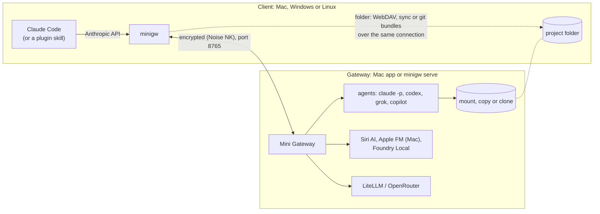

# How Mini Gateway works

What happens between Claude Code, the `minigw` client, the gateway and an agent, and which limits and protections
the gateway applies. For day-to-day use see [usage.md](usage.md).

- [Request flow](#request-flow)
- [The connection](#the-connection)
- [Devices and tokens](#devices-and-tokens)
- [How the folder reaches the agent](#how-the-folder-reaches-the-agent)
- [Protected paths](#protected-paths)
- [What minigw passes to Claude Code](#what-minigw-passes-to-claude-code)
- [minigw run sandbox](#minigw-run-sandbox)
- [Limits](#limits)
- [Session history](#session-history)
- [Security notes](#security-notes)

## Request flow

1. `minigw` starts `claude` with `ANTHROPIC_BASE_URL` pointing at the gateway (for an encrypted gateway, at a local
   proxy on `127.0.0.1` that `minigw` runs). Claude Code sends ordinary Anthropic Messages API requests
   (`/v1/messages`, `/v1/models`, `count_tokens`).
2. `minigw` forwards each request over one encrypted connection to the gateway, with the session ID, the folder and
   the work mode in headers.
3. The gateway checks the token and the device, then picks the provider by the model name
   ([usage.md → Models](usage.md#models)).
4. For an agent model, the gateway first makes sure it has the folder (mount, synced copy or clone), then runs the
   agent CLI there with the switches from its settings.
5. The answer streams back the same way. In worktree mode `minigw` then fetches the agent's branch into your
   repository, and each nested repository's branch into that repository.

The gateway on another computer never connects back to the client. Everything goes through the connection that
`minigw` opens.

## The connection

- **Encryption.** Between `minigw` and a gateway on another computer everything is encrypted, WireGuard-style:
  Noise NK with Curve25519. Current clients use AES-256-GCM; the Mac gateway also accepts ChaCha20-Poly1305 from
  older macOS clients.
- **Gateway key.** The token from **Copy Token** (or `minigw gw token`) contains the gateway's public key after a `#`.
  `minigw` talks only to the gateway that holds that key.
- **Port.** 8765 by default, on both gateways.
- **Unencrypted connections** are accepted only from the gateway computer itself, unless you turn on **Allow
  unencrypted connections from other Macs** (other computers on `minigw serve`).
- **Loopback.** Connections from the gateway computer itself skip the device check and encryption. Do not forward the
  gateway port to loopback (`ssh -L`, `netsh interface portproxy`, a reverse proxy): remote clients would get the
  same trust.

## Devices and tokens

- Every request needs the gateway token.
- Each client has one device key (for all profiles). A new device waits for approval on both gateways. Anyone with
  the token can try to connect, so compare the device ID that `minigw status` shows on the client before you allow
  it. A device's name is only a label.
- A client without a device key (minigw before 0.4.4, unencrypted clients) is accepted only while no device is
  allowed and **Allow any device with the token** is on.
- **Reject** is not a block list: a rejected device can ask again with the token. To lock someone out, remove the
  device and rotate the token (**New Token** or `minigw gw token rotate`).
- How to approve a device: [gateway.md → Devices](gateway.md#devices).

## How the folder reaches the agent

| Mode | Transport | Where the agent works |
|---|---|---|
| direct | The gateway Mac mounts the folder with macOS's own WebDAV client; requests go over the encrypted connection | The client's files |
| sync | Files go over the connection before each request, changes come back after it | A copy in the gateway's Scratch folder |
| worktree | Git bundles with only the missing objects | A clone of a mirror in Scratch |
| native | Nothing; the folder is the gateway's own SMB share (also the automatic home share, see [usage](usage.md#native-mode-and-builds-on-the-gateway-mac)); never the home folder itself, a top-level hidden folder or `~/Library` (resolved path) | The gateway's folder, or a clone of it |

Details:

- The direct-mode mount URL contains a secret that local processes can see (`mount`, `ps`). The gateway therefore
  serves a mount only to the system `webdavfs_agent` process that its own mount started; an agent or another local
  user with the URL is refused.
- The gateway caches folder listings (PROPFIND) for 10 seconds, like davfs2's `dir_refresh`. Writes through the
  mount clear the cache at once; changes made on the client outside the mount show up within 10 seconds.
- The folder's own Claude Code settings and hooks are not loaded on the gateway.
- Neither are its Codex project settings (`.codex/config.toml`: `notify`, `mcp_servers`, hooks and the rest, which
  would run outside Codex's sandbox): the gateway marks the run's folder and every folder above it as untrusted for
  that run (`-c projects={"<folder>"={trust_level="untrusted"},…}`), so a project or parent folder trusted in
  `~/.codex/config.toml` does not load them. Every gateway Codex run, every mode, both gateways.
- Sync copies of all devices are in the gateway's Scratch folder. Agents that can read every file of the gateway's
  user (Codex and Grok on the Mac, Codex on Windows without its own sandbox, any agent on a Windows gateway without
  the Windows sandbox) can read them too. Keep Scratch on APFS, NTFS or ext4:
  exFAT ignores the folder's private permissions.
- What the sandboxes hide as Scratch (Mac `minigw run`, Copilot and Claude CLI on the Mac, Claude CLI's `denyRead` and
  bwrap on Linux) is worked out at each run from the layout: the current Scratch; on the Mac its fallback in the
  default base (used while the chosen disk is unplugged) and the old default `Scratch`; on `minigw serve` the old
  default `~/.cache/minigw/scratch`; and, in the Scratch base and in the default base, every folder with an owner file
  (other gateways'), every folder named `<instance>.old-<YYYY-MM-DD>` (optionally `-<HHMMSS>`: this gateway's kept
  folders after Take over; a folder such as `Work.old-2025` is not one) and, Mac only, `Mini Gateway Scratch`.
  The base itself and other folders in it stay visible. Paths are resolved (`/private`, links). The run's own folders
  in Scratch (temporary folder, DerivedData, sync copy or clone) are allowed again after these rules. An allowed
  folder inside one of these folders, or around one, is left out of the agent's folders (Mac: refused as the working
  folder; `minigw serve`: not passed to Claude CLI, Codex, Grok or Copilot). Windows: the MXC box sees only its
  granted folders; Codex outside the box sees everything, and Copilot is not supported on a Windows gateway (see [windows-parity](windows-parity.md)).
  A Scratch base that is, or is inside, a folder with another gateway's owner file is refused; this check runs when
  Scratch is set or moved, not at start.
- In worktree mode the gateway never runs git with the agent's own `.git` (config, hooks) and reads the clone only
  from a sandbox. On Linux `minigw serve` pins the clone's `.git` with bwrap (`.git/config`, `hooks` and `info`
  read-only); without the pin Linux watches `.git` with inotify (no watch: the run is refused), and macOS and Windows
  `minigw serve` check it every second; a change stops the run.
- Each nested repository or submodule that git does not ignore has its own mirror
  (`repos/<device>/<id>-<key>.git`) and its own clone at its path in the agent's clone. Every clone's `.git` gets the
  same protection as the top one (read-only config, hooks, info and commondir, the bwrap pin and the change check).
  git started by the agent CLIs runs only with the `.git` of one of these clones as `GIT_DIR`; a repository the agent
  creates is never entered and stops that run's branch. Untracked nested repositories are excluded in the parent
  clone's `.git/info/exclude` before the agent starts. After the run the gateway stops the agent's leftover processes
  (also ones that left the clone or the session but carry its `GIT_WORK_TREE`), commits each clone's changes on its
  branch from the clone's real path (checked before and after, the result is dropped if a folder was swapped for a
  link; on the Mac git can read only that path), deepest first so a submodule's parent records its new commit, checks
  the objects (fsck) and sends one bundle per repository; all bundles of one upload together stay within 4 GB.
  In native mode on the Mac the same happens with the repositories in the share; git on the gateway reads them
  without the system or user git config.
- Repositories an agent creates (`git init`, `git clone`, CMake FetchContent, SwiftPM) go only to the conversation's
  dependencies folder `$MINIGW_DEPS`, next to the clone under Scratch (`<clone>.deps`). The `git` on the agent's PATH
  allows `init` and `clone` only there and only for a command in the agent's sandbox (Claude Code marks its sandboxed
  Bash with `SANDBOX_RUNTIME=1`, the gateway marks Codex commands and the sandboxed Copilot with `MINIGW_SANDBOXED=1`);
  there it runs plain git without the clone's `GIT_DIR`. Everywhere else, and for the agent CLIs themselves (outside
  the sandbox, without the markers), git keeps working only in the registered clones. The folder lives as long as the
  clone, is never delivered and is not kept with a kept clone. On Windows (in the Windows sandbox) the `git` on the
  agent's PATH is a copy of `minigw.exe` named `git.exe` (under `Scratch\gitexec\win-<hash>`, checked against its hash
  before use; stale copies are removed at start), with the same `init`/`clone` rule; every other git command goes
  unchanged to the real git.
- **Windows sandbox (minigw serve, #68).** On Windows the gateway starts Claude CLI and Grok as a whole (the CLI
  and every command it runs; Codex and Copilot cannot start there: both fail on Rust `std::fs::canonicalize`,
  "Access is denied (os error 5)", so they run outside it only with **Allow commands without a sandbox**) in a Microsoft MXC process container (`wxc-exec.exe` from MXC 1.0.1 in the
  install folder's `mxc` subfolder; low integrity and an AppContainer, no admin rights). It needs Windows 11 build
  26100.9278 / 26200.9278 or later (the Windows process container); an older build is refused before the probe, with
  the build in the reason. At start the gateway checks `wxc-exec.exe` against the SHA-256 built into minigw (again
  before every run; the `mxc` folder may hold only `wxc-exec.exe` and `LICENSE.txt`, and during a run the gateway
  keeps `wxc-exec.exe` open so it cannot be changed or deleted) and runs a probe in the container (prompt on stdin and
  exit code, writing a granted folder, the config folder's `admin.secret` unreadable). If any check fails, the
  settings page shows "Agent sandbox: not available (reason)" and agents run only with **Allow commands without a
  sandbox**, as before. The probe also tries a connection to the gateway on 127.0.0.1; that does not decide
  availability: when it fails (loopback may need a newer cumulative update), the gateway log says so and
  `status.agentSandbox` says "May ask other models" does not work. Inside the container reads are an allow-list too:
  - read and write: the clone or synced copy (only when the agent may write), `$MINIGW_DEPS`, the project's Maven
    repository and caches, a temporary folder for the run under Scratch (`Scratch\tmp\run-*`: `TEMP`, `TMP` and a
    fresh home, `USERPROFILE`, `APPDATA`, `LOCALAPPDATA`; Claude's `CLAUDE_CONFIG_DIR` is there too), and Grok's
    per-device `GROK_HOME` under `Scratch\state\<device>\` (Copilot gets a fresh `COPILOT_HOME` per request);
  - read only: the folders on `PATH` except Git's MSYS2 tools (`Git\usr\bin`, which cannot run there), folders above
    the home and folders in or above the Scratch or config folders; folders on `PATH` inside your home (for example
    `~\.local\bin`) are readable, and the settings page warns about them, so keep no secrets there; the CLI's own
    folder, the Git install, `JAVA_HOME`, `MAVEN_HOME`, `GRADLE_HOME`, `DOTNET_ROOT`, `GOROOT` and the minigw install
    folder; for a `PATH` folder named `bin` also the folder above it (the tool's root: Maven's `boot`, `lib`, `conf`, a
    JDK), except a drive root or a folder in or above the home, Scratch or config folders; the mirror objects in
    worktree mode;
  - denied: the gateway's config folder. Everything else (your home folder, other devices' copies, the rest of Scratch,
    the registry outside the container) is not readable. The container can list the names in the folders above the
    folders it may write and above its working folder (git needs them), not above read-only ones; with Scratch (for example
    `%LOCALAPPDATA%\minigw\scratch`, the default of installs before #68) or an allowed folder inside your home, that includes the home and every
    folder on the way, and the gateway warns about Scratch there: move it outside your home with the settings page's Scratch field. New
    installs and the Scratch **Default** button use `<first fixed drive that is not the system drive, else the system
    drive>\minigw-scratch\<instance>` (0.5.24; for example `D:\minigw-scratch\gw-3f9a1c2b7d4e`), with an owner-only protected
    access list; existing `\minigw-scratch\<Windows user name>` folders stay. On every platform the Scratch setting names a base
    folder and each gateway's Scratch is `<base>/<instance>`: an owner file (`.minigw-owner`) holds the gateway's instance ID,
    and a running gateway holds a lock on it (Windows: the open folder handle; macOS and Linux: `flock` on `.minigw-lock`).
    A folder of another gateway is not used (no agents, no cleanup) until it is taken over with **Take over** (only for
    a stale owner: rename, never merge). A Scratch base on a network drive shared by more than one computer is not
    supported (`flock` may not work there). MXC may let a listing grant reach subfolders (HPX360 saw
    `dir ~\.ssh` list names while reading the files was denied): names can show, file contents cannot.
  - The request for each run (it holds the Claude token or an API key you chose) is written to `Scratch\tmp\mxc`, a
    folder only your user can open (protected access list, also on a D: drive), outside every grant, and deleted after
    the run; leftovers are deleted when the gateway starts. Inherited environment variables ending in `_API_KEY` never
    reach an agent. Grok's home in the box keeps only `auth.json`, `config.toml` and its sessions between runs.
  - Logins: agents use subscription logins, never API keys unless you set one, and nothing is ever copied back from
    the container. Claude gets the long-lived token from `claude setup-token` (your Claude subscription, valid one
    year), stored in Credential Manager and passed as `CLAUDE_CODE_OAUTH_TOKEN`; `~\.claude` is never copied in.
    Without the token a Claude request is refused: "Claude CLI in the Windows sandbox needs a long-lived sign-in token:
    run claude setup-token, then minigw gw claude token". Only the conversation's transcript is kept between turns
    (`Scratch\state\<device>\claude\sessions\<session>`), so `--resume` works. Grok has no long-lived token: before
    each run the gateway copies `~\.grok\auth.json` and `config.toml` into its `GROK_HOME` (regular files only, with a
    size limit), never back; after Grok refreshes its login you may need `grok login` again. The opt-in **Use an API
    key instead** passes `ANTHROPIC_API_KEY` or `XAI_API_KEY` from the key store (billed through the provider's API).
    API-key variables in the gateway's own environment (`ANTHROPIC_*`, `OPENAI_API_KEY`, `CODEX_API_KEY`, `XAI_API_KEY`,
    `GROK_CODE_XAI_API_KEY`, `GEMINI_API_KEY`, `GOOGLE_API_KEY`) never reach any agent run (every `minigw serve`).
  - Claude uses its PowerShell tool for commands (`Bash` in the tools list means PowerShell there) and commits its
    own work in worktree mode, as on the Mac. The per-second `.git` check runs in the container too. Network: outbound
    allowed, except Claude in worktree mode with **Network for builds** off: then the container denies all outbound
    traffic except TCP 443 to the IP addresses of `api.anthropic.com` resolved when the run starts (every A/AAAA,
    logged in the gateway log). If the name cannot be resolved, the run is refused: "Cannot resolve api.anthropic.com
    for Claude CLI without network for builds; try again, or turn on Settings → General → Worktree mode → Network for
    builds" (503). Claude's web fetch and web search and every other host fail. There is no proxy in the container:
    MXC's `allowedProxyPeer` is a package identity, not a host and port, and MXC's proxying on Windows covers only
    WinHTTP clients.
  - Loopback: the run port on 127.0.0.1 exists only with **May ask other models**; then the container gets MXC's
    `ingress.hostLoopback` "allow", which opens all of the host's 127.0.0.1 services to the agent in both directions.
    Without it loopback is denied. The gateway still refuses the agent there: the admin API refuses every process in
    the gateway's agent Job (the boxed process inherits it), the main port treats AppContainer processes as confined
    and needs the token (which the agent cannot read: the config folder is denied), and the run port accepts only that
    run's process tree with its token. Other local services (for example LiteLLM, Foundry Local) are reachable by the
    agent, so keep **May ask other models** off if you run local services you do not want agents to reach.
  - Codex does not start inside an MXC container (it cannot read its own `CODEX_HOME` there). On Windows it runs only
    with **Allow commands without a sandbox**, also when its own **elevated** Windows sandbox is set up: HPX360 showed
    a Codex command in that sandbox reading `%APPDATA%\minigw\admin.secret` and `serve.json` (its read roots cover
    most of the profile). When it is set up (`[windows] sandbox = "elevated"` in `~\.codex\config.toml` and
    `.sandbox-secrets` in `CODEX_HOME`, done once by `codex sandbox setup --elevated` as administrator) each run still
    gets `-c windows.sandbox="elevated"` as extra protection (`~\.ssh`, writes in the profile). When `config.toml` asks
    for `elevated` but it is not set up, the run is refused ("Codex's elevated Windows sandbox is not set up on the gateway: run codex sandbox setup --elevated once at the gateway PC (as administrator)") instead of Codex starting a UAC prompt nobody
    can confirm (error 1223). Codex keeps the real `~\.codex` (its ChatGPT
    login refreshes itself) and gets the run's folder under Scratch as `TEMP`/`TMP`; the opt-in API key is passed as
    `CODEX_API_KEY`.
- How a nested clone is read after the run: on the Mac the path is checked once and then never resolved again (its
  objects are opened without following links, and git's sandbox may read only that real path), so a folder swapped
  for a link afterwards is refused. On Linux the clone folder is opened once and bound into a bwrap sandbox for git, so
  a later swap changes nothing; every agent runs in its own process namespace and cannot outlive its run. A Linux
  gateway without bwrap, or a run without its own process namespace, does not return nested repositories.

## Protected paths

In direct and sync mode, writes to these paths are refused, at any depth:

- `.git` (in any letter case, also `git~1`)
- `.claude/settings*.json`, `.claude/hooks`, `.claude/commands`, `.claude/agents`, `.claude/skills`
- `.husky`, `.githooks`, `.vscode/tasks.json`, `.envrc`

The check uses the real path, so a link in the folder (for example `hooks → .git/hooks`) does not get around it.
Moving, copying or deleting a folder is refused too when it would create or remove one of these files. Reading
still works. In sync mode such files are never copied back.

This list is defence in depth, not a sandbox for your folder. An agent that may write can still add code that runs
on your computer later, for example in `package.json` scripts, a `Makefile` or `.mcp.json`. Review an agent's
changes before you run builds or hooks, or share the folder read-only.

Native mode does not protect these paths: the agent can change every file there.

## What minigw passes to Claude Code

In a terminal every `claude` option works. Inside Claude Code (a skill, a subagent or its Bash tool) minigw passes
on only these options and refuses any other:

`-p`/`--print`, `--model`, `--output-format`, `--verbose`, `--max-turns`, `--append-system-prompt`,
`--fallback-model`, `-h`/`--help`

After `--` everything is the prompt. Inside Claude Code minigw also refuses a prompt (in the arguments or on stdin)
that starts with `/`, and a prompt argument that has `@` at the start of a word. Text on stdin may contain `@` (the
`@@` lines of a diff) only with Claude Code 2.1.299 or newer; with an older Claude Code minigw refuses it. With `-p`,
inside Claude Code, or with stdin that is not a terminal, the nested `claude` runs with file mentions and slash
commands off; inside Claude Code minigw also passes `--settings` so that your `settings.json` cannot turn file
mentions back on. `MINIGW_ALLOW_UNSAFE_FLAGS=1` turns these checks off for a person who wants them off.

The reason: other options (`--dangerously-skip-permissions`, `--allowedTools`, `--add-dir`, `--settings` …) would give
the nested, gateway-driven `claude` permissions the user never approved.

With `-p` and no `--output-format`, minigw runs `claude` with `--output-format stream-json --verbose
--include-partial-messages` and prints every text the model writes as it arrives, piece by piece (all turns, a blank line
between them, without terminal control characters); a line the model writes before a tool is finished on stdout
before that tool's stderr line. Tool use shows on stderr as one `minigw: · <tool>` line, also the
tools of a gateway agent (a Claude CLI agent sends its whole run as one streamed answer, its tools marked `⏺ <tool>`); a
tool name other than letters, digits and `_.:@/-` (at most 80) shows as `tool`. Codex, Grok, Copilot and Siri AI (Mac)
send only their final answer, when they finish. The `agent work is on branch …` lines wait until the answer is printed,
so they come on stderr after it. When the only text refers back ("above", "zgoraj"), minigw warns on stderr that the
answer may be incomplete. An explicit `--output-format` turns this off and is passed through unchanged.
With a provider model (not opus, sonnet, haiku, fable or an agent model) minigw also sets `ANTHROPIC_DEFAULT_HAIKU_MODEL`
and `ANTHROPIC_SMALL_FAST_MODEL` to it, unless you set them. On every run (also interactive) minigw sets `ENABLE_CLAUDEAI_MCP_SERVERS=false` unless
you set it: with the gateway's token claude.ai connectors cannot load, and Claude Code would warn about it on every run.

## minigw run sandbox

`minigw run` (Mac gateway, native mode) runs a build in the gateway's folder. It is outside the agent sandbox: the
build runs the project's code with your rights on the gateway. Enable it only for devices you would trust with your
user account there.

- Off by default; on per device in **Settings → General → minigw run** or with the admin API (`PATCH /run`).
- Only the listed commands run (default `mvn, swift, xcodebuild`), without a shell, at most two at a time per device.
- A `sandbox-exec` profile lets it write only to the folder (not its `.git`), `~/.m2` (not `settings*.xml`,
  `extensions.xml`) and SwiftPM's folders (not their configuration); not `~/Library/Developer` or `~/Library/Caches`.
- Each run gets its own temporary folder in the gateway's Scratch folder (`tmp/run-<id>`), removed when the run ends:
  `TMPDIR`, `TMP`, `TEMP`, the clang module cache and `java.io.tmpdir` of every Java process (through
  `JAVA_TOOL_OPTIONS`, so Java prints "Picked up JAVA_TOOL_OPTIONS") point there. The shared `/tmp` is not writable.
- macOS's per-user temporary and cache folders (`/var/folders/…/T` and `…/C`, which Foundation and Swift Build use
  instead of `TMPDIR`) are moved there too: the run gets `DIRHELPER_USER_DIR_SUFFIX=dev.trojar.minigateway.run-<id>`
  and the gateway links `…/T/<that name>` and `…/C/<that name>` to `T` and `C` in the run's folder (the links are
  removed when the run ends, dangling ones at app start). A run never starts without both links. So `swift test`
  and `swift build`/`run` of packages with resources work, with their products in the usual `.build`.
- The only writes outside the folder, the build caches above and Scratch are macOS's own save copies in the user
  temporary folder (`/var/folders/…/T`), because the link step of `swift build` gets an environment without the
  redirect and Foundation picks the save-copy folder by disk: new `TemporaryItems/NSIRD_*` folders (every atomic file save by Foundation, used by
  `swift build` and `xcodebuild`) and new `TemporaryDirectory.*` folders (the `swift build` link step). With them
  `swift build` and `xcodebuild` work. The build can create such folders and write inside them, but cannot rename,
  delete or replace them or write any other file there. A build could still change the contents of such a folder that
  another program of yours is using at the same moment. When the run ends the gateway removes such folders that were
  created during the run and are empty (or hold only an empty `.keep-directory`); existing folders and other files
  stay.
- When the folder is on another disk (for example `/Volumes/Java`), Foundation puts its save copies on that disk, in
  `/Volumes/<disk>/.TemporaryItems/folders.<uid>/TemporaryItems`. The same rule applies there: new `NSIRD_*` folders
  (and that path's folders when missing), nothing else on the disk.
- `swift build|test|run|package` get `--cache-path` in the run's temporary folder, so SwiftPM keeps its manifest and
  repository cache in Scratch. SwiftPM's configuration and package fingerprints (`~/Library/org.swift.swiftpm`) stay
  read-only, so your mirrors and the fingerprint check still apply; SwiftPM warns that it "is not accessible or not
  writable". The warnings "couldn't create cache file '/var/folders/…/T/xcrun_db-…'" are harmless: `xcrun` then
  runs without its cache.
- `xcodebuild` gets `-resultBundlePath`, `-packageCachePath` and `-clonedSourcePackagesDirPath` in the run's
  temporary folder (unless you pass them yourself) and `-IDEDisablePackageManifestCaching=YES`, so Swift packages
  without an `.xcodeproj` build too (Xcode otherwise writes its result bundle to `/var/folders/…/T` and manifest
  diagnostics to `~/Library/Caches`).
- `xcodebuild` also gets `-derivedDataPath <Scratch>/deriveddata/<id>` (unless you pass it): one folder per project
  folder (`<id>` is derived from the folder's path), kept between runs so the next build is incremental. These folders
  are not removed automatically; delete `deriveddata` in the Scratch folder to free the space (the next build is then a
  full build).
- It hides `~/.ssh`, `~/.aws`, `~/.gnupg`, `~/.netrc`, `~/.git-credentials`, `~/.npmrc`, `~/.pypirc`,
  `~/.gradle/gradle.properties`, shell histories, `~/.config`, `~/.docker`, `~/.kube`, the keychains, cookies,
  `~/Library/Application Support`, `Containers`, `Group Containers`, `Mail`, `Messages`, and Mini Gateway's Scratch
  folder and preferences. The rules also cover the resolved paths of links, and the gateway refuses the run when the
  folder or a writable folder is a link.
- It also blocks writing preferences, creating launchd jobs, opening apps and sending Apple events.
- Unix sockets are blocked (only DNS and syslog), so a build cannot reach Docker or an SSH agent. The gateway's own
  port is always blocked.
- Network is on per device. Off is best effort: it blocks direct connections and `nsurlsessiond`, but another system
  service could still reach the network.
- The gateway runs `swift build|test|run|package` with `--disable-sandbox` and `xcodebuild` without its package and
  script sandboxes, because a sandbox cannot run inside another.
- Stopping minigw stops the whole process group. In a terminal minigw shows only colours from the output, no other
  escape sequences.

## Limits

| Limit | Value |
|---|---|
| File an agent reads in one piece (direct mode) | 32 MB (larger files only in ranges) |
| Folder for sync | at most 100 000 files or 8 GB |
| Synced folders per device | 32 |
| Unused sync copy | deleted after 14 days |
| Unused worktree mirror and its clones | removed after 30 days |
| Agent dependencies folder (`$MINIGW_DEPS`) | removed with its clone (end of session) |
| Folder listing cache (direct mode) | 10 seconds |
| Wait for another writing agent (native-direct, direct, `minigw run`) | 5 minutes |
| `minigw run` at once | 2 per device |
| Siri AI: text from mentioned files | about 16 000 characters; up to 4 images or PDFs |
| Session history | last 200 sessions; last 20 connections per device |
| Settings page link | one-time, 60 seconds |

## Session history

Both gateways keep the last 200 client sessions: time, device, folder, work mode, role, and per model the requests,
errors, refusals, time and tokens. It stores folder paths, branch names and client addresses, never prompt text, and
stays on the gateway computer. See it in **Settings → Sessions** or with `minigw gw sessions`.

## Security notes

- **Trust the gateway.** With a remote gateway, `minigw` gives the gateway computer read and write access to the
  current folder while it runs (nothing outside it). Use it only with a gateway you trust.
- **Listen address.** The Mac app listens only on `127.0.0.1` until you change it. `minigw serve` listens on all
  addresses by default; limit clients with **Allowed client IPs** or a firewall ([gateway.md → Network](gateway.md#network-and-firewall)).
- **Claude CLI agents** run only inside the allowed folders, with the tools and permission mode you configure
  (default: read-only, `dontAsk`).
- **This user's apps without a token.** With **Allow this user's apps without a token** (General, off by default),
  programs of the gateway's own user on the same computer use the models and agents without the token, for example an
  app set to `http://127.0.0.1:8765`.
  - The gateway checks the process behind the connection (its user, and that it is not one of the gateway's agents).
    The request must carry `anthropic-version` or `x-api-key`, a loopback `Host` and no `Origin`, so a web page cannot
    send it.
  - Docker and other containers, VMs and tunnels (`ssh -R`, ngrok …) running as you also count as this user's apps.
  - Browser extensions with permission for localhost can remove `Origin` and add headers, so they can use it too.
  - Apps that call from a web view (Electron, WKWebView, WebView2) send `Origin` and need the token.
  - Sandboxed apps need the token: the Mac App Sandbox and Seatbelt (including commands run by Claude Code's
    sandboxed Bash), Flatpak and snap on Linux, AppContainer on Windows.
  - Other users of the computer, other computers and the admin API still need their token or secret. Turn it on only
    if you trust every program you run.
  - Example: `ANTHROPIC_BASE_URL=http://127.0.0.1:8765 ANTHROPIC_AUTH_TOKEN=local claude` (any value works; Claude
    Code needs one to start).
- **Providers over http.** A provider's API key goes over `http` only to localhost, a private or loopback IP or a
  `.local` name, and only with **Allow http** on. Such addresses are no proof that the provider is on your own network
  (a VPN, another Wi-Fi or a spoofed mDNS answer can serve them), so prefer `https`.
- **Windows commands.** With the Windows sandbox (MXC, see
  [How the folder reaches the agent](#how-the-folder-reaches-the-agent)) agent commands run in a container that cannot
  read your files or the gateway's settings. Without it (older Windows builds), and for Codex always (also with its
  own elevated sandbox), agents run only with **Allow commands without a sandbox**: then they can run any command as you and read
  the provider API keys in Credential Manager and the admin secret.
- **Siri AI** uses Accessibility UI automation of the Siri AI app. It only touches that app, but Accessibility is a
  powerful permission.
- **Release downloads** are checked against `SHA256SUMS`, which is signed with a key that is not on GitHub
  ([install.md → Check a download](install.md#check-a-download)).
