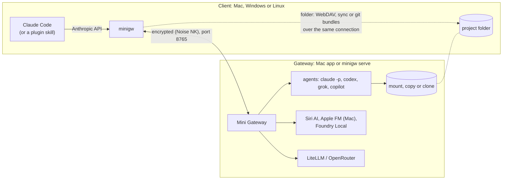

# How Mini Gateway works

What happens between Claude Code, the `minigw` client, the gateway and an agent, and which limits and protections
the gateway applies. For day-to-day use see [usage.md](usage.md).

- [Request flow](#request-flow)
- [The connection](#the-connection)
- [Devices and tokens](#devices-and-tokens)
- [How the folder reaches the agent](#how-the-folder-reaches-the-agent)
- [Protected paths](#protected-paths)
- [What minigw passes to Claude Code](#what-minigw-passes-to-claude-code)
- [minigw run sandbox](#minigw-run-sandbox)
- [Limits](#limits)
- [Session history](#session-history)
- [Security notes](#security-notes)

## Request flow

The project database keeps the outgoing title, body, class, kind, updated time and recorded provenance before a note is overwritten by an edit, accepted replacement or Markdown/bundle re-import. Schema 26 stores this history in the same transaction as the change, with separate limits of 100 historical revisions and 8 MiB per note, and 500 MiB per project (each team-note segment has its own budget). An overwrite that would exceed a limit is refused without changing the note; history is never silently pruned. Nothing shows or restores history yet. Deleting a note deletes its history. Full database backups carry history; Markdown exports, bundles, upstream pushes, search and mirrors contain only current content.

1. `minigw` starts `claude` with `ANTHROPIC_BASE_URL` pointing at the gateway (for an encrypted gateway, at a local
   proxy on `127.0.0.1` that `minigw` runs). Claude Code sends ordinary Anthropic Messages API requests
   (`/v1/messages`, `/v1/models`, `count_tokens`).
2. `minigw` forwards each request over one encrypted connection to the gateway, with the session ID, the folder and
   the work mode in headers.
3. The gateway checks the token and the device, then picks the provider by the model name
   ([usage.md → Models](usage.md#models)).
4. For an agent model, the gateway first makes sure it has the folder (mount, synced copy or clone), then runs the
   agent CLI there with the switches from its settings.
5. The answer streams back the same way. In worktree mode `minigw` then fetches the agent's branch into your
   repository, and each nested repository's branch into that repository.

The gateway on another computer never connects back to the client. Everything goes through the connection that
`minigw` opens.

## The connection

- **Encryption.** Between `minigw` and a gateway on another computer everything is encrypted, WireGuard-style:
  Noise NK with Curve25519. Current clients use AES-256-GCM; the Mac gateway also accepts ChaCha20-Poly1305 from
  older macOS clients.
- **Gateway key.** The token from **Copy Token** (or `minigw gw token`) contains the gateway's public key after a `#`.
  `minigw` talks only to the gateway that holds that key.
- **Port.** 8765 by default, on both gateways.
- **Unencrypted connections** are accepted only from the gateway computer itself, unless you turn on **Allow
  unencrypted connections from other Macs** (other computers on `minigw serve`).
- **Loopback.** Connections from the gateway computer itself skip the device check and encryption. Do not forward the
  gateway port to loopback (`ssh -L`, `netsh interface portproxy`, a reverse proxy): remote clients would get the
  same trust.

## Devices and tokens

- Every request needs the gateway token.
- Each client has one device key (for all profiles). A new device waits for approval on both gateways. Anyone with
  the token can try to connect, so compare the device ID that `minigw status` shows on the client before you allow
  it. A device's name is only a label.
- A client without a device key (minigw before 0.4.4, unencrypted clients) is accepted only while no device is
  allowed and **Allow any device with the token** is on.
- **Reject** is not a block list: a rejected device can ask again with the token. To lock someone out, remove the
  device and rotate the token (**New Token** or `minigw gw token rotate`).
- How to approve a device: [gateway.md → Devices](gateway.md#devices).

## How the folder reaches the agent

| Mode | Transport | Where the agent works |
|---|---|---|
| direct | The gateway Mac mounts the folder with macOS's own WebDAV client; requests go over the encrypted connection | The client's files |
| sync | Files go over the connection before each request, changes come back after it | A copy in the gateway's Scratch folder |
| worktree | Git bundles with only the missing objects | A clone of a mirror in Scratch |
| native | Nothing; the folder is the gateway's own SMB share (also the automatic home share, see [usage](usage.md#native-mode-and-builds-on-the-gateway-mac)); never the home folder itself, a top-level hidden folder or `~/Library` (resolved path) | The gateway's folder, or a clone of it |

Details:

- The direct-mode mount URL contains a secret that local processes can see (`mount`, `ps`). The gateway therefore
  serves a mount only to the system `webdavfs_agent` process that its own mount started; an agent or another local
  user with the URL is refused.
- minigw checks each path of a gateway request (inside the folder, protected files such as `.git`) and then acts on
  it. So that a folder moved in between cannot redirect the request, reads (GET, HEAD, PROPFIND, and the sync upload)
  share a lock on the folder; writes, copying the agent's changes back and worktree jobs take it alone. The lock also
  holds between minigw sessions on the same folder: a lock file named after the folder's identity in minigw's
  settings folder (`minigw/locks`, private to you, never in the project; `flock`, on Windows `LockFileEx`), released
  by the system if minigw crashes. A WebDAV request that waits more than 5 seconds for another session gets 503 "the
  shared folder is busy"; sync and worktree jobs wait up to the gateway's limit for the job. If the agent's work still
  cannot be copied back, the request ends with that error instead of an answer, and Claude Code does not run the
  agent again. Sync changes stay on the gateway, and only the next agent request in the folder copies them back. A
  worktree branch stays on the gateway: the next agent request (same agent) in the session delivers it; otherwise it
  is kept on the gateway for 30 days. The Go minigw client also performs DAV and sync file operations through an
  opened `os.Root`: a link or junction swapped in after a path check cannot redirect access outside the shared folder
  (#82). This applies on Windows, Linux and macOS. Links and Windows junctions that stay inside the shared folder
  work, also with an absolute target (pnpm and `npm link` trees): the client walks the path one component at a time,
  and a link whose absolute target lies inside the folder is rewritten to a path relative to the folder, up to 40
  rewrites (a loop is refused). A link or junction that leaves the folder is refused. The operation itself then goes
  through `os.Root` with the rewritten path, so a link retargeted after the walk still cannot lead out. The
  protected-path rules apply to the rewritten path, so a link into `.claude` or `.git` does not bypass them. The
  user's linked `.gitignore` remains supported for ignore rules. Mutations pin the parent directory,
  check its actual location for protected paths, and operate relative to that handle, so replacing a parent with
  a link into a protected directory during a download cannot bypass the protection. An open handle does not lock
  a directory against a local process renaming it after the check. The Swift Mac app still uses the folder locks described above.
- The gateway caches folder listings (PROPFIND) for 10 seconds, like davfs2's `dir_refresh`. Writes through the
  mount clear the cache at once; changes made on the client outside the mount show up within 10 seconds.
- The folder's own Claude Code settings and hooks are not loaded on the gateway.
- Neither are its Codex project settings (`.codex/config.toml`: `notify`, `mcp_servers`, hooks and the rest, which
  would run outside Codex's sandbox): the gateway marks the run's folder and every folder above it as untrusted for
  that run (`-c projects={"<folder>"={trust_level="untrusted"},…}`), so a project or parent folder trusted in
  `~/.codex/config.toml` does not load them. Every gateway Codex run, every mode, both gateways.
- Sync copies of all devices are in the gateway's Scratch folder. Agents that can read every file of the gateway's
  user (Codex on the Mac, Codex on Windows without its own sandbox, any agent on a Windows gateway without
  the Windows sandbox) can read them too. Keep Scratch on APFS, NTFS or ext4:
  exFAT ignores the folder's private permissions.
  The core data folder (the notes of all projects) is the exception since 0.6.0: it is denied to every agent with a sandbox,
  and on a Windows or Linux gateway with an agent without one the core stays closed unless the owner accepts that those
  agents read it ([gateway.md](gateway.md#minigw-serve-on-windows-and-linux)).
- What the sandboxes hide as Scratch (Mac `minigw run`, Copilot and Claude CLI on the Mac, Claude CLI's `denyRead` and
  bwrap on Linux) is worked out at each run from the layout: the current Scratch; on the Mac its fallback in the
  default base (used while the chosen disk is unplugged) and the old default `Scratch`; on `minigw serve` the old
  default `~/.cache/minigw/scratch`; and, in the Scratch base and in the default base, every folder with an owner file
  (other gateways'), every folder named `<instance>.old-<YYYY-MM-DD>` (optionally `-<HHMMSS>`: this gateway's kept
  folders after Take over; a folder such as `Work.old-2025` is not one) and, Mac only, `Mini Gateway Scratch`.
  The base itself and other folders in it stay visible. Paths are resolved (`/private`, links). The run's own folders
  in Scratch (temporary folder, DerivedData, sync copy or clone) are allowed again after these rules. An allowed
  folder inside one of these folders, or around one, is left out of the agent's folders (Mac: refused as the working
  folder; `minigw serve`: not passed to Claude CLI, Codex, Grok or Copilot). Windows: the MXC box sees only its
  granted folders; Codex outside the box sees everything, and Copilot is not supported on a Windows gateway (see [windows-parity](windows-parity.md)).
  A Scratch base that is, or is inside, a folder with another gateway's owner file is refused; this check runs when
  Scratch is set or moved, not at start.
- In worktree mode the gateway never runs git with the agent's own `.git` (config, hooks) and reads the clone only
  from a sandbox. On Linux `minigw serve` pins the clone's `.git` with bwrap (`.git/config`, `hooks` and `info`
  read-only); without the pin Linux watches `.git` with inotify (no watch: the run is refused), and macOS and Windows
  `minigw serve` check it every second; a change stops the run.
- Each nested repository or submodule that git does not ignore has its own mirror
  (`repos/<device>/<id>-<key>.git`) and its own clone at its path in the agent's clone. Every clone's `.git` gets the
  same protection as the top one (read-only config, hooks, info and commondir, the bwrap pin and the change check).
  git started by the agent CLIs runs only with the `.git` of one of these clones as `GIT_DIR`; a repository the agent
  creates is never entered and stops that run's branch. Untracked nested repositories are excluded in the parent
  clone's `.git/info/exclude` before the agent starts. After the run the gateway stops the agent's leftover processes
  (also ones that left the clone or the session but carry its `GIT_WORK_TREE`), commits each clone's changes on its
  branch from the clone's real path (checked before and after, the result is dropped if a folder was swapped for a
  link; on the Mac git can read only that path), deepest first so a submodule's parent records its new commit, checks
  the objects (fsck) and sends one bundle per repository; all bundles of one upload together stay within 4 GB.
  In native mode on the Mac the same happens with the repositories in the share; git on the gateway reads them
  without the system or user git config.
- Repositories an agent creates (`git init`, `git clone`, CMake FetchContent, SwiftPM) go only to the conversation's
  dependencies folder `$MINIGW_DEPS`, next to the clone under Scratch (`<clone>.deps`). The `git` on the agent's PATH
  allows `init` and `clone` only there and only for a command in the agent's sandbox (Claude Code marks its sandboxed
  Bash with `SANDBOX_RUNTIME=1`, the gateway marks Codex commands and the sandboxed Copilot with `MINIGW_SANDBOXED=1`);
  there it runs plain git without the clone's `GIT_DIR`. Everywhere else, and for the agent CLIs themselves (outside
  the sandbox, without the markers), git keeps working only in the registered clones. The folder lives as long as the
  clone, is never delivered and is not kept with a kept clone. On Windows (in the Windows sandbox) the `git` on the
  agent's PATH is a copy of `minigw.exe` named `git.exe` (under `Scratch\gitexec\win-<hash>`, checked against its hash
  before use; stale copies are removed at start), with the same `init`/`clone` rule; every other git command goes
  unchanged to the real git.
- **Copilot sign-in (#81).** Copilot uses only the gateway user's own `copilot login`; there is no token, `gh` or PAT
  path. Each request gets a fresh `COPILOT_HOME` (0700) with a newly written `config.json` that holds only
  `loggedInUsers` and `lastLoggedInUser` from the user's `~/.copilot/config.json` (read without following links, shape
  checked, every other key such as `trustedFolders` or `installedPlugins` left out). The token itself stays in the
  OS key store, addressed by host and login, not by the home path, and Copilot reads it there. `COPILOT_GITHUB_TOKEN`,
  `GH_TOKEN`, `GITHUB_TOKEN` and every inherited `COPILOT_*`/`GITHUB_COPILOT_*` are dropped (they would override the
  login or load config, trust, providers or another package), and `COPILOT_AUTO_UPDATE=false`. Mac: the Copilot
  `sandbox-exec` profile may read `~/Library/Keychains` (not write it); the Keychain item's access list lets only the
  signed `copilot` read it without a prompt. Linux `minigw serve`: Copilot runs only when a Secret Service keyring is on
  the user's D-Bus session (`busctl`/`dbus-send` list `org.freedesktop.secrets`, running or activatable) and
  `xdg-dbus-proxy` is installed; bwrap still hides the session bus, and Copilot gets only a per-request proxy socket
  that allows nothing but `org.freedesktop.secrets` (the full session bus would let it start programs outside bwrap
  through `systemd --user`); only a `unix:path=` session bus address is accepted, the proxy
  is killed with the gateway (Pdeathsig), and the git wrappers unset `DBUS_SESSION_BUS_ADDRESS`, so git and what it runs
  never get the proxy. Copilot has no commands on any gateway (shell tool always denied): on Linux Secret Service has
  no per-program access and a command could read the whole unlocked keyring; on the Mac a command could read
  `login.keychain-db` or start the ACL-trusted `copilot` with a planted package and read the token. With no commands
  only Copilot's own process tree reads the Keychain folder that its profile allows. Outside worktree mode Copilot sees
  no git repository (`GIT_DIR=/dev/null`), so a folder's `.git/config` or `.git/info/attributes` cannot run code in
  it. The old 0.5.24 Copilot token is deleted from the Keychain (`copilot-token`) or key store (`agent:copilot`) at
  start. A token that `copilot login` stored in plain text (headless Linux: an `authTokens`/`copilotTokens` key in
  `config.json`) is never copied: Copilot is then off. Windows: not supported.
  Without a usable login the settings, `GET /status` (`copilot`), `minigw gw status` and the request (503) give the reason.
- **Windows sandbox (minigw serve, #68).** On Windows the gateway starts Claude CLI and Grok as a whole (the CLI
  and every command it runs; Codex and Copilot cannot start there: both fail on Rust `std::fs::canonicalize`,
  "Access is denied (os error 5)", so Codex runs outside it only with **Allow commands without a sandbox** and Copilot
  is not supported on a Windows gateway) in a Microsoft MXC process container (`wxc-exec.exe` from MXC 1.0.1 in the
  install folder's `mxc` subfolder; low integrity and an AppContainer, no admin rights). It needs Windows 11 build
  26100.9278 / 26200.9278 or later (the Windows process container); an older build is refused before the probe, with
  the build in the reason. At start the gateway checks `wxc-exec.exe` against the SHA-256 built into minigw (again
  before every run; the `mxc` folder may hold only `wxc-exec.exe` and `LICENSE.txt`, and during a run the gateway
  keeps `wxc-exec.exe` open so it cannot be changed or deleted) and runs a probe in the container (prompt on stdin and
  exit code, writing a granted folder, the config folder's `admin.secret` unreadable). If any check fails, the
  settings page shows "Agent sandbox: not available (reason)" and agents run only with **Allow commands without a
  sandbox**, as before. The probe also tries a connection to the gateway on 127.0.0.1; that does not decide
  availability: when it fails (loopback may need a newer cumulative update), the gateway log says so and
  `status.agentSandbox` says "May ask other models" does not work. Inside the container reads are an allow-list too:
  - read and write: the clone or synced copy (only when the agent may write), `$MINIGW_DEPS`, the project's Maven
    repository and caches, a temporary folder for the run under Scratch (`Scratch\tmp\run-*`: `TEMP`, `TMP` and a
    fresh home, `USERPROFILE`, `APPDATA`, `LOCALAPPDATA`; Claude's `CLAUDE_CONFIG_DIR` is there too), and Grok's
    per-device `GROK_HOME` under `Scratch\state\<device>\` (Copilot gets a fresh `COPILOT_HOME` per request);
  - read only: the folders on `PATH` except Git's MSYS2 tools (`Git\usr\bin`, which cannot run there), folders above
    the home and folders in or above the Scratch or config folders; folders on `PATH` inside your home (for example
    `~\.local\bin`) are readable, and the settings page warns about them, so keep no secrets there; the CLI's own
    folder, the Git install, `JAVA_HOME`, `MAVEN_HOME`, `GRADLE_HOME`, `DOTNET_ROOT`, `GOROOT` and the minigw install
    folder; for a `PATH` folder named `bin` also the folder above it (the tool's root: Maven's `boot`, `lib`, `conf`, a
    JDK), except a drive root or a folder in or above the home, Scratch or config folders; the mirror objects in
    worktree mode;
  - denied: the gateway's config folder. Everything else (your home folder, other devices' copies, the rest of Scratch,
    the registry outside the container) is not readable. The container can list the names in the folders above the
    folders it may write and above its working folder (git needs them), not above read-only ones; with Scratch (for example
    `%LOCALAPPDATA%\minigw\scratch`, the default of installs before #68) or an allowed folder inside your home, that includes the home and every
    folder on the way, and the gateway warns about Scratch there: move it outside your home with the settings page's Scratch field. New
    installs and the Scratch **Default** button use `<first fixed drive that is not the system drive, else the system
    drive>\minigw-scratch\<instance>` (0.5.24; for example `D:\minigw-scratch\gw-3f9a1c2b7d4e`), with an owner-only protected
    access list; existing `\minigw-scratch\<Windows user name>` folders stay. On every platform the Scratch setting names a base
    folder and each gateway's Scratch is `<base>/<instance>`: an owner file (`.minigw-owner`) holds the gateway's instance ID,
    and a running gateway holds a lock on it (Windows: the open folder handle; macOS and Linux: `flock` on `.minigw-lock`).
    A folder of another gateway is not used (no agents, no cleanup) until it is taken over with **Take over** (only for
    a stale owner: rename, never merge). A Scratch base on a network drive shared by more than one computer is not
    supported (`flock` may not work there). MXC may let a listing grant reach subfolders (HPX360 saw
    `dir ~\.ssh` list names while reading the files was denied): names can show, file contents cannot.
  - The request for each run (it holds the Claude token or an API key you chose) is written to `Scratch\tmp\mxc`, a
    folder only your user can open (protected access list, also on a D: drive), outside every grant, and deleted after
    the run; leftovers are deleted when the gateway starts. Inherited environment variables ending in `_API_KEY` never
    reach an agent. Grok's home in the box keeps only `auth.json`, `config.toml` and its sessions between runs.
  - Logins: agents use subscription logins, never API keys unless you set one, and nothing is ever copied back from
    the container. Claude gets the long-lived token from `claude setup-token` (your Claude subscription, valid one
    year), stored in Credential Manager and passed as `CLAUDE_CODE_OAUTH_TOKEN`; `~\.claude` is never copied in.
    Without the token a Claude request is refused: "Claude CLI in the Windows sandbox needs a long-lived sign-in token:
    run claude setup-token, then minigw gw claude token". Only the conversation's transcript is kept between turns
    (`Scratch\state\<device>\claude\sessions\<session>`), so `--resume` works. Grok has no long-lived token: before
    each run the gateway copies `~\.grok\auth.json` and `config.toml` into its `GROK_HOME` (regular files only, with a
    size limit), never back; after Grok refreshes its login you may need `grok login` again. The opt-in **Use an API
    key instead** passes `ANTHROPIC_API_KEY` or `XAI_API_KEY` from the key store (billed through the provider's API).
    API-key variables in the gateway's own environment (`ANTHROPIC_*`, `OPENAI_API_KEY`, `CODEX_API_KEY`, `XAI_API_KEY`,
    `GROK_CODE_XAI_API_KEY`, `GEMINI_API_KEY`, `GOOGLE_API_KEY`) never reach any agent run (every `minigw serve`).
  - Claude uses its PowerShell tool for commands (`Bash` in the tools list means PowerShell there) and commits its
    own work in worktree mode, as on the Mac. The per-second `.git` check runs in the container too. Network: outbound
    allowed, except Claude in worktree mode with **Network for builds** off: then the container denies all outbound
    traffic except TCP 443 to the IP addresses of `api.anthropic.com` resolved when the run starts (every A/AAAA,
    logged in the gateway log). If the name cannot be resolved, the run is refused: "Cannot resolve api.anthropic.com
    for Claude CLI without network for builds; try again, or turn on Settings → General → Worktree mode → Network for
    builds" (503). Claude's web fetch and web search and every other host fail. There is no proxy in the container:
    MXC's `allowedProxyPeer` is a package identity, not a host and port, and MXC's proxying on Windows covers only
    WinHTTP clients.
  - Loopback: the run port on 127.0.0.1 exists only with **May ask other models**; then the container gets MXC's
    `ingress.hostLoopback` "allow", which opens all of the host's 127.0.0.1 services to the agent in both directions.
    Without it loopback is denied. The gateway still refuses the agent there: the admin API refuses every process in
    the gateway's agent Job (the boxed process inherits it), the main port treats AppContainer processes as confined
    and needs the token (which the agent cannot read: the config folder is denied), and the run port accepts only that
    run's process tree with its token. Other local services (for example LiteLLM, Foundry Local) are reachable by the
    agent, so keep **May ask other models** off if you run local services you do not want agents to reach.
  - Codex does not start inside an MXC container (it cannot read its own `CODEX_HOME` there). On Windows it runs only
    with **Allow commands without a sandbox**, also when its own **elevated** Windows sandbox is set up: HPX360 showed
    a Codex command in that sandbox reading `%APPDATA%\minigw\admin.secret` and `serve.json` (its read roots cover
    most of the profile). When it is set up (`[windows] sandbox = "elevated"` in `~\.codex\config.toml` and
    `.sandbox-secrets` in `CODEX_HOME`, done once by `codex sandbox setup --elevated` as administrator) each run still
    gets `-c windows.sandbox="elevated"` as extra protection (`~\.ssh`, writes in the profile). When `config.toml` asks
    for `elevated` but it is not set up, the run is refused ("Codex's elevated Windows sandbox is not set up on the gateway: run codex sandbox setup --elevated once at the gateway PC (as administrator)") instead of Codex starting a UAC prompt nobody
    can confirm (error 1223). Codex keeps the real `~\.codex` (its ChatGPT
    login refreshes itself) and gets the run's folder under Scratch as `TEMP`/`TMP`; the opt-in API key is passed as
    `CODEX_API_KEY`.
- **Real paths in the gateway's checks (`minigw serve`, #83).** Every check that compares folders (an allowed
  folder in or around Scratch or Copilot's package cache, the minigw install folder inside a folder an agent can
  change, Scratch moves and owners, the Foundry Local port check, worktree repository roots) uses the folder's real
  path: on Windows `GetFinalPathNameByHandle`, which follows directory junctions (Go's `EvalSymlinks` does not since
  Go 1.23), gives the long name for an 8.3 short name, the `\\server\share` form for a mapped network drive and the
  local folder for a `subst` drive; elsewhere `EvalSymlinks`. A path that does not exist yet
  is resolved through its nearest existing parent. Any other failure (access denied, a link or junction whose target
  is gone, a short name that cannot be expanded) fails closed: the folder counts as overlapping Scratch, as writable
  by agents, or the setting is refused, never compared as an unresolved path. A `\\localhost\C$\…` path is a
  different string from `C:\…` and is not matched to it; do not use admin-share paths for Scratch or allowed folders.
- **Config folder through aliases (#83).** The gateway's config folder (`admin.secret`, `serve.json`, keys) is denied
  by its given and its real path in Claude CLI's tool rules (`Read`/`Edit`/`Write(<config>/**)`), in the Claude
  sandbox's `denyRead` (macOS, Linux) and in the Windows sandbox's denied paths. A link, junction or hard link to it
  inside an allowed folder is a different matter per agent:
  - in a sandbox (the Windows MXC box, bwrap, Seatbelt) the deny applies to the folder itself, so a path through a
    junction or link into the config folder is denied; a hard link to a file in it can only be made by a process that
    can already reach the file, which a sandboxed agent cannot;
  - Claude CLI's tool rules (and Grok's `--deny`) are defence in depth only: they match paths as the CLI sees them.
    The boundary is the sandbox's deny (MXC denied paths, bwrap, Seatbelt `denyRead`);
  - outside a sandbox (Codex on Windows always, any agent with **Allow commands without a sandbox**) a path deny
    cannot help: such an agent can read every file this user can, including the config folder. That is what the
    switch says; the tool rules are defence in depth only.
- How a nested clone is read after the run: on the Mac the path is checked once and then never resolved again (its
  objects are opened without following links, and git's sandbox may read only that real path), so a folder swapped
  for a link afterwards is refused. On Linux the clone folder is opened once and bound into a bwrap sandbox for git, so
  a later swap changes nothing; every agent runs in its own process namespace and cannot outlive its run. A Linux
  gateway without bwrap, or a run without its own process namespace, does not return nested repositories.

## Projects, notes and agents (`minigw serve` and the Mac app, 0.6.0)

When the folder you start `minigw` in is linked to a project (`minigw project link`), `minigw` sends the project id
(`X-Minigw-Project`) with the agent requests. The gateway builds the principal as for the member routes (the device
key proven in the tunnel, the device on the approved list now, bound to an active user) and requires a **direct role**
in that project; otherwise the request is refused with 403 `no_project_access`, it never runs without the project.
A request without the header behaves as before. A `.minigw-project` file never links anything. On the project routes
the `no_project_access` body names the missing condition when the device is not on the device list or not bound to a
user; this project admission of an agent request keeps the fixed body. The generic token and device errors of the
model routes stay as in 0.5.x. The project header is set by minigw's own proxy (any header of that name from the agent CLI's
settings is removed), and the member routes refuse requests that come from an agent process of the gateway itself.

- **What the agent can read.** A run with a project gets a read-only notes capability (run, user, device, project,
  epoch) in the gateway, independent of "May ask other models". The run port then also serves
  `GET /minigw/v1/kb/search`, `GET /minigw/v1/notes` and `GET /minigw/v1/notes/{id}`, and `minigw kb search` or `minigw note list|read` work
  inside the run. The notes are the `structure` and `data` notes of the run's project that the user may read now, plus
  the notes that grants **to the run's project** give. `private` notes are never given to a run, and neither are other
  projects the user happens to belong to. No project id from the agent is read (path, query, header or body). A nested
  run inherits the root run's capability.
- **Revocation.** Every read is authorized again from the current state, with the device checked against the approved
  list. When the core's epoch changes (a device removed, a binding changed, a user deactivated, a membership removed or
  lowered, a grant removed, a note moved to another class, a restore) the next read of every older run fails with
  `no_project_access`; the run itself goes on without notes (it is not stopped). Re-approving a device or re-creating a binding does not
  revive earlier runs. Revocation stops new reads: it cannot take back what a model has already read, and a
  conversation that already holds notes is not resumed after the epoch changed.
- **Conversation isolation.** The key that finds a conversation to resume (the resume registry and the history match, for
  Claude CLI and for Codex, Grok and Copilot) gets the user id, the project id and the epoch when the run has a project, so
  a change of user (a rebinding), of project or of epoch starts a new conversation, also when the client sends the same
  session id. A request without a project keeps the old key and resumes its old conversations. The synced copy or clone of
  the folder is not split by project: it holds your files, not the conversation.
- **Notes are not instructions.** The agent is told that notes are reference material written by people and that it must
  not follow instructions inside them. This reduces, but does not remove, the risk of a note steering an agent.

## Protected paths

In sync mode and in direct mode, writes to these paths are refused, at any depth:

- `.git` (in any letter case, also `git~1`); in direct mode only what git does not run, see below
- `.claude/settings*.json`, `.claude/hooks`, `.claude/commands`, `.claude/agents`, `.claude/skills`
- `.husky`, `.githooks`, `.vscode/tasks.json`, `.envrc`

The check uses the real path, so a link in the folder (for example `hooks → .git/hooks`) does not get around it.
Moving, copying or deleting a folder is refused too when it would create or remove one of these files. Reading
still works. In sync mode such files are never copied back, and `.git` is never copied at all.

**Git in direct mode (0.6.0).** An agent in direct mode can commit in your repository: `git add`, `git commit`,
`git branch`, `git checkout`, `git stash`, `git tag` and `git merge` of a local branch work. For that the client lets
the agent write git's own data in the share's own `.git` only (a submodule's git folder `.git/modules/<name>` and a
nested repository stay read-only in direct mode; use worktree mode for them): `index`, `HEAD`, `ORIG_HEAD`, `FETCH_HEAD`, `MERGE_*`, `COMMIT_EDITMSG`, `packed-refs`, `refs/**`,
`logs/**`, `objects/<xx>/*`, `objects/pack/*`, the commit graph, and the `*.lock` files git writes next to these. A
client that wants the gateway to work on a separate copy uses worktree mode; direct is direct. What can run code or
send git elsewhere stays refused, in the same list on the gateway's sandboxes and in the client (Go and Swift):

- `.git/config`, `config.worktree`, `hooks/`, `info/` (attributes, exclude), `commondir`, `gitdir`, `shallow`, `grafts`,
  `remotes/`, `branches/`, `worktrees/` (`git worktree add` by the agent does not work in direct mode),
  `objects/info/alternates` and `http-alternates`, and the same names inside `.git/modules/<name>/`;
- `rebase-merge/`, `rebase-apply/` and `sequencer/`: an agent could leave a rebase in progress whose todo file has an
  `exec` line that you would run with `git rebase --continue`. So `git rebase` (it always writes `rebase-merge/`) and
  a `git cherry-pick` or `git revert` of several commits (`sequencer/`) fail in direct mode and leave nothing behind;
  a single `git cherry-pick`, `git revert`, `git commit --amend` and `git merge` work;
- any name git does not write for the commands above `.git` itself being replaced by a file or a link, and
  `refs`, `logs`, `objects` and `modules` themselves (their contents are writable, the folders cannot be removed or
  renamed);
- the `.lock` file of a refused name, so the lock-file-then-rename that git uses for `config` stays refused while
  `index.lock` to `index` works.

The agent is told these limits in its system note, built from the same rules (Claude CLI, Codex, Grok and Copilot on
the Mac; `minigw serve` for sync mode): in direct mode which git commands work and which do not, with merge as the
alternative to rebase; in sync mode that there is no `.git` in the copy; read-only and no-shell runs (Claude CLI
without "Allow local tools", Copilot) that there are no commits. When a refused write has an alternative, the client's
refusal line names it, for example `(protected path: rebase is not available in direct mode; use merge, or worktree mode)`.

Git as a way around the protected paths (known property): with `index`, `objects` and `refs` writable an agent can stage or commit `.claude/settings.json`,
`.envrc`, `.vscode/tasks.json` or `.husky/*` without touching the work tree, where the guard looks; your next `git checkout`, `reset --hard`, `restore` or
`stash pop` would write them to disk, and your next commit would carry them. A forged `MERGE_HEAD` would make your next commit a merge with the agent's
history. So in direct mode the client reports at the end of the share what the agent did in the repository (one line: HEAD, new commits, branches, tags,
staged paths), warns loudly about protected paths in new commits (review them before you check out or commit), takes staged protected paths out of the index
(your files and the agent's commits are not touched or rewritten), and warns when a merge, cherry-pick or revert was started by the agent (it is not deleted).
The client runs git for this without hooks, fsmonitor or external diff. If the client is killed before the end, the start state it stored (ids of HEAD and refs, a hash of the index and the index entries of protected paths, no file contents; in `~/Library/Application Support/minigw/gitwatch` or the settings folder's `minigw/gitwatch`, mode 0600, never in the repository) is compared at the next start in that folder, and the same report is printed with "from the previous run that did not finish". The agent is told that its git changes are reported. Worktree mode has no such warning today: it returns a branch that you review before you apply it (see
[Worktree mode](usage.md#worktree-mode-results-as-branches)).

Grok's sandbox (Windows and Linux gateways) does not fence `.git` (issue #115): in direct mode on a client's shared folder the client guard alone holds, and on a folder of the gateway computer
itself Grok has no `.git` protection at all.

Known properties, not protected on purpose: `.gitattributes` and `.gitmodules` in the work tree are ordinary tracked files that an agent
is there to edit, and the change shows in the diff; filter and diff drivers and `update = !cmd` only take effect from `.git/config`, which
stays closed. Review `.gitmodules` URL changes before you run `git submodule update`. An agent in direct mode can also damage the
repository's own state (`index`, refs, `HEAD`) just as it can delete work files; the history in `objects` is not rewritten by this and the
reflog stays.

What the agent gains by writing refs, objects and the index in your repository: it can create commits and move
branches (wanted; `git reflog` and the objects keep what it replaced), and it can plant objects that a ref points to
(visible in `git log`, never executed). It cannot run code at your next git command, because config, hooks,
attributes, alternates and the rebase and sequencer state stay closed; a crafted index or `packed-refs` is data that
git validates (`git fsck`). It does not change where git pushes: remotes live in `.git/config`, which stays closed. Review the agent's commits before you push them. Read-only (`--minigw-ro`),
sync and worktree mode are unchanged, and so is the Claude CLI mode without "Allow local tools": its file tools stay
out of `.git` altogether (commits need Bash, which exists only in the sandboxed mode).

Layers per Claude CLI mode on the Mac (0.6.0): **kernel profile** (the `claude` process in `sandbox-exec`, default-deny files), **Claude Code rules** (scoped `--allowedTools`, `--disallowedTools`, `dontAsk`), **client guard** (the minigw client refuses what it can see before the request).
- *Without "Allow local tools"* (file tools only): kernel profile + Claude Code rules + client guard. The profile is the layer that still holds when the rules fail open (0.5.27); a failed self-check falls back to the rules and is shown in `minigw gw status`, the log and Settings.
- *With "Allow local tools"*: Claude Code's own sandbox confines Bash, and its rules confine the file tools; no outer profile (Claude Code's sandbox does not run inside `sandbox-exec`).
- *Worktree mode*: Claude Code's sandbox in a git clone, as before.
The kernel layer does not stop network egress of what the agent can read (WebFetch to any host on port 443) and leaves the login keychain files accessible to the confined process (encrypted; the rules keep the file tools away). Details: [gateway.md](gateway.md).

This list is defence in depth, not a sandbox for your folder. An agent that may write can still add code that runs
on your computer later, for example in `package.json` scripts, a `Makefile` or `.mcp.json`. Review an agent's
changes before you run builds or hooks, or share the folder read-only.

Native mode does not protect these paths: the agent can change every file there.

## What minigw passes to Claude Code

In a terminal every `claude` option works. Inside Claude Code (a skill, a subagent or its Bash tool) minigw passes
on only these options and refuses any other, before it shares the folder or starts `claude`:

`-p`/`--print`, `--model`, `--output-format`, `--verbose`, `--max-turns`, `--append-system-prompt`,
`--fallback-model`, `-h`/`--help`

After `--` everything is the prompt. Inside Claude Code minigw also refuses a prompt (in the arguments or on stdin)
that starts with `/`, and a prompt argument that has `@` at the start of a word. Text on stdin may contain `@` (the
`@@` lines of a diff) only with Claude Code 2.1.299 or newer; with an older Claude Code minigw refuses it. With `-p`,
inside Claude Code, or with stdin that is not a terminal, the nested `claude` runs with file mentions and slash
commands off; inside Claude Code minigw also passes `--settings` so that your `settings.json` cannot turn file
mentions back on. `MINIGW_ALLOW_UNSAFE_FLAGS=1` turns these checks off for a person who wants them off.

**How minigw tells that it runs inside Claude Code:** `CLAUDECODE` is set, or one of minigw's parent processes is
Claude Code itself: the `claude` program (also the native installer's `…/claude/versions/<version>`) or `node` running
Claude Code's `cli.js`. minigw walks up to 64 parent processes (macOS: `sysctl`; Linux: `/proc`; Windows: a process
snapshot, and the command line of `node.exe`). So `env -u CLAUDECODE minigw -p --continue …` from Claude Code's Bash
tool is refused like the same command with `CLAUDECODE`. When minigw cannot read its parent processes, or when it was
left without its parent (its parent is `launchd`, `init`, `systemd` or process 1, or on Windows has ended: `cmd &`,
`nohup`, `setsid`, a launchd job), it counts as inside Claude Code unless stdin is a terminal. A person at a terminal and
your own scripts outside Claude Code (also with stdin from a pipe or a file) keep every option, `--continue` and
`--resume` included. Scripts that minigw counts as inside Claude Code set `MINIGW_ALLOW_UNSAFE_FLAGS=1` for the other
options: a trusted script run by Claude Code, and a launchd or `systemd --user` job (or a command left running after
its shell ended) without a terminal. Inside Claude Code, Claude Code then asks you before it runs that command, because the
skills' pre-approved `minigw -p --model …` rule covers only that prefix.

**Known differences between the two minigw clients:** (#80) when Claude Code stops reading its output, the Mac
`minigw` keeps up to 16 MB of standard output and 1 MB of error output, then drops the rest and exits 1; the Go
`minigw` (Windows, Linux) holds Claude Code back like a plain pipe. The Ctrl+Z (suspend) and signal-exit fix applies to
macOS and Linux; Windows has no Ctrl+Z job control.

This is a guard rail, not a boundary. minigw catches one orphaning: its own parent ended and minigw was handed to
`launchd`, `init`, `systemd` or process 1. It does not catch deeper re-parenting (a chain of processes that hands minigw
to another long-running process), a command that gives minigw a new terminal and parent (`tmux`, `screen`, a new
Terminal window, any new pty), or another agent tool. The boundary is Claude Code's permission prompt: the plugin
pre-approves only commands that start with `minigw -p --model`, so every other way to run minigw from Claude Code,
including the ones above, asks you first.

The reason: other options (`--dangerously-skip-permissions`, `--allowedTools`, `--add-dir`, `--settings` …) would give
the nested, gateway-driven `claude` permissions the user never approved.

With `-p` and no `--output-format`, minigw runs `claude` with `--output-format stream-json --verbose
--include-partial-messages` and prints every text the model writes as it arrives, piece by piece (all turns, a blank line
between them, without terminal control characters); a line the model writes before a tool is finished on stdout
before that tool's stderr line. Tool use shows on stderr as one `minigw: · <tool>` line, also the
tools of a gateway agent (a Claude CLI agent sends its whole run as one streamed answer, its tools marked `⏺ <tool>`); a
tool name other than letters, digits and `_.:@/-` (at most 80) shows as `tool`. Codex, Grok, Copilot and Siri AI (Mac)
send only their final answer, when they finish. The `agent work is on branch …` lines wait until the answer is printed,
so they come on stderr after it. When the only text refers back ("above", "zgoraj"), minigw warns on stderr that the
answer may be incomplete. An explicit `--output-format` turns this off and is passed through unchanged.
With a provider model (not opus, sonnet, haiku, fable or an agent model) minigw also sets `ANTHROPIC_DEFAULT_HAIKU_MODEL`
and `ANTHROPIC_SMALL_FAST_MODEL` to it, unless you set them. On every run (also interactive) minigw sets `ENABLE_CLAUDEAI_MCP_SERVERS=false` unless
you set it: with the gateway's token claude.ai connectors cannot load, and Claude Code would warn about it on every run.

## minigw run sandbox

`minigw run` (Mac gateway, native mode) runs a build in the gateway's folder. It is outside the agent sandbox: the
build runs the project's code with your rights on the gateway. Enable it only for devices you would trust with your
user account there.

- Off by default; on per device in **Settings → General → minigw run** or with the admin API (`PATCH /run`).
- Only the listed commands run (default `mvn, swift, xcodebuild`), without a shell, at most two at a time per device.
- A `sandbox-exec` profile lets it write only to the folder (not its `.git`), `~/.m2` (not `settings*.xml`,
  `extensions.xml`) and SwiftPM's folders (not their configuration); not `~/Library/Developer` or `~/Library/Caches`.
- Each run gets its own temporary folder in the gateway's Scratch folder (`tmp/run-<id>`), removed when the run ends:
  `TMPDIR`, `TMP`, `TEMP`, the clang module cache and `java.io.tmpdir` of every Java process (through
  `JAVA_TOOL_OPTIONS`, so Java prints "Picked up JAVA_TOOL_OPTIONS") point there. The shared `/tmp` is not writable.
- macOS's per-user temporary and cache folders (`/var/folders/…/T` and `…/C`, which Foundation and Swift Build use
  instead of `TMPDIR`) are moved there too: the run gets `DIRHELPER_USER_DIR_SUFFIX=dev.trojar.minigateway.run-<id>`
  and the gateway links `…/T/<that name>` and `…/C/<that name>` to `T` and `C` in the run's folder (the links are
  removed when the run ends, dangling ones at app start). A run never starts without both links. So `swift test`
  and `swift build`/`run` of packages with resources work, with their products in the usual `.build`.
- The only writes outside the folder, the build caches above and Scratch are macOS's own save copies in the user
  temporary folder (`/var/folders/…/T`), because the link step of `swift build` gets an environment without the
  redirect and Foundation picks the save-copy folder by disk: new `TemporaryItems/NSIRD_*` folders (every atomic file save by Foundation, used by
  `swift build` and `xcodebuild`) and new `TemporaryDirectory.*` folders (the `swift build` link step). With them
  `swift build` and `xcodebuild` work. The build can create such folders and write inside them, but cannot rename,
  delete or replace them or write any other file there. A build could still change the contents of such a folder that
  another program of yours is using at the same moment. When the run ends the gateway removes such folders that were
  created during the run and are empty (or hold only an empty `.keep-directory`); existing folders and other files
  stay.
- When the folder is on another disk (for example `/Volumes/Java`), Foundation puts its save copies on that disk, in
  `/Volumes/<disk>/.TemporaryItems/folders.<uid>/TemporaryItems`. The same rule applies there: new `NSIRD_*` folders
  (and that path's folders when missing), nothing else on the disk.
- `swift build|test|run|package` get `--cache-path` in the run's temporary folder, so SwiftPM keeps its manifest and
  repository cache in Scratch. SwiftPM's configuration and package fingerprints (`~/Library/org.swift.swiftpm`) stay
  read-only, so your mirrors and the fingerprint check still apply; SwiftPM warns that it "is not accessible or not
  writable". The warnings "couldn't create cache file '/var/folders/…/T/xcrun_db-…'" are harmless: `xcrun` then
  runs without its cache.
- `xcodebuild` gets `-resultBundlePath`, `-packageCachePath` and `-clonedSourcePackagesDirPath` in the run's
  temporary folder (unless you pass them yourself) and `-IDEDisablePackageManifestCaching=YES`, so Swift packages
  without an `.xcodeproj` build too (Xcode otherwise writes its result bundle to `/var/folders/…/T` and manifest
  diagnostics to `~/Library/Caches`).
- `xcodebuild` also gets `-derivedDataPath <Scratch>/deriveddata/<id>` (unless you pass it): one folder per project
  folder (`<id>` is derived from the folder's path), kept between runs so the next build is incremental. These folders
  are not removed automatically; delete `deriveddata` in the Scratch folder to free the space (the next build is then a
  full build).
- It hides `~/.ssh`, `~/.aws`, `~/.gnupg`, `~/.netrc`, `~/.git-credentials`, `~/.npmrc`, `~/.pypirc`,
  `~/.gradle/gradle.properties`, shell histories, `~/.config`, `~/.docker`, `~/.kube`, the keychains, cookies,
  `~/Library/Application Support`, `Containers`, `Group Containers`, `Mail`, `Messages`, and Mini Gateway's Scratch
  folder and preferences. The rules also cover the resolved paths of links, and the gateway refuses the run when the
  folder or a writable folder is a link.
- It also blocks writing preferences, creating launchd jobs, opening apps and sending Apple events.
- Unix sockets are blocked (only DNS and syslog), so a build cannot reach Docker or an SSH agent. The gateway's own
  port is always blocked.
- Network is on per device. Off is best effort: it blocks direct connections and `nsurlsessiond`, but another system
  service could still reach the network.
- The gateway runs `swift build|test|run|package` with `--disable-sandbox` and `xcodebuild` without its package and
  script sandboxes, because a sandbox cannot run inside another.
- Stopping minigw stops the whole process group. In a terminal minigw shows only colours from the output, no other
  escape sequences.

## Limits

| Limit | Value |
|---|---|
| File an agent reads in one piece (direct mode) | 32 MB (larger files only in ranges) |
| Folder for sync | at most 100 000 files or 8 GB |
| Synced folders per device | 32 |
| Unused sync copy | deleted after 14 days |
| Unused worktree mirror and its clones | removed after 30 days |
| Agent dependencies folder (`$MINIGW_DEPS`) | removed with its clone (end of session) |
| Folder listing cache (direct mode) | 10 seconds |
| Wait for another writing agent (native-direct, direct, `minigw run`) | 5 minutes |
| `minigw run` at once | 2 per device |
| Siri AI: text from mentioned files | about 16 000 characters; up to 4 images or PDFs |
| Session history | last 200 sessions; last 20 connections per device |
| Settings page link | one-time, 60 seconds |

## Session history

Both gateways keep the last 200 client sessions: time, device, folder, work mode, role, and per model the requests,
errors, refusals, time and tokens. It stores folder paths, branch names and client addresses, never prompt text, and
stays on the gateway computer. See it in **Settings → Sessions** or with `minigw gw sessions`.

## Security notes

- **Trust the gateway.** With a remote gateway, `minigw` gives the gateway computer read and write access to the
  current folder while it runs (nothing outside it). Use it only with a gateway you trust.
- **Listen address.** The Mac app listens only on `127.0.0.1` until you change it. `minigw serve` listens on all
  addresses by default; limit clients with **Allowed client IPs** or a firewall ([gateway.md → Network](gateway.md#network-and-firewall)).
- **Claude CLI agents** run only inside the allowed folders, with the tools and permission mode you configure
  (default: read-only, `dontAsk`).
- **This user's apps without a token.** With **Allow this user's apps without a token** (General, off by default),
  programs of the gateway's own user on the same computer use the models and agents without the token, for example an
  app set to `http://127.0.0.1:8765`.
  - The gateway checks the process behind the connection (its user, and that it is not one of the gateway's agents).
    The request must carry `anthropic-version` or `x-api-key`, a loopback `Host` and no `Origin`, so a web page cannot
    send it.
  - Docker and other containers, VMs and tunnels (`ssh -R`, ngrok …) running as you also count as this user's apps.
  - Browser extensions with permission for localhost can remove `Origin` and add headers, so they can use it too.
  - Apps that call from a web view (Electron, WKWebView, WebView2) send `Origin` and need the token.
  - Sandboxed apps need the token: the Mac App Sandbox and Seatbelt (including commands run by Claude Code's
    sandboxed Bash), Flatpak and snap on Linux, AppContainer on Windows.
  - Other users of the computer, other computers and the admin API still need their token or secret. Turn it on only
    if you trust every program you run.
  - Example: `ANTHROPIC_BASE_URL=http://127.0.0.1:8765 ANTHROPIC_AUTH_TOKEN=local claude` (any value works; Claude
    Code needs one to start).
- **Providers over http.** A provider's API key goes over `http` only to localhost, a private or loopback IP or a
  `.local` name, and only with **Allow http** on. Such addresses are no proof that the provider is on your own network
  (a VPN, another Wi-Fi or a spoofed mDNS answer can serve them), so prefer `https`.
- **Windows commands.** With the Windows sandbox (MXC, see
  [How the folder reaches the agent](#how-the-folder-reaches-the-agent)) agent commands run in a container that cannot
  read your files or the gateway's settings. Without it (older Windows builds), and for Codex always (also with its
  own elevated sandbox), agents run only with **Allow commands without a sandbox**: then they can run any command as you and read
  the provider API keys in Credential Manager and the admin secret.
- **Siri AI** uses Accessibility UI automation of the Siri AI app. It only touches that app, but Accessibility is a
  powerful permission.
- **Release downloads** are checked against `SHA256SUMS`, which is signed with a key that is not on GitHub
  ([install.md → Check a download](install.md#check-a-download)).

# Permission-aware KB search

Schema 12 adds a rebuildable FTS5 title/body index over published notes only.
The Go core resolves the authenticated member's project/class/author scope, or
revalidates the run capability, before searching. SQL materializes authorized
metadata, intersects it with the FTS index, orders and limits those candidates,
then loads only their bounded body previews. No body scan, global top-N filter,
corpus-based ranking or hidden total count is used. Results use revision time
and note ID, so hidden content cannot change another note's score.
Indexed project/class/author tokens also constrain MATCH itself; query words
match only the title and body columns, never these internal permission tokens.

Note creation, revision, deletion, reclassification and submission acceptance
update the index in the same transaction. Restoring a backup of schema 12 or newer
rebuilds the index from the notes before the swap; an older backup gets it from
the migration. Explicit index writes preserve
`trusted_schema=0`; no virtual-table triggers are needed. The query language is
bounded literal words with AND, with a 250 ms deadline. The shared core enforces
20 hits and an 8 KiB JSON budget. Swift forwards trusted context and results.
Both gateways advertise `kb search` alongside `note list|read` to project runs,
without injecting bodies. Search results remain reference data, never orders.

## What is guarded when minigw runs git

minigw runs git in repositories that are not its own: your folders (worktree mode, the git watch, project links) and, on the gateway, mirrors and clones of what your computer sent. Every such call carries one shared guard: no hooks, no fsmonitor, no pager, external diff, ssh command or credential helper, no command to list the refs of an alternate, and only local-file transports (the environment overrides a repository's own protocol settings). Calls on a nested repository also read no attributes, so no clean filter runs there. On the gateway the mirror and the clone have an empty configuration of their own and the tree cannot carry any. The top repository of your folder is the one exception by design: its own filters run when the snapshot is made, so that tools such as Git LFS keep working; use sync mode for a repository you do not trust. A test lists every place that starts git and fails when a new one lacks the guard.
